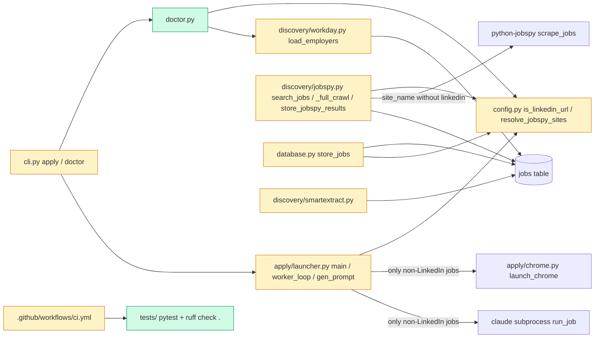

# Tech spec: Add test harness and CI, block LinkedIn, extend doctor checks

## Approach
This builds on the existing ApplyPilot code (gate1) and does not replace it. The LinkedIn policy goes next to the other URL and site policy helpers in `src/applypilot/config.py` (`is_manual_ats`, `load_blocked_sites`): it adds `is_linkedin_url`, `resolve_jobspy_sites` and `LinkedInBlockedError`. Every discovery insert path and the apply stage call these helpers, so there is one definition of what counts as a LinkedIn URL.

- **Discovery.** `discovery/jobspy.py` keeps its structure. The hard-coded defaults `["indeed", "linkedin", "zip_recruiter"]` become `config.DEFAULT_JOBSPY_SITES`, and every site list goes through `resolve_jobspy_sites`. `store_jobspy_results` and the other three `INSERT INTO jobs` paths (`database.store_jobs`, `discovery/workday.store_results`, `discovery/smartextract._store_jobs_filtered`) skip rows on a LinkedIn host.
- **Apply.** The CLI `apply` command rejects `--url` before `_bootstrap()`. `apply/launcher.main` and `gen_prompt` raise `LinkedInBlockedError` for a LinkedIn target. `worker_loop` checks each acquired job before `launch_chrome`/`run_job`, and the check follows the existing `mark_result(..., permanent=True)` pattern.
- **Doctor.** The checks move out of the 120-line `cli.doctor` body into a new module, `src/applypilot/doctor.py`. That is the only new module. Each check is a small function returning a `Check` record. Tests can call the checks directly or through the CLI, and can monkeypatch Chrome or Node discovery. `cli.doctor` only renders the records. The existing profile, resume, searches.yaml, python-jobspy, LLM and CapSolver checks stay, with the same names and semantics.
- **python-jobspy import.** `python-jobspy` is installed separately (`pip install --no-deps`, README) and is not a declared dependency. `discovery/jobspy.py` therefore must import without it: the `from jobspy import scrape_jobs` import gets an `ImportError` fallback, so tests and CI can import the module and stub `scrape_jobs`.
- **Lint.** The repo has no explicit rule selection. Ruff 0.17 (the current release) widens the default rule set and reports 144 errors, against 34 with the classic `E4,E7,E9,F` defaults. `pyproject.toml` therefore pins `[tool.ruff.lint] select` so `ruff check .` gives the same result on every ruff version, and the 34 existing errors get fixed.
- **Interpreter.** The local `python3` is 3.9.6, below `requires-python >=3.11`, and pytest and ruff are not installed. The bootstrap therefore creates a project `.venv` with uv (Python 3.11 is installed under uv) and points the standards commands at it.
- **CI.** `.github/workflows/ci.yml` keeps its matrix and gets real triggers.

## Architecture



## Interface contract

All Python imports assume `PYTHONPATH=src` (package `applypilot`). Tests must never touch the real `~/.applypilot` or the network.

### Test harness (written with the acceptance tests; frozen at Gate 2)
The acceptance-test stage owns these files. The implementer does not create or edit them.
- `tests/conftest.py` (shared, required by AC-1). Before any `applypilot` import, at module top level, it must set `os.environ["APPLYPILOT_DIR"]` to a fresh temporary directory, and it must remove `CHROME_PATH` from the environment. `applypilot.config` reads `APPLYPILOT_DIR` once, at import time, to build `APP_DIR`, `DB_PATH`, `PROFILE_PATH` and the other paths. It must also provide a fixture `fixture_form_server`, which yields the base URL `http://127.0.0.1:<port>/` of a stdlib `http.server.ThreadingHTTPServer` bound to `127.0.0.1` on an ephemeral port and serving `tests/fixtures/`. The fixture shuts the server down afterwards.
- `tests/fixtures/forms/basic_form.html`. It is served at `<base>/forms/basic_form.html` and contains a `<form>` with at least one `<input type="text">`, one `<input type="file">` and one submit button (`<button type="submit">` or `<input type="submit">`). It has no external resources.
- Acceptance tests live in `tests/acceptance/`. Implementer unit tests live in `tests/unit/`.
- Test runner: `PYTHONPATH=src python -m pytest tests/` (pytest is at least 7.4; `pyproject.toml` sets `testpaths = ["tests"]` and `pythonpath = ["src"]`).
- When a test needs the default DB, monkeypatch `applypilot.database.DB_PATH` (used by `get_connection()` / `init_db()` with no argument) and `applypilot.config.DB_PATH` (used by doctor) to a `tmp_path` file.

### `applypilot.config` (LinkedIn policy)
- `DEFAULT_JOBSPY_SITES: tuple[str, ...] = ("indeed", "zip_recruiter")`.
- `is_linkedin_url(url: str | None) -> bool`. True if and only if the URL's host, lower-cased, is `linkedin.com` or ends with `.linkedin.com`. A URL without a scheme (`www.linkedin.com/jobs/view/1`) is parsed as `https://`. `None`, `""` and `"nan"` give False. `https://notlinkedin.com/x` and `https://example.com/?ref=linkedin.com` give False.
- `resolve_jobspy_sites(sites: list[str] | None) -> list[str]`. `None` returns `list(DEFAULT_JOBSPY_SITES)`. Otherwise it returns the given list in its original order, minus every entry whose `.strip().lower() == "linkedin"`. When it removes something, it logs a WARNING containing `LinkedIn` through the logger `applypilot.config`. It can return `[]`.
- `class LinkedInBlockedError(ValueError)`. `str(err)` contains `LinkedIn` and the offending URL.

### `applypilot.discovery.jobspy`
- The module imports even when `python-jobspy` is not installed. The module attribute `scrape_jobs` is what every search calls, so tests can monkeypatch `applypilot.discovery.jobspy.scrape_jobs`. When the package is missing, calling the fallback raises `ImportError` with an install hint.
- `search_jobs(query: str, location: str, sites: list[str] | None = None, remote_only: bool = False, results_per_site: int = 50, hours_old: int = 72, proxy: str | None = None, country_indeed: str = "usa") -> dict`. It calls `scrape_jobs(**kwargs)` once, with `kwargs["site_name"] == resolve_jobspy_sites(sites)`, so with `sites=None` that is `["indeed", "zip_recruiter"]`. `linkedin_fetch_description` is never passed. If the resolved list is empty, it does not call `scrape_jobs` and returns `{"error": "no JobSpy sites configured", "total": 0, "new": 0, "existing": 0}`. If `scrape_jobs` returns an empty DataFrame, it returns `{"total": 0, "new": 0, "existing": 0}` without touching the DB.
- `_full_crawl(search_cfg: dict, tiers=None, locations=None, sites: list[str] | None = None, results_per_site=100, hours_old=72, proxy=None, max_retries=2) -> dict`. Every `scrape_jobs` call gets a `site_name` list with no `linkedin`; with `sites=None` that is `["indeed", "zip_recruiter"]`. Glassdoor is still split into its own call, as today. `search_cfg` needs `queries: [{query, tier}]` and `locations: [{location, remote, label?}]`. It calls `init_db()` on the default DB path. If the resolved list is empty, it returns `{"new": 0, "existing": 0, "errors": 0, "db_total": <count>, "queries": 0}` without scraping.
- `run_discovery(cfg: dict | None = None) -> dict`. Unchanged; it reads `cfg["sites"]`, which goes through the same resolution.
- `store_jobspy_results(conn: sqlite3.Connection, df: pandas.DataFrame, source_label: str) -> tuple[int, int]`. It returns `(new, existing)`. A row whose `job_url` or `job_url_direct` is a LinkedIn URL is not inserted and is not counted. Columns used: `job_url`, `job_url_direct`, `title`, `company`, `location`, `site`, `description`, `min_amount`, `max_amount`, `interval`, `currency`, `is_remote`. Missing columns are fine. Example: rows with `job_url` set to `https://www.linkedin.com/jobs/view/123`, `https://linkedin.com/jobs/view/456` and `https://www.indeed.com/viewjob?jk=1` give `(1, 0)`, and only the Indeed URL is in `jobs`. Use `conn = applypilot.database.init_db(tmp_path / "t.db")`.

### Other discovery store paths (same rule: LinkedIn rows skipped, not counted)
- `applypilot.database.store_jobs(conn, jobs: list[dict], site: str, strategy: str) -> tuple[int, int]` skips a job whose `url` or `application_url` is LinkedIn.
- `applypilot.discovery.workday.store_results(conn, jobs, employers) -> tuple[int, int]` skips a job whose resolved URL is LinkedIn.

### `src/applypilot/config/searches.example.yaml`
- `boards:` does not contain `linkedin`; it keeps `indeed`, `glassdoor`, `zip_recruiter` and `google`. No other key in the file lists `linkedin`.

### Apply stage (`applypilot.apply.launcher`)
- `main(limit=1, target_url=None, min_score=7, headless=False, model="sonnet", dry_run=False, continuous=False, poll_interval=60, workers=1) -> None`. When `is_linkedin_url(target_url)` is true, it raises `applypilot.config.LinkedInBlockedError` as its first statement, before `ensure_dirs`, signal handlers, the dashboard, `launch_chrome` or `subprocess.Popen`.
- `gen_prompt(target_url: str, min_score: int = 7, model: str = "sonnet", worker_id: int = 0)` raises `LinkedInBlockedError` for a LinkedIn `target_url` before touching the DB.
- `worker_loop(worker_id: int = 0, limit: int = 1, target_url: str | None = None, min_score: int = 7, headless: bool = False, model: str = "sonnet", dry_run: bool = False) -> tuple[int, int]`. After `acquire_job` returns a job whose `url` or `application_url` is LinkedIn:
  - It does not call `launch_chrome` or `run_job`.
  - It updates the job row to `apply_status = 'failed'`, `apply_error = 'linkedin_blocked: LinkedIn jobs are not supported'` and `apply_attempts = 99`.
  - It logs a WARNING containing `LinkedIn`.
  - It does not count the job in the returned `(applied, failed)`, and it moves on to the next job. In `target_url` mode it stops instead.

  With a queue holding only that job and `limit=1`, it returns `(0, 0)`. Queue-mode `acquire_job` needs a `jobs` row with `tailored_resume_path` not null, `apply_status` null, `fit_score` at least `min_score`, and `site` not in the `sites.yaml` blocked list (for example `site='indeed'`). Use the default DB via the monkeypatched `applypilot.database.DB_PATH`, and call `applypilot.apply.dashboard.init_worker(0)` first. Stub points: `applypilot.apply.launcher.launch_chrome`, `applypilot.apply.launcher.run_job` and `applypilot.apply.launcher.subprocess.Popen`.

### CLI (`from applypilot.cli import app`; test with `typer.testing.CliRunner`)
- `applypilot apply --url https://www.linkedin.com/jobs/view/123` (with or without `--gen`) exits with code 1 and prints `LinkedIn job URLs are not supported: <url>`. The check runs before `_bootstrap()`, the tier check, the DB, Chrome and Claude Code.
- `applypilot doctor` exits with code 0. It prints a title line `ApplyPilot Doctor`, then one line per check in the form `  <name><padding><STATUS>  <note>`. Each check is printed on exactly one line (`soft_wrap=True`), so the name and its status are always on the same line. The status words are `OK`, `MISSING`, `WARN` and `optional`. The check names, in order:
  `Python`, `profile.json`, `resume.txt`, `searches.yaml`, `python-jobspy`, `LLM API key`, `Claude Code CLI`, `Chrome/Chromium`, `Node.js`, `Database`, `Job sources`, `CapSolver API key`. A tier summary line follows the checks, as today.

### `applypilot.doctor` (new)
- `@dataclass(frozen=True) class Check: name: str; status: str; note: str`. `status` is one of `"OK"`, `"MISSING"`, `"WARN"`, `"optional"`.
- `check_python(version: tuple[int, int, int] | None = None) -> Check`. It defaults to `sys.version_info[:3]`. The name is `Python`. At 3.11 or later the status is `OK` and the note is the version (`3.12.4`). Below that the status is `MISSING` and the note is `found 3.10.0, need 3.11+`.
- `check_chrome() -> Check`. The name is `Chrome/Chromium`. It calls `applypilot.config.get_chrome_path()`, looked up at call time, so monkeypatching `applypilot.config.get_chrome_path` takes effect. On success the status is `OK` and the note is the path. On `FileNotFoundError` the status is `MISSING` and the note mentions `CHROME_PATH`.
- `get_node_version() -> tuple[int, int, int] | None`. It runs `node --version` when `shutil.which("node")` finds Node (5 s timeout) and parses `vX.Y.Z`. It returns None when Node is absent or the output cannot be parsed.
- `check_node() -> Check`. The name is `Node.js`. It calls the module-level `get_node_version()` at call time, so monkeypatching `applypilot.doctor.get_node_version` takes effect. Version 18 or later gives `OK` with a note like `v20.11.1`. Below 18 gives `MISSING` with a note like `found v16.20.0, need 18+`. None gives `MISSING` with a note mentioning `Node.js 18+`. With `PATH=""` it reports `MISSING`.
- `check_claude() -> Check`. The name is `Claude Code CLI`. If `shutil.which("claude")` finds it, the status is `OK`; otherwise `MISSING`.
- `check_database(db_path: str | Path | None = None) -> Check`. The name is `Database`. It defaults to `applypilot.config.DB_PATH`, read at call time. If the file is absent the status is `MISSING` and the note mentions `applypilot init`. If the file opens read-only and `SELECT count(*) FROM sqlite_master` succeeds, the status is `OK` and the note is the path. Otherwise the status is `MISSING` with the error. It never creates the file.
- `check_sources(search_cfg: dict | None = None) -> Check`. The name is `Job sources`. `None` loads `config.load_search_config()`. The note lists the JobSpy boards from `resolve_jobspy_sites(search_cfg.get("sites"))`, the Workday employer count and the career-site count (`config.load_sites_config()["sites"]`), for example `JobSpy: indeed, zip_recruiter | Workday employers: 48 | career sites: 30`. The status is `OK` if there is at least one source in total; otherwise `MISSING`. The note never contains `linkedin`.
- `run_checks() -> list[Check]` returns all twelve checks in the CLI order above.

### CI and repo files (static content tests may read)
- `.github/workflows/ci.yml`. `on:` has `push`, `pull_request` and `workflow_dispatch`. The job matrix is `python-version: ["3.11", "3.12", "3.13"]`. One step runs `ruff check .`, another runs `python -m pytest tests/` (with `PYTHONPATH: src`). The file contains no `continue-on-error` and no `|| true`.
- `pyproject.toml`. `[project.optional-dependencies] dev` includes `pytest` and `ruff`.
- `README.md` has a section headed `## Fork notice`. It contains the words `fork`, `ApplyPilot`, the link `https://github.com/Pickle-Pixel/ApplyPilot` and `AGPL-3.0`. The existing `## License` section and the Pickle-Pixel attribution stay.
- `docs/traceability.md` has a Markdown table with the header `| Requirement | Description | Tests |` and one row each for `FR-DIS-2`, `SAF-4`, `FR-CLI-2`, `NFR-1`, `NFR-10` and `NFR-11`. Each row's Tests cell names at least one path under `tests/` (or a `path::test_name`). The NFR-1 and NFR-11 rows also name `.github/workflows/ci.yml`.

## Data and state changes
- No DB schema change. LinkedIn jobs that reach apply are marked `apply_status='failed'`, `apply_error='linkedin_blocked: ...'` and `apply_attempts=99`, using the existing columns.
- Config: `searches.example.yaml` loses `linkedin` from `boards`. A user `searches.yaml` or a `sites` argument listing `linkedin` is filtered at runtime with a warning.
- Env vars: none new. `APPLYPILOT_DIR` and `CHROME_PATH` are the existing ones.
- Tooling: a new `.venv/` (gitignored), `[tool.ruff.lint]` and `[tool.pytest.ini_options]` in `pyproject.toml`, and a `[commands]` block in the worktree's `.congoforce/standards.md`.

## Tasks
1. **Bootstrap the test runner and local commands.**
   - `pyproject.toml` (modified):
     - Set `dev = ["pytest>=7.4", "ruff>=0.6"]`.
     - Add `[tool.ruff.lint] select = ["E4", "E7", "E9", "F"]`.
     - Add `[tool.ruff] extend-exclude = [".congoforce"]`.
     - Add `[tool.pytest.ini_options] testpaths = ["tests"]` and `pythonpath = ["src"]`.
   - `.gitignore` (modified): add `.venv/`.
   - `tests/unit/test_package.py` (new): a smoke test asserting `applypilot.__version__` is a non-empty string, so the suite is never empty.
   - `.congoforce/standards.md` in the worktree (new): copy `/Users/reetesh/workspace/openapply/.congoforce/standards.md` and change only the `[commands]` block:
     ```toml
     install = "uv venv --allow-existing --python 3.11 .venv && uv pip install --python .venv/bin/python -e '.[dev]'"
     lint = ".venv/bin/ruff check ."
     test = "PYTHONPATH=src .venv/bin/python -m pytest -q -o junit_family=xunit1 --continue-on-collection-errors --junitxml={junit}"
     test_files = "PYTHONPATH=src .venv/bin/python -m pytest -q -o junit_family=xunit1 --continue-on-collection-errors --junitxml={junit} {files}"
     ```
     Run `install` once. `ruff check .` will still fail until task 2, so commit tasks 1 and 2 back to back.
2. **Fix the existing lint errors.** Modified files: `src/applypilot/{cli.py,llm.py,pipeline.py,view.py}`, `apply/{dashboard.py,launcher.py,prompt.py}`, `discovery/{jobspy.py,smartextract.py}`, `enrichment/detail.py`, `scoring/{cover_letter.py,scorer.py,tailor.py}` and `wizard/init.py`.
   - Run `.venv/bin/ruff check . --fix` for the 31 safe fixes (unused imports, f-strings without placeholders).
   - Fix the three F841 errors by hand: `apply/prompt.py:199` `auth_info`, `scoring/tailor.py:61` `projects_str`, `llm.py:210` `exc`. Delete each unused assignment only if its right-hand side has no side effect; otherwise assign it to `_`.
   - In `discovery/jobspy.py`, delete the unused `company` variable and the `store_jobs` import.
   - No behaviour change. `ruff check .` and pytest must pass.
3. **Run CI on push and pull requests.**
   - `.github/workflows/ci.yml` (modified): `on: [push, pull_request, workflow_dispatch]` as a mapping. Keep the matrix 3.11/3.12/3.13. The lint step runs `ruff check .`. The test step runs `python -m pytest tests/ -v` with `env: PYTHONPATH: src`. No `continue-on-error`.
   - `CONTRIBUTING.md` (modified): the verify commands become `pytest tests/ -v` and `ruff check .`.
4. **LinkedIn policy helpers and discovery filtering.**
   - `src/applypilot/config.py` (modified): add `import logging`, `log = logging.getLogger(__name__)`, `DEFAULT_JOBSPY_SITES`, `is_linkedin_url` (built on `urllib.parse.urlsplit`), `resolve_jobspy_sites` and `LinkedInBlockedError`, exactly as in the contract.
   - `src/applypilot/discovery/jobspy.py` (modified):
     - Wrap the import as `try: from jobspy import scrape_jobs` / `except ImportError: def scrape_jobs(**kwargs): raise ImportError("python-jobspy is not installed: pip install --no-deps python-jobspy && pip install pydantic tls-client requests markdownify regex")`.
     - `search_jobs` and `_full_crawl` replace their `if sites is None` defaults with `sites = config.resolve_jobspy_sites(sites)` and return early on empty, as in the contract.
     - Delete both `linkedin_fetch_description` branches.
     - In `store_jobspy_results`, `continue` when `config.is_linkedin_url(url)` or `config.is_linkedin_url(apply_url)` (compute `apply_url` before the insert check).
     - Update the module docstring to drop LinkedIn.
   - `src/applypilot/database.py` (modified): `store_jobs` skips LinkedIn `url` and `application_url`. Import `is_linkedin_url` from `applypilot.config`; `config` does not import `database`, so there is no cycle.
   - `src/applypilot/discovery/workday.py` (modified): `store_results` skips LinkedIn.
   - `src/applypilot/discovery/smartextract.py` (modified): `_store_jobs_filtered` skips LinkedIn.
   - `src/applypilot/config/searches.example.yaml` (modified): remove `- linkedin` from `boards` and change the comment `Indeed/LinkedIn/Google` to `Indeed/Google`.
5. **Reject LinkedIn in the apply stage.**
   - `src/applypilot/apply/launcher.py` (modified):
     - Add the guard as the first statement of `main` and of `gen_prompt`.
     - In `worker_loop`, right after the `if not job:` block and before `launch_chrome`: if the job's `url` or `application_url` is LinkedIn, call `mark_result(job["url"], "failed", "linkedin_blocked: LinkedIn jobs are not supported", permanent=True)`, `add_event(f"[W{worker_id}] Rejected LinkedIn job")` and `logger.warning(...)`, then `break` if `target_url`, else `continue`.
   - `src/applypilot/cli.py` (modified): in `apply`, before `_bootstrap()`, add `if url and is_linkedin_url(url): console.print(f"[red]LinkedIn job URLs are not supported:[/red] {url}"); raise typer.Exit(code=1)`.
6. **Extend doctor.**
   - `src/applypilot/doctor.py` (new): `Check`, `check_python`, `check_chrome`, `get_node_version`, `check_node`, `check_claude`, `check_database`, `check_sources` and `run_checks`, as in the contract. Move the existing profile, resume, searches.yaml, python-jobspy, LLM key and CapSolver logic from `cli.doctor` into private `_check_*` helpers with the same names, statuses and notes. Rename the old `Node.js (npx)` check to `Node.js`; it is now version-aware. Reference `config.get_chrome_path` and `config.DB_PATH` through `from applypilot import config` so monkeypatching works.
   - `src/applypilot/cli.py` (modified): `doctor()` calls `load_env()` and `run_checks()`, maps statuses to colours (`OK` green, `MISSING` red, `WARN` yellow, `optional` dim), prints each line with `console.print(..., soft_wrap=True)`, and keeps the tier summary unchanged. Update the tier hint text to `Node.js 18+`.
7. **Fork notice and traceability.**
   - `README.md` (modified): add `## Fork notice` directly under the top disclaimer block. It says HireEmber/OpenApply is a fork of [ApplyPilot](https://github.com/Pickle-Pixel/ApplyPilot) by Pickle-Pixel, distributed under AGPL-3.0, with the original copyright and attribution kept. Leave all existing attribution and `## License` untouched.
   - `docs/traceability.md` (new): a short intro and the table from the contract. Fill the Tests column with the actual acceptance test files and test names under `tests/acceptance/` (read them) plus this task's unit tests. NFR-1 lists the doctor tests and `.github/workflows/ci.yml` (3.11–3.13 matrix). NFR-10 lists the fixture-form test and states that the table is completed in phase 6.

## Implementation tests
Unit tests go in `tests/unit/` and do not edit `tests/conftest.py`.
- `tests/unit/test_package.py`: the smoke import test (task 1).
- `tests/unit/test_linkedin_policy.py` (task 4):
  - `is_linkedin_url` cases: `www.`, bare and `uk.` subdomains, no-scheme, upper case, `notlinkedin.com`, a query-string mention, `None`, `""`, `"nan"`.
  - `resolve_jobspy_sites`: `None` gives the defaults; `["LinkedIn", "indeed"]` gives `["indeed"]` and the warning is captured with `caplog`; `["linkedin"]` gives `[]`.
  - `database.store_jobs` and `workday.store_results` skip LinkedIn rows on a `tmp_path` DB.
  - `search_jobs(sites=["linkedin"])` returns the error dict without calling a stubbed `scrape_jobs`.
- `tests/unit/test_apply_linkedin.py` (task 5):
  - `gen_prompt` raises `LinkedInBlockedError`.
  - `worker_loop` in `target_url` mode with a LinkedIn `application_url` row stops after one iteration (`acquire_job` is stubbed to return the job once and is asserted called once).
  - The CLI `apply --gen --url <linkedin>` exits 1.
- `tests/unit/test_doctor.py` (task 6):
  - `check_python((3, 10, 0))` gives MISSING and `(3, 11, 0)` gives OK.
  - `get_node_version` parses `v20.11.1\n` (stub `subprocess.run` and `shutil.which`) and returns None for garbage.
  - `check_database` on a missing path gives MISSING and does not create the file; on an `init_db` path it gives OK.
  - `check_sources({"sites": ["linkedin"]})` has a note without `linkedin`.
  - `run_checks()` names come in the contract order.

## Risks and rollout
- **Ruff version drift.** Without the explicit `select`, newer ruff versions widen the default rules and break CI. Task 1 pins the selection, so this risk is handled.
- **python-jobspy is absent in CI.** The guarded import keeps imports working, and discovery still logs a clear error when a real user lacks the package.
- **The `boards:` key in `searches.yaml` is not read by `run_discovery`, which reads `sites`.** This is an existing upstream quirk. Changing which key is read would change discovery behaviour, so it is left for a later phase. The LinkedIn filter applies to `sites`, and both `boards` and `sites` are linkedin-free by default.
- **The doctor `Node.js (npx)` check is renamed to `Node.js`.** It is display-only and nothing parses it.
- **Local runs need uv and network access** for the first `install`, to create `.venv` and fetch pandas and playwright wheels. CI uses `pip install -e ".[dev]"`, as before.
- **The macOS `get_chrome_path` checks `/Applications/...` regardless of `PATH`.** Tests that need Chrome missing must monkeypatch `applypilot.config.get_chrome_path`, as the contract says.

## Open questions
- none
