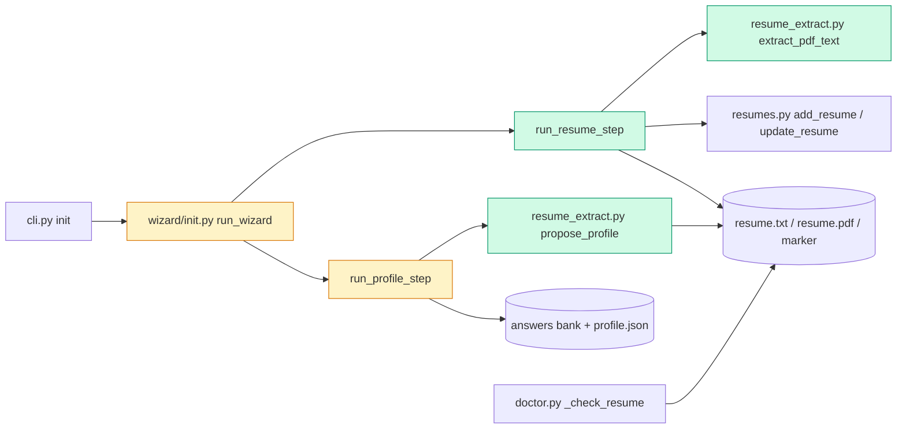

# Tech spec — Make hireember init read the resume and pre-fill the profile

## Approach
Add one small pure module, `src/hireember/resume_extract.py`, holding PDF text extraction (pypdf, local) and the regex-based profile proposals. Rework step 1 in `src/hireember/wizard/init.py` into a testable `run_resume_step(conn, ask=None, *, console=None)`. It follows the existing `run_profile_step(conn, ask, *, console)` pattern: one injectable `ask(question, **kwargs) -> str` callable handles every prompt, including yes/no ones (as the "Keep your ... answers? [Y/n]" prompt does today). `run_profile_step` gets a `resume_text` lookup and passes `default=<proposal>` to `ask` only for questions that have a proposal and no stored answer. Registration reuses `resumes.add_resume` / `resumes.update_resume` (`src/hireember/resumes.py`), keyed on the name "Master resume". The doctor message is a one-line check: `_check_resume` already returns OK when `resume.txt` exists, so no doctor logic change is needed. Once init always produces `resume.txt`, the "Only PDF found" branch is not hit.

Design decisions (resolving the product-spec open questions):
- Registry name: "Master resume". Re-run: if an entry with that name exists, call `update_resume` (refreshes stored copy and text in place); otherwise `add_resume`. No error is shown.
- "User-supplied vs extracted" `resume.txt`: after extracting from a PDF, init writes `APP_DIR/.resume_txt_sha256` containing the SHA-256 of the written `resume.txt`. `resume.txt` counts as extracted only if that marker exists and matches the file's current hash; otherwise (no marker, or user edited it) it is user-supplied and the overwrite prompt applies. A .txt copy removes the marker.
- The 200-character threshold applies to the extracted text as returned (joined pages, no trimming).
- A failed PDF is extracted from the source path in memory before anything is copied, so no `resume.pdf` or `resume.txt` is written from it.

## Architecture

## Interface contract

### `hireember.resume_extract` (new)
- `MIN_TEXT_CHARS = 200`
- `extract_pdf_text(path: str | Path) -> str` — returns all pages' text joined with `"\n"` via pypdf. Never raises: any failure (corrupt, empty, image-only, encrypted that cannot be decrypted with an empty password, unreadable) returns `""`. Local only, no network.
- `propose_profile(text: str) -> dict[str, str]` — returns only confidently found fields; keys are a subset of `full_name`, `email`, `phone`, `linkedin_url`, `city`, `province_state`, `country`. Never returns postal code. Rules:
  - `email`: exactly one distinct email address in the text, else absent.
  - `phone`: exactly one distinct phone number (7 to 15 digits, ignoring spaces, dashes, dots, parentheses, leading +), returned as written in the resume; two different numbers means absent.
  - `linkedin_url`: exactly one distinct `linkedin.com/in/<slug>` match, returned as written (including `https://`/`www.` if present); otherwise absent.
  - `full_name`: the first non-empty line, only if it has 2 to 4 words, all letters (plus `-`, `'`, `.`), with no digits, `@` or `/`; otherwise absent.
  - `city`, `province_state`, `country`: from the first 10 non-empty lines; split a line on `|`, `•`, `·` into segments; a segment with exactly three non-empty comma-separated parts and no digits gives the three values (stripped). Zero or more than one such segment, or a two-part header like "Toronto, Ontario", gives none of the three.
  - Malformed input (empty string, binary-ish text) returns `{}`; no exceptions.

### `hireember.wizard.init`
- `run_resume_step(conn, ask: Callable[..., str] | None = None, *, console: Console | None = None) -> None` — step 1. Default `ask` is `Prompt.ask(escape(question), console=out, **kwargs)`. Uses `config.RESUME_PATH`, `config.RESUME_PDF_PATH` (read at call time via module attribute so tests' `HIREEMBER_DIR` isolation works as `run_profile_step` does). Questions passed to `ask`, exact strings:
  - `"Resume file path"` — reply is stripped, outer quotes removed, `~` expanded. Missing: prints `File not found: <path>`, re-asks. Wrong extension: prints `Unsupported format. Provide a .txt or .pdf file.`, re-asks.
  - `"resume.txt already exists. Overwrite it? [y/N]"` — asked only when `resume.txt` exists, is user-supplied (see marker rule), and the new file would replace it. Reply `y`/`yes` (case-insensitive) replaces; anything else leaves it byte-for-byte unchanged. Declined: step continues with the existing `resume.txt` (a chosen .pdf is still copied to `resume.pdf`).
  - `"Resume .txt file path"` — asked after printing `Could not read any text from <filename>. It may be a scanned image, password-protected, or damaged. Please give a plain-text (.txt) version of your resume instead.` Non-.txt reply prints `Please provide a .txt file.` and re-asks; missing file prints `File not found: <path>` and re-asks.
  - `"Does this look right? [Y/n]"` — printed after: the first 10 non-empty lines of `resume.txt` (each truncated to 100 chars), `Characters read: <N>` (N = `len` of `resume.txt` text), and `Saved as <full path of resume.txt> (you can edit this file).` Reply `n`/`no` re-asks `"Resume file path"` (no abort, no registration); anything else confirms.
  - Result files: `.txt` source gives `resume.txt` (copy, bytes preserved, `resume.pdf` not created). `.pdf` source with at least 200 extracted chars gives `resume.pdf` (copy) and `resume.txt` (UTF-8 extracted text). A text-less PDF writes neither file.
  - After confirmation, registers "Master resume" (see Approach): `.pdf` run registers `resume.pdf` with `text_file=resume.txt`; `.txt` run registers `resume.txt`. Two consecutive runs leave exactly one entry in `list_resumes(conn)`, no exception, no error output.
  - Never raises for any bad PDF or bad input path; Ctrl+C (KeyboardInterrupt from `ask`) propagates.
- `run_profile_step(conn, ask=None, *, console=None) -> dict` — same signature and return as today. New behaviour: reads `config.RESUME_PATH` (if it exists; `errors="replace"`), calls `propose_profile`. For a question in the contact or location groups that has a proposal AND no stored profile answer, it calls `ask(question, default=<proposal>)`; the default `ask` wrapper forwards `default=` to `Prompt.ask`, so Enter accepts. A reply is stripped; empty reply with default is impossible (rich returns the default). Questions without a proposal are called as `ask(question)` with no kwargs, exactly as before. The "Keep your <group> answers? [Y/n]" prompt and the blank re-ask message are unchanged. Stored answers are never overwritten by proposals, including after the user answers `n` to keep (the stored value gets no proposal, no default). A missing or unreadable `resume.txt` gives no proposals.
- `run_wizard()` — calls `conn = init_db()`, `run_resume_step(conn)`, then `run_profile_step(conn)`; steps 3 to 5 unchanged. The old private `_setup_resume` is removed.
- Scripted test `ask` callables receive `(question, **kwargs)`; tests read `kwargs.get("default")` to see the proposed default.

### CLI / doctor
- `hireember init` runs the new flow. `hireember resume list` shows one "Master resume" row after init (twice).
- `hireember doctor`: with `resume.txt` present, the row is `resume.txt  OK  <path>`; "Only PDF found" does not appear. Other rows unchanged.

### Dependency
- `pypdf>=4.0` added to `[project].dependencies` in `pyproject.toml` (version, authors, urls untouched; the pyproject-unchanged acceptance test only checks those).

## Data and state changes
- New dependency `pypdf`.
- New marker file `<data folder>/.resume_txt_sha256` (text, hex SHA-256 of the extracted `resume.txt`). No DB schema change; the `resumes` table is used as is.
- No new env vars.

## Tasks
1. **Add pypdf and the extraction/proposal module** — `pyproject.toml` (modified: add `"pypdf>=4.0"` to dependencies), `src/hireember/resume_extract.py` (new: `MIN_TEXT_CHARS`, `extract_pdf_text`, `propose_profile`), `tests/unit/test_resume_extract.py` (new). Follows the pure-helper style of `src/hireember/profile.py`; separate module because it is shared by two wizard steps and keeps `init.py` focused on prompting.
2. **Resume step: single prompt, PDF extraction, confirmation, overwrite guard, registration** — `src/hireember/wizard/init.py` (modified): replace `_setup_resume` with `run_resume_step` as specified above (marker file helpers `_sha256`, `_is_user_supplied_txt`, `_register` as private helpers), and update `run_wizard` to call it with the `init_db()` connection shared with the profile step. `tests/unit/test_wizard_resume.py` (new).
3. **Profile step: pre-fill from resume** — `src/hireember/wizard/init.py` (modified): in `run_profile_step` read `resume.txt`, compute proposals, map the seven fields to the contact and location questions via the question text in `PROFILE_GROUPS` (index 0 to 3 of contact, 0 to 2 of location), and pass `default=` only when no stored answer exists (use `answers`/`profile._stored`-style lookup through `group_complete`'s existing helpers; if none is public, add a small `stored_answer(conn, question)` in `src/hireember/profile.py`). Extend the default `ask` wrapper to forward kwargs (already does). `tests/unit/test_wizard_profile.py` (modified: add proposal cases without changing existing ones) or `tests/unit/test_wizard_profile_prefill.py` (new).
4. **Doctor regression test and docs** — `tests/unit/test_doctor_resume.py` (new: `resume.txt` present alongside `resume.pdf` is OK with no "Only PDF found"); `README.md` (modified: init section mentions a single resume file, local PDF text extraction, editable `resume.txt`). `src/hireember/doctor.py` is not changed unless the test shows otherwise.

## Implementation tests
- `test_resume_extract.py`: build a text PDF with a hand-written minimal PDF byte string (single page, Helvetica text), a blank-page PDF via `pypdf.PdfWriter().add_blank_page`, an encrypted PDF via `PdfWriter.encrypt`, and a corrupt `x.pdf`; assert `extract_pdf_text` returns words or `""` and never raises. `propose_profile`: full header, two emails gives no email, two-part location gives none, no name line gives none, `{}` for empty.
- `test_wizard_resume.py`: scripted `ask`; .txt copy (no `resume.pdf`, prompts are only path and confirm); .pdf with text; short text (199 vs 200 chars) boundary; bad PDF then `.txt`; overwrite guard y/N with unchanged bytes; extracted-then-rerun replaced silently; edited extracted file is treated as user-supplied; `n` to confirmation re-asks and does not register; registry has one entry after two runs.
- Profile prefill: defaults seen in `kwargs["default"]`, Enter-equivalent reply stored in the answer bank and `profile.json`; missing fields have no `default` kwarg; stored answers get no default; postal code never has a default.

## Risks and rollout
- Heuristic name detection can miss; by design it yields no proposal rather than a guess.
- pypdf text quality varies; the user sees the first lines and can edit `resume.txt` before confirming (they may need to decline and re-run).
- `update_resume` removes the old stored copy before storing the new one; fine for a base resume with no tickets pointing at the file.
- Existing frozen acceptance tests call `run_profile_step` with `ask(question, **kwargs)`; passing `default=` only for proposals keeps them compatible.

## Open questions
- none
