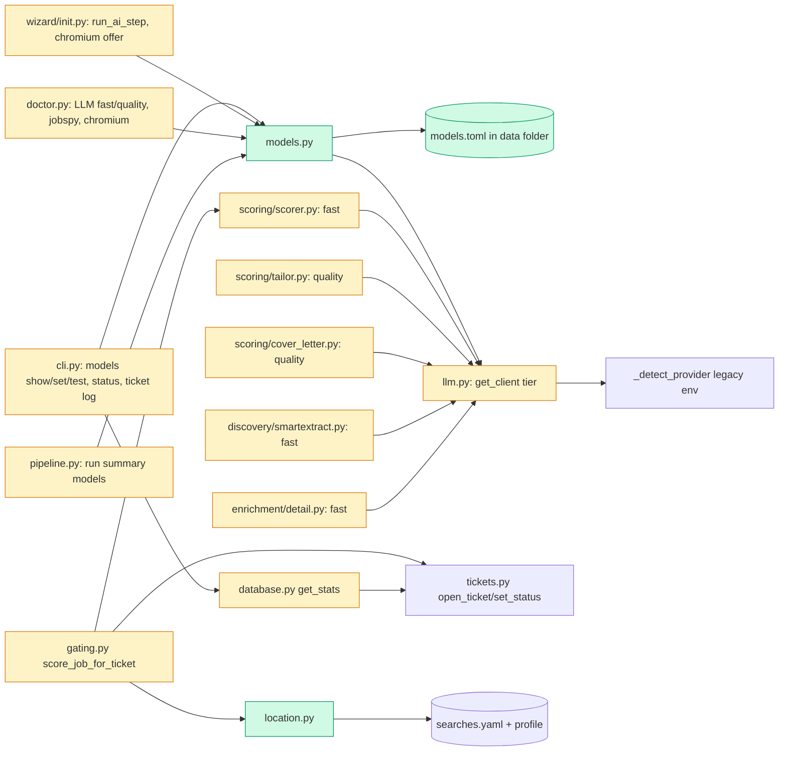

# Tech spec — Add fast/quality model tiers, location pre-skip and one-command install

## Approach
Three independent parts in one PR, each a small new module plus thin edits to existing call sites.

- **Tiers.** New `src/hireember/models.py` owns `models.toml` (read with stdlib `tomllib`, written by a tiny hand-rolled writer, so no new dependency), tier resolution (file section, then the legacy env logic, which stays in `llm._detect_provider`), error wording and the `test`/`probe` helpers. `llm.get_client()` becomes `get_client(tier)` with one cached `LLMClient` per resolved tier; every call site passes its tier by name. The `LLMClient` HTTP code is untouched. CLI gets a `models_app` Typer group beside `answers_app`/`ticket_app` in `cli.py`. `doctor.py` replaces `_check_llm` with two per-tier checks. The `init` AI step is rewritten as `run_ai_step(ask, console=)`, the same injectable-`ask` shape as `run_resume_step` in `wizard/init.py`.
- **Location.** New `src/hireember/location.py` is a pure, deterministic check. It is called from `gating.score_job_for_ticket`, the single scoring entry used for jobspy, Workday and smart extract rows alike (all land in the `jobs` table with a `location` column), before `choose_resume`, so no LLM call happens. It uses the `_block` pattern (`tickets.open_ticket` then `tickets.set_status`). The discovery-time `_location_ok` functions in `discovery/jobspy.py` and `discovery/workday.py` are left alone.
- **Install.** `python-jobspy` becomes a plain dependency (dry-run resolve with uv on this repo succeeds: jobspy 1.4.0 pulls `curl-cffi`, `pydantic`, `requests`, `markdownify`). The stale doctor hint and README text go. A Chromium check is added to `doctor.py`, plus an install offer in `wizard/init.py`.

Existing tests monkeypatch `scorer/tailor/cover_letter.get_client` with `lambda *a, **k`, so the new positional tier argument is compatible with them.

## Architecture


## Interface contract

### `hireember.models` (new)
- `TIERS = ("fast", "quality")`.
- `MODELS_PATH` is `hireember.config.MODELS_PATH` (`APP_DIR / "models.toml"`). Every function below that takes `path: Path | None = None` defaults to `hireember.config.MODELS_PATH` read at call time (tests monkeypatch the attribute on `hireember.config`).
- Exceptions, all subclass `ModelsError(Exception)`; `str(e)` is the one-line user message:
  - `ModelsConfigError`: `models.toml is not valid TOML (line N). Fix or delete it: <path>`.
  - `TierNotConfigured`: `<tier> tier is not configured. Run 'hireember models set <tier>' or 'hireember init'.`, or, for a non-local tier with no key, `<tier> tier has no API key. Set it with 'hireember models set <tier> --api-key ...' or the GEMINI_API_KEY / OPENAI_API_KEY variable.`
- `@dataclass(frozen=True) TierSettings(tier: str, provider: str, model: str, base_url: str, api_key: str, source: str)`. `provider` is `"gemini"`, `"openai"` or `"custom"`. `source` is `"config file"` or `"environment"`. `base_url` is the full endpoint URL (the preset URL for gemini/openai). Property `is_local -> bool` is true for hosts `localhost`, `127.0.0.1`, `::1`. Property `key_state -> str` is `"set"`, `"not set"` or `"not needed (local)"`.
- `resolve_tier(tier: str, path: Path | None = None) -> TierSettings`. Order: the `[tier]` section of `models.toml`, then legacy env (`GEMINI_API_KEY`, `OPENAI_API_KEY`, `LLM_URL`+`LLM_MODEL`+`LLM_API_KEY`, via `llm._detect_provider`). A file section may omit fields: missing `model` uses the preset default (`gemini-2.0-flash` / `gpt-4o-mini`); missing `api_key` falls back to the matching env key (`GEMINI_API_KEY` for gemini, `OPENAI_API_KEY` for openai, `LLM_API_KEY` for custom). A file section with `provider = "custom"` or a local `base_url` needs no key. Raises `TierNotConfigured` or `ModelsConfigError`; raises `ValueError("Tier must be 'fast' or 'quality'.")` for another tier name. With only `GEMINI_API_KEY` set and no file, both tiers return provider `gemini`, model `gemini-2.0-flash`, the Gemini compat URL and that key (same values as `llm._detect_provider()` today).
- `load_models_file(path=None) -> dict[str, dict[str, str]]`: `{}` when the file is absent; raises `ModelsConfigError` on bad TOML.
- `save_tier(tier: str, *, provider=None, model=None, base_url=None, api_key=None, path=None) -> Path`: merges only the given fields into the tier's section, keeps the other tier and fields, writes the file (owner-only mode `0o600` where the OS allows), returns the path. Raises `ModelsConfigError` (file untouched) on a malformed existing file, `ValueError` on a bad tier or provider.
- `@dataclass(frozen=True) TierResult(tier: str, ok: bool, provider: str, model: str, seconds: float, message: str)`.
- `test_tier(tier: str) -> TierResult`: resolves the tier, then makes one tiny call through `hireember.llm.get_client(tier).chat(...)` (the module attribute is looked up at call time, so tests can monkeypatch `hireember.llm.get_client`). Never raises: any failure becomes `ok=False` with a one-line `message` (`Cannot reach <url>`, `Key rejected by <provider>`, `Model '<name>' not found`, the `TierNotConfigured`/`ModelsConfigError` text, or `Request timed out`). No traceback text or exception class name appears in `message`.
- `probe_tier(tier: str) -> TierResult`: reachability only, no text generation (HTTP GET `<base_url>/models`, 5 s timeout, any HTTP response below 500 counts as reachable, 401/403 gives `Key rejected by <provider>`). Never raises.
- `friendly_error(exc: Exception, settings: TierSettings | None = None) -> str`: the mapping used above.
- `stage_model_lines(stages: list[str]) -> list[str]`: for each executed stage in `discover, enrich, score, tailor, cover` (`pdf` has none) returns `"<label>: <model> (<tier>)"`, with labels `discovery`, `enrichment`, `scoring`, `tailoring`, `cover letters`; stages are `fast` for discover/enrich/score and `quality` for tailor/cover. An unconfigured tier's stage is omitted. Example `scoring: gemini-2.0-flash (fast)`.

### `hireember.llm` (changed)
- `get_client(tier: str) -> LLMClient`: required positional argument, `"fast"` or `"quality"`; no default. Resolves via `models.resolve_tier`, caches one client per `(tier, base_url, model, api_key)`; raises `RuntimeError` with the `TierNotConfigured` text when unconfigured. `LLMClient(base_url, model, api_key)` and `_detect_provider()` keep their signatures.
- Call sites and tiers: `scoring/scorer.py` `score_job` `"fast"`; `scoring/tailor.py` `tailor_resume` and the judge call `"quality"`; `scoring/cover_letter.py` `"quality"`; `discovery/smartextract.py` (both `get_client()` uses) `"fast"`; `enrichment/detail.py` `extract_with_llm` `"fast"`. Each calls `get_client("<tier>")` through the name imported into its own module (`hireember.scoring.scorer.get_client` etc.), as today.

### CLI (`hireember` Typer app, group `models`)
- `hireember models show`: prints `Model tiers`, then a block per tier, `fast` then `quality`, with lines `provider:`, `model:`, `base url:` (`(preset)` for gemini/openai), `key:` (`set (environment)`, `set (config file)`, `not set`, `not needed (local)`) and `source:` (`config file` or `environment`). An unconfigured tier shows `not configured`. An API key value never appears in the output. Exit 0. A malformed file prints the `ModelsConfigError` line and exits 1.
- `hireember models set TIER [--provider gemini|openai|custom] [--model NAME] [--base-url URL] [--api-key KEY]`: prints `Saved <tier> tier to <path>.` and exits 0. Bad tier prints `Tier must be 'fast' or 'quality'.` and exits 1. No option given prints `Nothing to change. Pass --provider, --model, --base-url or --api-key.` and exits 1. Both failures leave the file untouched. The key value is never echoed.
- `hireember models test`: one line per tier, fast then quality, `fast     ok       <model> (<seconds>s)` or `quality  FAILED   <one-line reason>`; both lines print even when both tiers share a model. Exit 0 only if both ok, else 1. No traceback.

### Other CLI and module behaviour
- `hireember doctor`: lines named `LLM fast` and `LLM quality` replace `LLM API key`. Status `OK` with note `<provider> / <model>, reachable`; `WARN` with `<provider> / <model>, not reachable: <reason>`; `MISSING` with `not configured — run 'hireember models set <tier>' or 'hireember init'`. A malformed `models.toml` gives `MISSING` and the `ModelsConfigError` text. Output never contains `--no-deps` or a traceback.
- `hireember.doctor.run_checks()` order: `Python`, `profile.json`, `resume.txt`, `searches.yaml`, `python-jobspy`, `Playwright Chromium`, `LLM fast`, `LLM quality`, `Claude Code CLI`, `Chrome/Chromium`, `Node.js`, `Database`, `Job sources`.
- `hireember.doctor._check_jobspy() -> Check`: `Check("python-jobspy", "OK", "Job board scraping available")`, or on ImportError `Check("python-jobspy", "WARN", f"Not importable. Reinstall hireember in the active Python: {sys.executable} -m pip install -e .")`.
- `hireember.doctor.chromium_path() -> str | None` (path of the Playwright Chromium executable if it exists, else None; tests monkeypatch it) and `hireember.doctor.check_playwright_chromium() -> Check`: `Check("Playwright Chromium", "OK", <path>)` or `Check("Playwright Chromium", "MISSING", "Run: playwright install chromium")`.
- `hireember.doctor.check_llm_tiers() -> list[Check]`: the two per-tier checks above, using `models.probe_tier` (looked up through the `models` module at call time).
- `hireember.wizard.init.run_ai_step(ask: Callable[..., str] | None = None, *, console: Console | None = None) -> None`: the AI step. `ask(question, **kwargs)` returns text, as in `run_resume_step`. Questions include `Enable AI scoring and resume tailoring? [Y/n]` (n ends the step and writes nothing), then per tier `Provider (gemini/openai/custom)`, `Model`, `Base URL` (custom only), `API key` (non-local only), and `Use a different model for tailoring and cover letters? [y/N]`. After the fast tier it calls `models.save_tier("fast", ...)`; on `y` it asks the same for quality and saves it; on N it prints that the quality tier uses the fast/legacy settings. It writes `models.toml` through `models.save_tier` (the same file `models set` writes) and no longer writes the LLM lines to `.env`.
- `hireember.wizard.init.offer_chromium_install(ask=None, *, console=None, runner=None) -> bool`: does nothing and returns False when `doctor.chromium_path()` is not None. Otherwise asks `Playwright Chromium is not installed. Run 'playwright install chromium' now? [Y/n]`. Y calls `runner(["playwright", "install", "chromium"])` (default `subprocess.run`, output streamed, not captured) and prints `Installed.` on return code 0, else a one-line failure plus `Run it yourself: playwright install chromium`. N prints the command and continues. Returns True when the install succeeded. `run_wizard` calls it after the AI step.
- `hireember.pipeline.run_pipeline` summary: after the existing Pipeline Summary table it prints one line per entry of `models.stage_model_lines(<executed stage names>)`.

### `hireember.location` (new)
- `location_skip_reason(location: str | None, profile: dict | None = None, search_cfg: dict | None = None) -> str | None`: returns `f"location: {location}"` (the string exactly as given) when the job must be skipped, else None. `search_cfg=None` loads `hireember.config.SEARCH_CONFIG_PATH` (looked up at call time; `{}` if the file is absent or unreadable).
  - Targets: accept entries from `location.accept_patterns` and top-level `location_accept`; reject entries from `location.reject_patterns` and top-level `location_reject_non_remote`; each `locations[*].location` string is also an accept entry; profile `personal.city`, `personal.province_state`, `personal.country` are accept entries. Remote is accepted when any `locations[*].remote` is true, or an accept entry is `remote` or `anywhere`.
  - Matching is case-insensitive, punctuation-insensitive, on whole words/phrases (so `CA` does not match `Chicago`); province/state and country abbreviations match their full names (for example `ON` and `Ontario`, `US`/`USA`/`United States`).
  - Decision per location: blank, non-alphabetic, or a placeholder (`n/a`, `nan`, `none`, `tbd`, `various`, `multiple locations`, `unknown`, `worldwide`, `global`) is not skipped. If no targets exist at all, not skipped. Several locations separated by `;` or `|` are skipped only when none passes. For one location: remote wording passes when remote is accepted (`Remote - US`, `Hybrid, Toronto` check the non-remote remainder only when remote is not accepted; a remainder that is empty passes); a reject entry match fails; an accept, province or country match passes; otherwise it fails.
- `hireember.gating.score_job_for_ticket(conn, url, *, profile=None) -> GateResult`: unchanged signature. New: when the job has no existing ticket with a score and `location_skip_reason(job["location"], profile)` returns a reason, it creates the ticket with status `skipped`, `status_reason` that reason, and a history event, makes no LLM call, and returns the `GateResult` (`score=None`). Applies identically to jobs from jobspy, Workday and smart extract.
- `hireember.scoring.scorer.SCORE_PROMPT` contains, verbatim: `A job whose location is incompatible with the candidate's target locations is a reason for a low score.`
- `hireember.scoring.scorer.run_scoring()` return dict gains `"location_skipped": int`; those jobs are not counted in `errors`.
- `hireember.database.get_stats()` gains `"location_skipped"`: count of tickets with `status = 'skipped'` and `status_reason LIKE 'location:%'`.
- `hireember status` prints a row `Skipped by location` with that count in the Pipeline Overview table.
- `hireember ticket log <id>` prints, before the attempt table (or the existing `No attempts logged for ticket <id>.` line), a line `Status: <status> (<status_reason>)`, so `location: <text>` appears.

### Packaging
- `pyproject.toml` `dependencies` includes `"python-jobspy>=1.1.80"` (plain, no extra); `uv.lock` regenerated. `README.md` has no `--no-deps` text and no separate jobspy package list.

## Data and state changes
- New file `<data folder>/models.toml`, plain TOML, optional. Shape:
  ```toml
  [fast]
  provider = "gemini"          # gemini | openai | custom
  model = "gemini-2.0-flash"
  base_url = ""                # required for custom; omitted for presets
  api_key = ""                 # optional; env keys also work

  [quality]
  provider = "custom"
  model = "llama3.1:70b"
  base_url = "http://localhost:11434/v1"
  ```
- `hireember.config.MODELS_PATH = APP_DIR / "models.toml"` (new constant). No DB schema change; `ticket_events` and `tickets` already hold status and reason.
- Env variables unchanged (`GEMINI_API_KEY`, `OPENAI_API_KEY`, `LLM_URL`, `LLM_MODEL`, `LLM_API_KEY`). `config.get_tier()`/`check_tier()` also treat a configured `models.toml` as having an LLM (tier 2 unlocked) so `run` is not blocked when only the file is set.

## Tasks
1. **One-command install and jobspy doctor hint** — `pyproject.toml` (modified: add `python-jobspy>=1.1.80` to dependencies), `uv.lock` (modified: `uv lock`), `README.md` (modified: remove both `--no-deps` passages and the extra package list, say `pip install -e .` is enough), `src/hireember/doctor.py` (modified: `_check_jobspy` new WARN text with `sys.executable`), `tests/unit/test_doctor.py` (modified: add a test for the hint).
2. **Playwright Chromium check and init offer** — `src/hireember/doctor.py` (modified: `chromium_path`, `check_playwright_chromium`, add to `run_checks` after jobspy), `src/hireember/wizard/init.py` (modified: `offer_chromium_install`, called in `run_wizard` after the AI step), `tests/unit/test_doctor.py` and `tests/acceptance/test_ac6_doctor.py` (modified: update the expected check-name order; these two old tests hard-code the list), new `tests/unit/test_wizard_chromium.py`.
3. **Tier resolution and `get_client(tier)`** — `src/hireember/config.py` (modified: `MODELS_PATH`; `get_tier`/`check_tier` also accept a `models.toml` with a configured tier), `src/hireember/models.py` (new: dataclasses, errors, `resolve_tier`, `load_models_file`, `save_tier`, `friendly_error`, `test_tier`, `probe_tier`, `stage_model_lines`; stdlib `tomllib` plus a small writer for string values), `src/hireember/llm.py` (modified: `get_client(tier)`, per-tier cache, `_detect_provider` kept), the five call-site modules `scoring/scorer.py`, `scoring/tailor.py`, `scoring/cover_letter.py`, `discovery/smartextract.py`, `enrichment/detail.py` (modified: pass the tier), new `tests/unit/test_models.py`, `tests/unit/test_llm_tiers.py`. `models.py` is new because tier state needs one owner shared by CLI, doctor, wizard and `llm`; `_detect_provider` is reused, not copied.
4. **`hireember models` command** — `src/hireember/cli.py` (modified: `models_app = typer.Typer(help="Model tiers: fast and quality.", no_args_is_help=True)`, `show`, `set`, `test`; update the root `help` only if it lists commands), new `tests/unit/test_cli_models.py`.
5. **Doctor tiers and run summary** — `src/hireember/doctor.py` (modified: `check_llm_tiers`, replace `_check_llm` in `run_checks`), `src/hireember/pipeline.py` (modified: print `stage_model_lines` after the summary table), `tests/unit/test_doctor.py` and `tests/acceptance/test_ac6_doctor.py` (modified: order list now has `LLM fast`, `LLM quality`), new `tests/unit/test_doctor_tiers.py`, `tests/unit/test_pipeline_models_summary.py`.
6. **Init AI step writes `models.toml`** — `src/hireember/wizard/init.py` (modified: replace `_setup_ai_features` with `run_ai_step`, keep a one-line `_setup_ai_features` wrapper if `run_wizard` needs it), new `tests/unit/test_wizard_ai.py`. Existing non-AI steps untouched.
7. **Location pre-skip** — `src/hireember/location.py` (new), `src/hireember/gating.py` (modified: check before `choose_resume`, skipping when no scored ticket exists), `src/hireember/scoring/scorer.py` (modified: add the prompt sentence under IMPORTANT FACTORS; `run_scoring` counts `location_skipped` separately from errors), new `tests/unit/test_location.py`, `tests/unit/test_gating_location.py`.
8. **Surface the skip reason** — `src/hireember/database.py` (modified: `get_stats` adds `location_skipped`), `src/hireember/cli.py` (modified: `Skipped by location` row in `status`; `Status: ...` line in `ticket log`), new `tests/unit/test_location_visibility.py`.

## Implementation tests
- `test_models.py`: legacy-only env resolves both tiers to one provider; file overrides env; one tier in file falls back for the other; local base URL with no key resolves; malformed TOML gives the exact message and `save_tier` leaves the file bytes unchanged; `save_tier` merges and keeps other fields; file mode 0o600 on POSIX.
- `test_llm_tiers.py`: `get_client("fast")` and `("quality")` return distinct clients for distinct settings and the same for shared; no default tier.
- `test_cli_models.py`: `show` never prints a key (env and file keys), `set` round trip, invalid tier and no-option messages and exit codes, `test` with `hireember.llm.get_client` faked and with an unreachable `http://127.0.0.1:1/v1` (one line, exit 1, no `Traceback`).
- `test_doctor_tiers.py`: OK/WARN/MISSING lines with `models.probe_tier` faked; no `--no-deps`; Chromium missing mentions `playwright install chromium`.
- `test_wizard_ai.py` and `test_wizard_chromium.py`: scripted `ask`, N path stores only fast, Y path stores both, decline Chromium does not abort, no prompt when installed.
- `test_location.py`: table of cases (accept hit, city in profile province kept, other country skipped, reject hit, remote accepted vs not, empty, placeholder, multi-location `;`, `CA` vs `Chicago`, no targets).
- `test_gating_location.py`: a fake client records zero calls for a skipped job from each of jobspy, Workday and smart extract rows (differing `site`/`strategy` values); scored jobs are not re-skipped.
- Scoring/tailoring tier test: fake `get_client` records the tier argument per call site.

## Risks and rollout
- Two older tests hard-code the doctor check order (`tests/unit/test_doctor.py`, `tests/acceptance/test_ac6_doctor.py`); tasks 2 and 5 update them. These are not this task's frozen acceptance tests, but a reviewer should know they change.
- `ticket log` previously printed only the attempt table; the extra `Status:` line is additive.
- `python-jobspy` historically pinned numpy; a uv dry-run resolves cleanly on this repo, but `uv lock` in task 1 is the real check. If resolution fails, task 1 is blocked.
- `models test` costs a few tokens per tier; `doctor` uses the no-generation probe only.
- `.env` is no longer written by `init` for LLM settings; existing `.env` values still work as the fallback.
- Location matching is conservative by design: no targets configured or unrecognised text means no skip.

## Open questions
- Task 1 includes `python-jobspy>=1.1.80` as the version floor; confirm or give a different floor.
