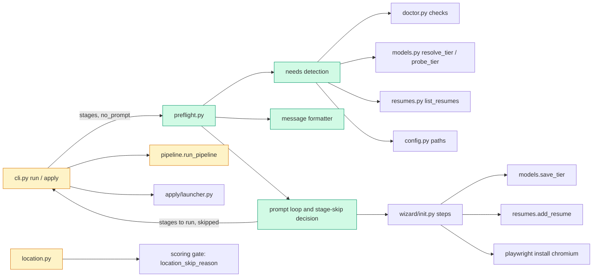

# Tech spec — Fix location matching and add a settings check before run and apply

## Approach
Two independent deliverables in one PR.

**Location.** Extend `src/hireember/location.py` in place. Add `canada` as a country token next to the existing `us` and `uk`, and a region-to-country map (Canadian provinces and territories to Canada; US states and DC to the United States). `_part_passes` changes in three ways. (1) After the reject check, a part with no recognised region or country token passes (R2). (2) A recognised part is matched against the accept phrases as before, plus implied country: a region in the text makes its country available, so a `canada`/`us` accept phrase matches any region of that country (R1). (3) Bare `ca` counts as California and, when the text names no explicit country token, also as Canada (R3). A region accept phrase (for example `ab`) matches that region only; as an accepted proposal, text that names only the region's own country ("Calgary, Canada") also passes. Remote, placeholder, empty, multi-part (`;`, `|`), and reject handling are untouched. The skip reason stays `location: <text>`.

**Settings check.** One new module, `src/hireember/preflight.py`, owns detection, the message, the prompt loop and the stage-skip decision. It reuses, and does not change:
- `hireember.doctor` for detection and fix text: `check_claude`, `check_chrome`, `check_playwright_chromium`/`chromium_path`, `_check_jobspy`, `check_sources` helpers (`_load_yaml_mapping`).
- `hireember.models` for tiers: `resolve_tier`, `probe_tier`, `save_tier`, `TIERS`.
- `hireember.wizard.init` for fixes: `_ask_tier` (provider, model, base URL, key; saves with `models.save_tier`, the code behind `models set`), `run_resume_step`, `run_profile_step`, `_setup_searches`, `offer_chromium_install`. Each takes the `ask` callable pattern used by the wizard, so the check passes its own prompt function.
- `hireember.resumes.list_resumes` and `config.RESUME_PATH`, `config.PROFILE_PATH`, `config.SEARCH_CONFIG_PATH`.

`cli.py` (`run`, `apply`) calls `preflight.run_preflight(...)` first, after argument validation and, for `apply`, after the utility modes. The existing `check_tier` and apply checks stay as backstops. `pipeline.run_pipeline` gets one optional keyword, `skipped_notes`, so the skip line is repeated after the summary table. No other pipeline change: running a stage subset already works (`hireember run tailor`).

Stage skipping rule (from product-spec). A requested stage is blocked when it has a still-missing need. In canonical order, a requested stage whose `_UPSTREAM` stage is skipped is skipped too (so `pdf` follows `cover`). If no requested stage remains, exit 1 with the list; otherwise run the rest and print `Skipping <stages>: <reason>.`

Prompt plumbing. `preflight.ask_user(question, **kwargs)` wraps `rich.prompt.Prompt.ask` (`password=True` hides keys). The loop wraps it so `EOFError` and `KeyboardInterrupt` become "decline everything remaining", and a question answered empty or invalid twice becomes a decline for that item. `preflight.is_interactive()` is `sys.stdin.isatty() and sys.stdout.isatty()`. Both are module-level so tests patch them.

## Architecture

## Interface contract

### Location (unchanged signature)
- `hireember.location.location_skip_reason(location: str | None, profile: dict | None = None, search_cfg: dict | None = None) -> str | None`. Returns `"location: <text>"` (the text exactly as given) or `None`.
  - Targets come from `profile["personal"]` (`city`, `province_state`, `country`) and `search_cfg` (`location.accept_patterns`, `location_accept`, `locations[].location`, `locations[].remote`; reject via `location.reject_patterns` and `location_reject_non_remote`), as in phase 0e.
  - Canada target accepts any Canadian province or territory (abbreviation or full name), `Canada`; US target (`United States`, `USA`, `US`) accepts any US state or DC; a region target accepts that region only (and country-only text of that region's country).
  - Text with no recognised region or country token returns `None` (after the reject check, which still applies).
  - Bare `CA` returns `None` when targets are Canada or California, and a skip when the only target is, for example, Texas.
  - Expected: target `Canada`: `Calgary, AB`, `Toronto, ON`, `Vancouver, British Columbia`, `Montreal, QC, Canada` -> `None`; `Austin, TX` -> `location: Austin, TX`; `London, UK` -> `location: London, UK`. Target `Alberta`: `Calgary, AB` -> `None`; `Toronto, ON` -> `location: Toronto, ON`. `Calgary`, `Greater Toronto Area` -> `None`.

### Settings check
- `hireember.preflight` (new module):
  - `is_interactive() -> bool`: stdin and stdout both TTYs.
  - `ask_user(question: str, **kwargs) -> str`: prompt function; kwargs `default=`, `password=True` as `rich.prompt.Prompt.ask`. All prompts go through it.
  - `@dataclass(frozen=True) Need`: `key: str` (one of `search_config`, `jobspy`, `fast_tier`, `quality_tier`, `resume`, `profile`, `browser`, `claude`, `chrome`, `tailored`), `title: str`, `stages: tuple[str, ...]`, `fix: str`, `fixable: bool`, `detail: str`.
  - `find_needs(command: str, stages: list[str], *, conn=None, gen_url: bool = False) -> tuple[list[Need], list[str]]`: `command` is `"run"` or `"apply"`; returns (missing needs in fixed order, warning lines). `stages` are resolved names (`all` expanded) for `run`, ignored for `apply`. Fixed order: search_config, jobspy, fast_tier, quality_tier, resume, profile, browser, claude, chrome, tailored. Makes no LLM call; probes each configured, needed tier with `models.probe_tier` (unreachable gives a warning line, not a need).
  - `format_report(needs: list[Need], warnings: list[str], *, interactive: bool) -> str`.
  - `@dataclass PreflightOutcome`: `proceed: bool`, `stages: list[str]` (stages to run, canonical order), `skipped: dict[str, str]` (stage -> reason), `missing: list[Need]`.
  - `run_preflight(command: str, stages: list[str], *, no_prompt: bool = False, gen_url: bool = False, console=None) -> PreflightOutcome`. Prints nothing and returns `proceed=True` with all stages when nothing is missing. Non-interactive or `no_prompt`: prints the report ending with `Run again after fixing these, or run in a terminal to be prompted.`, returns `proceed=False`, never calls `ask_user`.
- CLI:
  - `hireember run [STAGES] --no-prompt` and `hireember apply --no-prompt`. Help text exactly `Never prompt; list missing settings and exit 1.`
  - Skipped (no check, no output, no prompt) with `run --dry-run`, `apply --dry-run`, `apply --mark-applied`, `apply --mark-failed`, `apply --reset-failed`.
  - Exit code 1 when `proceed` is false; nothing started (no stage, no database write by a stage, no network use beyond the tier probe).
- Message text (stable fragments the tests may match):
  - Header `Before this run can start, N things need setting up:` (`1 thing` when N is 1), then numbered items. Each item: title line naming the stages in the form `(used by tailor, cover)` and a line `Fix: <command>`.
  - Titles: `Fast model`, `Quality model`, `Base resume` (`No base resume is registered, or its text file is missing.`), `Profile`, `Search config`, `Playwright browser`, `python-jobspy`, `Claude Code CLI`, `Chrome`, `Tailored resumes` (`No tailored resumes ready. Run hireember run score tailor first.`).
  - Fix lines: `hireember models set fast|quality`; `hireember resume add <file> --name <name>`; `hireember init`; `playwright install chromium`; the `doctor` install text for Claude Code (`https://claude.ai/code`), Chrome, and jobspy (`<python> -m pip install -e .`).
- Interactive prompts (through `ask_user`, in listed order, one item at a time): `Set up the fast model now? [Y/n]`, `Set up the quality model now? [Y/n]`, `Use the same settings as the fast tier? [Y/n]` (quality only, only when the fast tier resolves), `Add your resume now? [Y/n]`, `Run the profile step of init now? [Y/n]`, `Run the search step of init now? [Y/n]`, `Install the Playwright browser now (playwright install chromium)? [Y/n]`. Items `jobspy`, `claude`, `chrome`, `tailored` are never prompted. Model questions follow `init` (`Provider (gemini/openai/custom)`, `Model`, `Base URL`, `API key` hidden).
- After a satisfied fix: line `<Title>: set.` (for example `Quality model: set.`). When all fixed: `All set. Starting run.` Declined/failed: item stays missing. Skip line `Skipping tailor, cover: quality model is not set up.` (also printed after the pipeline summary). Ctrl-C/Ctrl-D: decline everything remaining, no traceback.
- Fixes persist: tier answers in `models.toml` (identical to `models.save_tier(tier, provider=, model=, base_url=, api_key=)`); "same as fast" calls `save_tier("quality", provider=fast.provider, model=fast.model, base_url=<fast base_url only when provider is custom>, api_key=<fast resolved key, if non-empty>)`, so the key is copied, including one that came from the environment. API key values never appear in any output.
- Needs per stage: discover -> `search_config`, `jobspy` (only when `config.resolve_jobspy_sites` of the search config gives at least one board); enrich -> `browser`; discover also -> `browser` when `sites.yaml` lists career sites; score -> `fast_tier`, `resume`, `profile`; tailor and cover -> `quality_tier`, `resume`, `profile`; pdf -> none; apply -> `profile`, `claude`, `chrome`, `tailored` (not checked when `gen_url`). A need shared by several stages is one item naming all of them. `resume` is missing when no resume is registered or `config.RESUME_PATH` does not exist.

## Data and state changes
- No schema change. `models.toml`, `resume.txt`, `profile.json`, `searches.yaml` and the resume registry are written only through the existing wizard and models code.
- New CLI flag `--no-prompt` on `run` and `apply`. No new env vars, no new dependencies.
- `pipeline.run_pipeline(..., skipped_notes: list[str] | None = None)`: new optional keyword; when given, each note is printed after the summary table.

## Tasks
1. **Region-aware location matching** — `src/hireember/location.py` (modified): add `canada` country token, region-to-country table (Canada: on bc ab qc mb sk ns nb nl pe nt nu yt; United States: the 50 states and dc), implied-country accept matching, bare `ca` ambiguity, pass-through for text without a recognised token. Update the phase 0e tests that expected a skip for unrecognised text (in `tests/unit/test_location.py`, `tests/unit/test_p0e_location_rules.py`, `tests/unit/test_gating_location.py` as found failing) and add the cases in AC-2 to AC-5 (`tests/unit/test_location_regions.py`, new). Docstring updated.
2. **Settings check: detection and report** — `src/hireember/preflight.py` (new): `Need`, `find_needs`, `format_report`, `PreflightOutcome`, `is_interactive`, and `run_preflight` handling only the nothing-missing and non-interactive/`no_prompt` paths (an interactive caller falls through to the same list-and-stop until task 3). Reuses `doctor` checks and fix text, `models.resolve_tier`/`probe_tier`, `resumes.list_resumes`. Tests: `tests/unit/test_preflight_detect.py` (new).
3. **Settings check: interactive fixes and stage skipping** — `src/hireember/preflight.py` (modified): `ask_user`, the prompt loop, fixers calling the wizard functions (`_ask_tier`, "same as fast" copy, `run_resume_step`, `run_profile_step`, `_setup_searches`, `offer_chromium_install`), re-evaluation after each fix, confirmation lines, decline/EOF/repeat-once handling, stage-skip decision using `pipeline._UPSTREAM`, `All set.` line. If a wizard helper needs a small signature tweak (for example making `_ask_tier` importable under a public name), do it without changing wizard behaviour: `src/hireember/wizard/init.py` (modified only if needed). Tests: `tests/unit/test_preflight_fix.py` (new).
4. **Wire into `run` and `apply`** — `src/hireember/cli.py` (modified): `--no-prompt` option on both commands (Typer help text, plus docstring where the command help is restated); `run`: after stage-name and `--validation` validation, call `run_preflight("run", resolved_stages, no_prompt=...)` unless `--dry-run`, exit 1 on `proceed=False`, run `check_tier` and `run_pipeline` with `outcome.stages`; `apply`: after the utility modes and before `check_worker_profiles`, call `run_preflight("apply", [], no_prompt=..., gen_url=bool(gen and url))` unless `--dry-run`. `src/hireember/pipeline.py` (modified): `skipped_notes` keyword. Tests: `tests/unit/test_cli_preflight.py` (new) using `CliRunner`.
5. **Docs** — `README.md` (modified): short note on the start-of-run check and `--no-prompt`.

## Implementation tests
- Location: table-driven cases for AC-2 to AC-5, plus `Washington, DC`, `Georgia`, `Toronto, ON / New York, NY`, `Los Angeles, CA, USA` with target Canada (skipped), reject patterns still skipping, `Calgary, Canada` with target Alberta (passes).
- Detection: each stage's needs (AC-10), one item for a shared need (AC-17), jobspy only with a board source, `resume.txt` missing counts as the resume item, malformed `models.toml` listed with its message, unreachable tier is a warning (patch `models.probe_tier`), no LLM call (patch `llm`/httpx completions to fail).
- Prompt loop with patched `ask_user` and `is_interactive`: quality model saved and equal to what `models.save_tier` writes (AC-6); "same as fast" copies the key, including from the environment; resume step; Chromium install via patched `subprocess.run`; three-item order (AC-7); decline of the only needed item exits 1, optional decline runs the rest and names skipped stages including `pdf` after `cover` (AC-9); EOF/Ctrl-C; empty answer twice; API key never in captured output (AC-13).
- CLI: non-TTY and `--no-prompt` print the list, exit 1, call no stage runner (AC-8); nothing missing prints nothing; dry-run and utility modes skip the check (AC-12); `--help` shows `--no-prompt` (AC-15); apply lists Claude Code CLI and Chrome without prompting (AC-11).

## Risks and rollout
- Behaviour change in task 1: text with no recognised token (including non-listed countries such as "Berlin, Germany") now passes. This follows R2; phase 0e tests that assumed otherwise are updated.
- `wizard/init.py` helpers were written for the full wizard; `_ask_file` and the resume loop retry until valid. The repeat-once rule is enforced by the check's prompt wrapper (it raises a decline), not by changing the wizard.
- The check must run before any `run_pipeline` work (`run_pipeline` calls `init_db` and `ensure_dirs`); `cli._bootstrap()` already does this, so detection may use `database.get_connection()`.
- `pdf` is skipped when `cover` is skipped (decision taken from the product-spec rule that dependents of a skipped stage are skipped).
- Probe time: `models.probe_tier` has its own short timeout; the check adds no waiting beyond one probe per needed tier.

## Open questions
- "Calgary, Canada" with target Alberta is implemented as pass (country matches the region's country); confirm.
- Confirm `pdf` is skipped when `cover` is skipped in `run all`.
- Confirm copying a key that came from an environment variable into `models.toml` for "same as fast".
