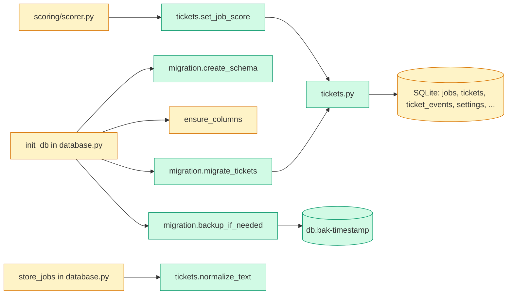

# Tech spec — Add ticket data layer, ApplyPilot migration and duplicate detection

## Approach
Extend the existing schema path in `src/hireember/database.py` (`init_db`, `_ALL_COLUMNS`, `ensure_columns`, `store_jobs`) rather than adding a migration framework. `init_db` stays the single start-up entry: it takes a backup first (only when the file exists and the migration would change it), then creates the jobs table, runs `ensure_columns`, creates the eight new tables with `CREATE TABLE IF NOT EXISTS`, backfills normalized columns, and creates tickets for tailored/attempted jobs. Idempotency comes from `tickets.job_url UNIQUE` plus "insert ticket and first event in one transaction only when no ticket exists for that URL", so a rerun or an interrupted run converges. Ticket logic (statuses, history, scoring tickets, duplicate check, override) goes in one new module `src/hireember/tickets.py`; migration helpers (backup, schema, status mapping) go in a new `src/hireember/migration.py`. Two modules keep `database.py` (already 427 lines) from growing a second concern, and `migration.py` imports only `tickets` helpers for normalization. The scorer (`src/hireember/scoring/scorer.py`, the `UPDATE jobs SET fit_score ...` loop) is changed to call `tickets.set_job_score`, so scoring creates tickets in the real pipeline. Tests follow the style of `tests/unit/test_app_dir.py` (plain pytest, `tmp_path`).

Design decisions the spec left open:
- Backup name: `<db file name>.bak-<YYYYMMDDTHHMMSSZ>` (UTC); on collision append `-1`, `-2`, ... and never overwrite. Made with `sqlite3.Connection.backup` (WAL-safe), not a file copy.
- Settings key: `score_threshold`.
- Unknown old `apply_status`: migrated as blocked for human, reason `unknown status: <value>` (product-spec proposal accepted).
- `jobs` has no company text column. Company for the duplicate key is `companies.name` via `jobs.company_id`, falling back to `jobs.site` when `company_id` is NULL (the launcher already treats `site` as company). `store_jobs` accepts an optional `company` key in each job dict and then sets `company_id` via `get_or_create_company`.
- Needs-migration test (for deciding to back up): file exists and is non-empty, and any of: a new table missing, a new `jobs` column missing, a `jobs` row with NULL normalized title/location, an attempted/tailored job without a ticket. Checked with a separate read-only connection before any write.

## Architecture

## Interface contract

All functions take a `sqlite3.Connection` as returned by `hireember.database.init_db(path)` (row factory `sqlite3.Row`). Rows are returned as plain `dict`.

### `hireember.database`
- `init_db(db_path: Path | str | None = None) -> sqlite3.Connection` — unchanged signature. Now also: backs up an existing database that would change, creates the new tables/columns, migrates tickets. Idempotent. Raises `hireember.migration.MigrationError` if the backup cannot be written (message starts `Backup failed; the database was not changed:`) and then touches nothing.
- `ensure_columns(conn) -> list[str]` — now also adds to `jobs`: `company_id INTEGER`, `title_normalized TEXT`, `location_normalized TEXT`, `last_seen_at TEXT`.
- `store_jobs(conn, jobs, site, strategy) -> tuple[int, int]` — same return/insert/skip behaviour. New: sets `title_normalized`, `location_normalized`, `last_seen_at` on insert; on an already-stored URL updates only `last_seen_at`; optional `job["company"]` sets `company_id`.
- Existing `get_stats` is unchanged.

### `hireember.migration`
- `class MigrationError(RuntimeError)`.
- `migrate_database(db_path: Path | str) -> Path | None` — calls `init_db(db_path)` semantics (closing nothing) and returns the path of the backup created by this call, or `None` when no backup was needed (fresh install or already migrated). Safe to call repeatedly.
- Backup file: same directory, name `<db file name>.bak-<YYYYMMDDTHHMMSSZ>`, openable as SQLite with the original `jobs` rows. Glob for tests: `<db name>.bak-*`.
- Tables created: `companies`, `tickets`, `ticket_events`, `queue_items`, `answers`, `resumes`, `runs`, `settings`.

### `hireember.tickets`
- `ALLOWED_STATUSES: tuple[str, ...]` = `("pending", "started", "applying", "blocked for human", "applied", "skipped", "closed")`.
- Exceptions: `TicketError(Exception)`; `InvalidStatusError(TicketError, ValueError)` (message names the value and lists allowed ones); `TicketNotFoundError(TicketError)` (message `Ticket <id> not found.`); `DuplicateTicketError(TicketError)` with attributes `ticket_id: int`, `duplicate_of: int`, message `Ticket <id> is a duplicate of ticket <other id>; not started.`; `OverrideReasonError(TicketError)` (message `An override needs a reason.`).
- `normalize_text(value: str | None) -> str` — lowercase, replace punctuation with a space, collapse whitespace, trim; `None` gives `""`. `normalize_text("  Senior  Engineer (Remote) ") == "senior engineer remote"`.
- `get_or_create_company(conn, name: str) -> int` — case-insensitive lookup on trimmed name; creates `companies` row if missing.
- `set_job_company(conn, url: str, name: str) -> int` — sets `jobs.company_id`, returns company id.
- `get_threshold(conn) -> int` — `settings` key `score_threshold`; missing/non-numeric/empty gives 7.
- `set_setting(conn, key: str, value: str) -> None` — upsert into `settings`.
- `set_job_score(conn, url: str, score: int, reasoning: str = "") -> int` — updates `jobs.fit_score`, `score_reasoning`, `scored_at`, then ensures one ticket and returns its id. New ticket: `pending` if `score >= threshold` else `skipped`; first event actor `system`, reason `score <n> meets threshold <t>` or `score <n> below threshold <t>`; ticket `score`/`score_reason` filled. If a ticket for the URL exists, it is returned unchanged (status untouched; score fields may be refreshed).
- `ensure_ticket(conn, url: str) -> int` — same ticket creation for a job that already has `fit_score` set (used when tests set the score directly). Raises `TicketError` if the job does not exist or has no score.
- `get_ticket(conn, ticket_id: int) -> dict` — keys include `id, job_url, status, status_reason, duplicate_of, unverified, score, score_reason, created_at, updated_at`. Raises `TicketNotFoundError`.
- `get_ticket_by_url(conn, url: str) -> dict | None`.
- `set_status(conn, ticket_id: int, status: str, *, actor: str = "system", reason: str = "", link: str | None = None, link_kind: str | None = None, override_reason: str | None = None) -> None`
  - Invalid status: `InvalidStatusError`, nothing written. Invalid actor (not `system`/`user`): `ValueError`. Unknown id: `TicketNotFoundError`.
  - Same status as current: no-op, no event.
  - Otherwise updates `tickets.status`, `status_reason`, `updated_at` and writes one `ticket_events` row.
  - When `status == "started"`: duplicate check first (match rule and blocking statuses per product spec; oldest matching ticket id is linked). On blocking match without override: sets ticket to `blocked for human`, reason `duplicate`, `tickets.duplicate_of = <other id>`, event actor `system` with `link = str(other id)`, `link_kind = "duplicate-of"`, commits, then raises `DuplicateTicketError`. A ticket already `blocked for human` with reason `duplicate` asked again is refused with the same error and no new event. Non-blocking or no match: proceeds.
  - `override_reason` given with a blocking match (or on a ticket blocked as duplicate): empty/whitespace raises `OverrideReasonError` with nothing written; otherwise writes an override event (`actor "user"`, `reason = override_reason`, `link = str(other id)`, `link_kind = "override"`, `status` = the ticket's current status), then moves to `started` with a second event; `duplicate_of` stays set. The other ticket is not altered.
- `get_history(conn, ticket_id: int) -> list[dict]` — oldest first (by event id). Each dict has keys `id, ticket_id, status, actor, reason, link, link_kind, time` (`time` is UTC ISO 8601).

### Match rule details (observable through `set_status`)
Application URL = `jobs.application_url`, falling back to `jobs.url` when empty. Company key = `lower(trim(companies.name))` via `jobs.company_id`, else `lower(trim(jobs.site))`; with `title_normalized` and `location_normalized`. If any of company, title or location is empty the text key does not match; the URL key still does.

### Migrated tickets (via `init_db` / `migrate_database`)
One ticket per `jobs` row with non-empty `apply_status` or non-empty `tailored_resume_path`, status and first-event reason per the req.md R3 table, actor `system`; `applied` rows have `tickets.unverified = 1`; `failed` uses the exact `apply_error` (empty string if none); unknown status gives `blocked for human` with `unknown status: <value>`. `tickets.score` copies `fit_score`. No duplicate check.

## Data and state changes
New `jobs` columns: `company_id INTEGER`, `title_normalized TEXT`, `location_normalized TEXT`, `last_seen_at TEXT` (added to `_ALL_COLUMNS`). Backfill: normalized columns from `title`/`location` where NULL; `last_seen_at` from `discovered_at` where NULL.

New tables (all `CREATE TABLE IF NOT EXISTS`):
- `companies(id INTEGER PK, name TEXT NOT NULL, careers_url TEXT, ats_type TEXT, active INTEGER DEFAULT 1)`
- `tickets(id INTEGER PK, job_url TEXT NOT NULL UNIQUE, status TEXT NOT NULL, status_reason TEXT DEFAULT '', resume_id INTEGER, tailored_resume_path TEXT, cover_letter_path TEXT, score INTEGER, score_reason TEXT, duplicate_of INTEGER, unverified INTEGER DEFAULT 0, referral_note TEXT, notes TEXT, created_at TEXT, updated_at TEXT)`
- `ticket_events(id INTEGER PK, ticket_id INTEGER NOT NULL, status TEXT, actor TEXT, reason TEXT DEFAULT '', link TEXT, link_kind TEXT, time TEXT NOT NULL)`
- `queue_items(id INTEGER PK, ticket_id INTEGER, kind TEXT, reason TEXT, page_link TEXT, question_text TEXT, resolved_at TEXT)`
- `answers(id INTEGER PK, question_text TEXT, normalized_key TEXT, answer TEXT, source TEXT, times_used INTEGER DEFAULT 0, last_used_at TEXT)`
- `resumes(id INTEGER PK, name TEXT, tags TEXT, file_path TEXT, pinned INTEGER DEFAULT 0, added_at TEXT)`
- `runs(id INTEGER PK, kind TEXT, started_at TEXT, ended_at TEXT, summary TEXT)`
- `settings(key TEXT PRIMARY KEY, value TEXT)`

Indexes: `ticket_events(ticket_id)`, `tickets(status)`. No new env vars. Backup files accumulate next to the database (one per changing migration run).

## Tasks
1. **Normalization, errors, statuses** — `src/hireember/tickets.py` (new): `ALLOWED_STATUSES`, exceptions, `normalize_text`. Unit tests in `tests/unit/test_tickets_normalize.py` (new).
2. **Schema, backup and new jobs columns** — `src/hireember/migration.py` (new: `MigrationError`, `needs_migration`, `backup_if_needed`, `create_schema`, `backfill_jobs`); `src/hireember/database.py` (modified: add four columns to `_ALL_COLUMNS`; `init_db` calls backup first, then create_schema/backfill after `ensure_columns`; `store_jobs` fills normalized/last-seen/company). `migrate_database` added to `migration.py`. Tests: `tests/unit/test_migration_schema.py` (new).
3. **Ticket core: settings, tickets, history, set_status** — `src/hireember/tickets.py` (modified): `get_or_create_company`, `set_job_company`, `get_threshold`, `set_setting`, `ensure_ticket`, `set_job_score`, `get_ticket`, `get_ticket_by_url`, `set_status` (without duplicate logic yet, but with status validation, same-status no-op, event writing), `get_history`. Tests: `tests/unit/test_tickets_core.py` (new).
4. **Migrate existing tickets** — `src/hireember/migration.py` (modified: `migrate_tickets` mapping per R3 incl. unknown status; transactional per ticket; called from `init_db` in `database.py` after backfill). `needs_migration` includes the "attempted job without ticket" condition. Tests: `tests/unit/test_migration_tickets.py` (new, builds fixture legacy DB as `applypilot.db` and `hireember.db`).
5. **Duplicate detection and override** — `src/hireember/tickets.py` (modified): duplicate lookup, block path, `DuplicateTicketError`, `override_reason` handling in `set_status`. Tests: `tests/unit/test_tickets_duplicates.py` (new).
6. **Scorer creates tickets** — `src/hireember/scoring/scorer.py` (modified: replace the raw `UPDATE jobs SET fit_score` loop with `tickets.set_job_score(conn, r["url"], r["score"], reasoning)` preserving the stored `f"{keywords}\n{reasoning}"` text and a single commit at the end). Test: `tests/unit/test_scorer_tickets.py` (new) feeding `run_scoring` is not required; test `set_job_score` call-through by monkeypatching `score_job`.

## Implementation tests
Unit tests listed per task, using `tmp_path` DBs. Key cases: backup contains original rows and is not created on fresh or fully migrated DBs; same-second backup collision; backup failure (read-only dir) leaves DB unchanged; interrupted migration (delete half the tickets, rerun, no duplicates); `failed` with empty error; threshold from settings (8, "abc", empty); each blocking and non-blocking status; empty-key roles not matched; lowest-id link; repeated start on a duplicate-blocked ticket writes no extra event; override with whitespace reason refused. Run the existing suite to confirm AC-7 (`store_jobs`, `get_stats`, `init_db`).

## Risks and rollout
- `init_db` runs on every start and is called from many places; `needs_migration` must be cheap (a few queries). Keep the fully-migrated path read-only.
- Backup runs before `get_connection` creates the file in WAL mode; for existing files, the separate backup connection must be closed before `init_db` proceeds.
- `set_job_score` changes scorer write path; the scorer previously batched one commit, keep that.
- `company` data is thin until a later phase; duplicates by text key fall back to `site`, which may over-match different roles on the same job board with the same title and location. Documented limitation; the URL key is the reliable one.
- Legacy `applypilot.db` keeps its filename; no rename.

## Open questions
- none
