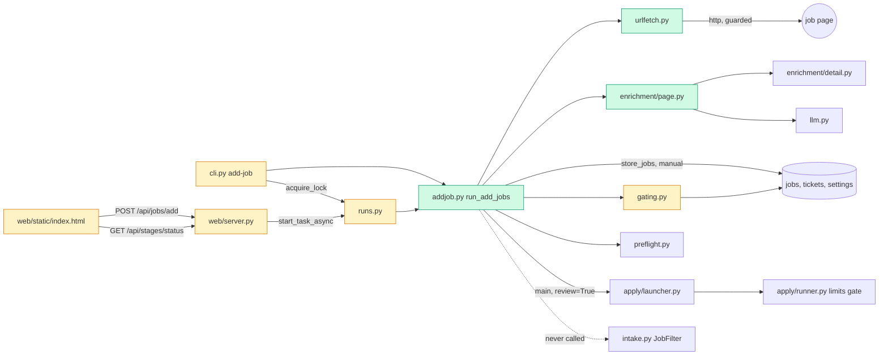

# Tech spec — Add jobs by URL and apply to them

## Approach
Add one orchestration module, `src/hireember/addjob.py`, plus two small helpers: `urlfetch.py` (safe HTTP fetch with the SSRF guard) and `enrichment/page.py` (the existing enrich cascade run on fetched HTML instead of a Playwright page). The new code reuses what exists and does not copy it:

- `enrichment/detail.py` supplies `extract_from_json_ld`, `DESCRIPTION_SELECTORS` and `clean_description`. `page.py` feeds them parsed HTML (BeautifulSoup is already a dependency).
- `database.store_jobs` inserts the job row. It is called directly, not through `intake.store_filtered`, so the phase 9 `JobFilter.reason`, `mark_dropped` and `store_filtered` are never reached for these jobs. The jobs carry `strategy='manual'`.
- `gating.score_job_for_ticket` and `gating.tailor_ticket` do score, tailor, cover letter and ticket (tailoring writes the cover letter). `gating` already applies the phase 9 location filter inside scoring, so it gets a small change. For `strategy='manual'` it skips the location filter, and a below-threshold score leaves the ticket `pending` with the score kept instead of `skipped`.
- Apply goes through `apply.launcher.main(limit=1, target_url=<job url>, review=<bool>)`, once per added job. That keeps the existing gate, rate limits, duplicate check, blocked queue and `apply_ticket`. `acquire_job(target_url=...)` already accepts a job that has `tailored_resume_path`. The daily limit comes from `schedule_apply_limit` minus `scheduler._applied_today`.
- The single-run lock is `runs.acquire_lock`. The CLI takes it the way `cli.apply` does. The API takes it through a new `runs.start_task_async`, modelled on `start_stage_async`.
- State for the status route lives in the `settings` table through `tickets.set_setting`, the same pattern as `runs.last_stage_result`. No migration is needed.
- CLI follows `cli.apply` (bootstrap, lock, rich output). The API follows `_start_stage` and `ApiError` in `web/server.py`. The UI follows `startStage` and `loadStageStatus` in `web/static/index.html`.

Review mode: `run_add_jobs` always passes an explicit `review=True` to the launcher unless its caller passed `review=False`. Only the CLI `--no-review` flag can do that. The API, config and environment have no path to it. `None` ("use the saved setting") is never passed.

## Architecture

## Interface contract

### Python: `hireember.urlfetch`
- `class FetchResult`: dataclass with `url: str` (the final URL after redirects), `status: int`, `html: str`, `truncated: bool`.
- `class FetchError(Exception)`: has `.reason: str`, a plain-language message, and `.refused: bool`.
- `check_url(url: str, *, resolver=socket.getaddrinfo) -> str | None`: returns None if the URL is allowed, otherwise the refusal reason.
  - Scheme not `http` or `https` gives `"Only http and https links are supported."`.
  - No host gives `"That is not a valid web address."`.
  - Host `localhost`, `*.localhost`, or an IP literal or resolved address that is loopback, private, link-local, unique-local, unspecified, multicast or reserved gives `"This address is on your own network or computer, so it was not fetched."`. Every resolved address is checked.
  - `resolver` is injectable so tests need no DNS.
- `fetch_page(url: str, *, transport: httpx.BaseTransport | None = None, resolver=socket.getaddrinfo, timeout: float = 15.0, max_bytes: int = 2_000_000) -> FetchResult`
  - Runs `check_url` on the URL and on every redirect hop (at most 5, followed manually). The check runs before the response body is read.
  - Streams the body and stops at `max_bytes`.
  - Raises `FetchError` with these reasons:
    - 404: `"The page was not found (404)."`
    - 403 or 429: `"The site blocked the request."`
    - timeout: `"The page did not load in time."`
    - other errors or status >= 400: `"The page could not be fetched."`
    - refusal: the `check_url` reason, with `refused=True`.
  - `transport` accepts `httpx.MockTransport` for tests.

### Python: `hireember.enrichment.page`
- `parse_job_page(html: str, url: str, *, extract=None) -> dict | None`: returns `{"title", "company", "location", "description", "application_url"}`, with blanks as `""`, or None if no description was found.
  - Order: JSON-LD `JobPosting` (via `extract_from_json_ld`), then deterministic selectors (Greenhouse, Lever, Ashby, Workday and generic, from `DESCRIPTION_SELECTORS`).
  - The title falls back to the page `h1` and then `og:title`.
  - The company falls back to JSON-LD `hiringOrganization`, then `og:site_name`, then the ATS URL slug.
  - `extract(url, text) -> dict` is called only when the cascade finds no description. It returns the same keys. When `extract` is None the default `extract_with_ai` is used, resolved at call time.
- `extract_with_ai(url: str, text: str) -> dict`: one `llm.get_client()` call on the visible page text, truncated.
- `looks_like_login(html: str, url: str) -> bool`: password field present and no description, or a login or sign-in path.

### Python: `hireember.addjob`
- `TRACKING_PARAMS`: `utm_*` (any name starting `utm_`), `gh_src`, `source`.
- `normalize_url(url: str) -> str`
  - Removes tracking parameters and keeps the order of the others.
  - Drops the fragment, lower-cases the host, and strips a trailing slash from the path.
  - Returns the input stripped if it has no scheme and host.
- `@dataclass AddResult`: `status: str` (`"added"`, `"duplicate"` or `"failed"`), `job_url: str` (normalised), `ticket_id: int | None`, `reason: str`. For `added`, `reason` is `""`. For `duplicate`, `reason` is exactly `"already added"`.
- `add_job_from_url(conn, url: str, *, fetch=None, extract=None, text: str | None = None) -> AddResult`
  - `fetch(url) -> FetchResult` defaults to `fetch_page`. `extract(url, text) -> dict` is the AI fallback and defaults to `extract_with_ai`. Both are resolved at call time, so `monkeypatch.setattr("hireember.addjob.fetch_page", ...)` works.
  - Steps:
    1. Normalise the URL.
    2. Compare it with `jobs.url` and `jobs.application_url`, both after normalisation, and with an applied ticket. A match gives `duplicate` with the existing ticket id. A job with a `blocked for human` ticket from a failed fetch is not a duplicate when `text` is given (see below).
    3. Fetch, then parse, then insert with `database.store_jobs(..., strategy="manual", site=<host>)`.
    4. Set `full_description`, `application_url` and `detail_scraped_at`.
    5. Open an unscored `pending` ticket with reason "added by link".
  - The filter functions in `hireember.intake` are never called, and no `skipped` ticket is created.
  - Failure cases return `failed`; the order is how the code checks them:
    - Non-http scheme: no ticket, reason `"Only http and https links are supported."`.
    - Malformed string: no ticket, reason `"That is not a valid web address."`.
    - LinkedIn host: no ticket, reason `"LinkedIn links are not supported because they need a signed-in session."`.
    - Private address (well-formed http(s)): a job row plus a `blocked for human` ticket, reason from the guard.
    - Fetch error: ticket with the `FetchError.reason` (404 text and the other plain reasons from `urlfetch`).
    - Login page: `"The page needs you to sign in, so the description could not be read."`
    - No description: `"No job description was found on the page."`
    - Unexpected exception: `"Something went wrong adding this link."`, details only in the log.
  - A failed job stores the job row with `strategy='manual'` and `detail_scraped_at` set. The ticket is `blocked for human` with the reason, and the blocked queue receives it through `runs.enqueue_blocked`.
  - With `text` given:
    - Fetch is skipped and the text is the description.
    - If the URL has an existing job with a blocked ticket and no description, the same job and ticket are updated and any open queue item is resolved. The result is `added`.
    - Otherwise a new job is created.
    - Title falls back to the first line of the text.
- `@dataclass AddRow`: `url: str`, `status: str` (`"added"`, `"already added"` or `"failed"`), `ticket_id: int | None`, `score: int | None`, `reason: str`, `next_step: str`.
- `run_add_jobs(conn, urls: list[str], *, apply: bool = False, review: bool = True, text: str | None = None, fetch=None, extract=None, progress=None, now=None) -> list[AddRow]`
  - One row per input URL, in input order. A repeated URL gives one `added` row and one `already added` row. A failure on one URL never stops the others.
  - For each `added` job it runs `gating.score_job_for_ticket(conn, job_url)`, then `gating.tailor_ticket(conn, ticket_id)` when the ticket is `pending`. Both are looked up as module attributes at call time so tests can stub them.
  - Manual jobs get no title or location filter. Their score is stored and shown. A low score does not stop the job.
  - The ticket ends `pending` (shown as approved/ready) or `blocked for human` with a reason. A blocked result after tailoring still gives `added`, with next step `"Blocked for human: <reason>"`.
  - `progress(done: int, total: int)` is called after each URL.
  - With `apply=True`:
    1. Run `preflight.run_preflight("apply", [], no_prompt=True)` once, before any job. If `.proceed` is false, no job is applied and every added row's next step is `"Stopped at ticket: <problem>"`.
    2. Call `apply.launcher.main(limit=1, target_url=<job_url>, headless=False, review=review)` once per `added` job, in input order, and for no other URL. The call is made as `launcher.main`, so stubbing `hireember.apply.launcher.main` works.
    3. If nothing was added, skip the apply stage.
    4. Apply at most `schedule_apply_limit` minus `scheduler._applied_today` jobs. The rest are not passed to the launcher and read `"Daily apply limit reached; will wait."`.
  - `review` is passed through as an explicit bool, never `None`.
  - After each launcher call the next step is read from the ticket:

    | Ticket state | Next step |
    | --- | --- |
    | `applied` | `"Applied"` |
    | `blocked for human` | `"Blocked for human: <plain reason>"` |
    | pending with a `limit: daily` reason | `"Daily apply limit reached; will wait."` |
    | anything else | `"Waiting at review"` |

  - Plain reasons: `captcha` becomes `"A CAPTCHA needs you to solve it."`, `account needed` becomes `"A sign-in is needed to continue."`, and any other reason is used as is.
  - Without `apply`, the next step is `"Stopped at ticket (run with --apply to apply)"`.
  - A duplicate row's next step is `"Already in your tickets"`.
  - A failed row's next step is `"Blocked for human: <reason>"`, or the reason alone when there is no ticket.
  - Row text is built by `addjob.next_step`. Logging (`logging` and `runs.log_event`) never includes API keys, resume text or page text above debug level.
- `format_summary(rows: list[AddRow]) -> str`, for example `"3 URLs: 2 added, 0 already added, 1 failed."`.
- State helpers:
  - `save_state(conn, *, running: bool, rows: list[AddRow], progress: dict | None)`.
  - `load_state(conn) -> {"results": list[dict], "progress": dict | None}`.
  - Stored in `settings` key `add_jobs_state` as JSON.
  - A result dict is `{url, status, ticket_id, score, reason, next_step}`.

### Python: `hireember.runs`
- `start_task_async(name: str, work: Callable[[sqlite3.Connection], None], *, conn=None) -> threading.Thread`: acquires the single-run lock immediately (raises `RunInProgressError`), runs `work` on its own connection in a daemon thread and always releases the lock. An exception is logged with `log_event` and stored as the last stage result, like `start_stage_async`.

### Python: `hireember.gating` (changed behaviour)
- `score_job_for_ticket`: for a job whose `strategy == 'manual'` the location check is skipped. If the new score is below the threshold the ticket stays `pending` with reason `"score N below threshold T (added by link)"` and the score recorded. Behaviour for all other jobs is unchanged.

### CLI
`hireember add-job URL [URL...] [--apply] [--no-review] [--text FILE]`
- No URL: usage error, exit 2.
- `--no-review` without `--apply`: prints `--no-review needs --apply.`, exit 2.
- `--text FILE` with more than one URL: prints `--text works with one URL at a time.`, exit 2.
- Empty file: prints `The description file is empty.`. Unreadable file: prints `The description file could not be read.`. Both exit 1, and nothing is changed.
- If a run is active it prints `A run is already in progress. Wait for it to finish, then try again.` and exits 1.
- Otherwise it takes the run lock, runs `addjob.run_add_jobs` with `review = not no_review`, and prints a rich table with columns `URL`, `Result`, `Ticket`, `Score`, `Next step`.
  - Ticket is `#<id>` or `-`. Score is the number or `-`.
  - A summary line from `format_summary` follows.
  - When `--apply` is given and nothing was added, it prints `Nothing new to apply to.`.
- Exit 0 when the run completed, even if some rows failed.
- URLs are de-duplicated within one command.
- `main` callback docstring and `typer.Typer(help=...)` both mention adding jobs by URL.
- Stubs used by tests: `hireember.apply.launcher.main`, `hireember.preflight.run_preflight`, `hireember.addjob.fetch_page`, `hireember.addjob.extract_with_ai`, `hireember.gating.score_job_for_ticket`, `hireember.gating.tailor_ticket`.

### HTTP (`web/server.py`)
- `POST /api/jobs/add` with JSON `{"urls": [str, ...], "apply": bool, "text": str (optional)}`.
  - `202 {"started": true}`.
  - Errors use `{error, code}`:
    - 400 `"Enter at least one URL."` (`invalid_urls`): empty list, non-list, or non-string items. Blank lines and surrounding spaces are stripped first.
    - 400 `"You can add up to 25 URLs at a time."` (`too_many_urls`).
    - 400 `"A URL is longer than 2048 characters."` (`url_too_long`).
    - 400 (`bad_request`) when `text` is given with more than one URL.
    - 409 `"A run is already in progress."` (`busy`).
  - There is no `review` field; an extra `review` key is ignored. The run always uses `review=True`.
  - Runs through `runs.start_task_async("add-jobs", ...)`, under the single-run lock.
- `POST /api/tickets/<id>/description` with `{"text": str}`: resumes a blocked URL with pasted text.
  - `202 {"started": true}`.
  - Empty text: 400 `"Enter the job description."`.
  - Unknown ticket: 404.
  - Run active: 409 `busy`.
  - It runs `run_add_jobs(conn, [ticket.job_url], text=text, apply=False)` and stores state like the add route.
- `GET /api/stages/status` keeps `running` and `last`. It adds `results` (list of `{url, status, ticket_id, score, reason, next_step}`, in input order, `[]` when none) and `progress: {done, total}` while running (otherwise null).

### UI (`web/static/index.html`, Tickets tab)
- A panel above the board/list.
  - Region labelled "Add job URLs".
  - Textarea with label "Job URLs (one per line)".
  - Field labelled "Job description text (use if a page cannot be read)", visible only when exactly one URL is entered.
  - Buttons with text "Add" and "Add and apply".
  - A line `role="status"` reading "A run is in progress." when running, and "Adding 2 of 3..." for progress.
  - Errors in an element with `role="alert"`: "Enter at least one URL.", "You can add up to 25 URLs at a time.", "A URL is longer than 2048 characters.".
  - Both buttons are disabled while a run is active.
  - A results table with column headers `URL`, `Result`, `Ticket`, `Score`, `Next step`. The Ticket cell links to the ticket.
  - There is no control that turns review off.
- The ticket drawer for a ticket blocked on a page that could not be read shows a text field labelled "Paste job description" and a button "Continue" that posts to `/api/tickets/<id>/description`.

## Data and state changes
- No schema migration. The `jobs.strategy` column already exists and takes the value `'manual'`.
- New `settings` key `add_jobs_state` (JSON), written through `tickets.set_setting`.
- No new config keys or environment variables. Review cannot be set from config or environment for this path.
- No new dependencies: `httpx`, `beautifulsoup4` and `llm.get_client` are already present.

## Tasks
1. **Safe URL fetch** — `src/hireember/urlfetch.py` (new), `tests/unit/test_urlfetch.py` (new): `check_url`, `fetch_page`, `FetchError`, `FetchResult`. Scheme and address checks, manual redirect following with a re-check on each hop, a streamed body with a size cap, a timeout, and plain reasons. No body is read before the check passes.
2. **HTML cascade** — `src/hireember/enrichment/page.py` (new), `tests/unit/test_enrichment_page.py` (new), `tests/fixtures/` HTML files for JSON-LD, Greenhouse, Lever, Ashby, Workday, an unknown layout, a 404 body and a login page (new): `parse_job_page`, `extract_with_ai`, `looks_like_login`. They reuse `detail.extract_from_json_ld`, `DESCRIPTION_SELECTORS` and `clean_description`; `detail.py` is not changed.
3. **Add core** — `src/hireember/addjob.py` (new), `tests/unit/test_addjob_core.py` (new): `normalize_url`, `AddResult`, `add_job_from_url`. Dedupe by `url` and `application_url`, `strategy='manual'`, failure tickets and the blocked queue, the LinkedIn and bad-scheme rules, and the `text` path with job reuse. It stores through `database.store_jobs` and never touches `intake` filters.
4. **Manual jobs in gating** — `src/hireember/gating.py` (modified), `tests/unit/test_gating_manual.py` (new): skip the location check and keep a low score `pending` when `strategy == 'manual'`. Existing gating behaviour and tests are unchanged.
5. **Pipeline run** — `src/hireember/addjob.py` (modified), `tests/unit/test_addjob_run.py` (new): `AddRow`, `run_add_jobs` without apply (score, tailor, rows, next-step text, progress callback, in-run duplicates, per-URL error isolation), `format_summary`, `save_state` and `load_state`.
6. **Apply stage** — `src/hireember/addjob.py` (modified), `tests/unit/test_addjob_apply.py` (new): the `apply=True` path. Preflight first, one `launcher.main` call per added job with an explicit `review` bool, the daily limit using `scheduler._applied_today` and `schedule_apply_limit`, next-step mapping including CAPTCHA, and "Nothing new to apply to." as a returned condition.
7. **CLI command** — `src/hireember/cli.py` (modified), `tests/unit/test_cli_add_job.py` (new): the `add-job` command, option validation, lock handling, `--text` file reading, the results table and summary. Update `typer.Typer(help=...)` and the `main` docstring.
8. **Task runner and status** — `src/hireember/runs.py` (modified), `tests/unit/test_runs_task.py` (new): `start_task_async`.
9. **Dashboard API** — `src/hireember/web/server.py` (modified), `tests/unit/test_web_add_jobs.py` (new): `POST /api/jobs/add`, `POST /api/tickets/<id>/description`, and the `results` and `progress` fields on `GET /api/stages/status`. Validation order is: list shape, count, length, text with several URLs.
10. **Dashboard UI** — `src/hireember/web/static/index.html` (modified), `tests/unit/test_index_add_jobs.py` (new): the Add job URLs panel, polling, the results table, and "Paste job description" with "Continue" in the ticket drawer. It follows the `startStage` and `loadStageStatus` pattern and mirrors the client-side checks.
11. **Docs** — `README.md` (modified): new section "Apply to jobs you found" and the CLI reference entry for `add-job`. `docs/traceability.md` (modified): new section listing the command, the endpoint and AC-1 to AC-16.

## Implementation tests
- Unit: `check_url` against the full address table, including IPv6 and hostnames that resolve to private addresses through an injected resolver. `fetch_page` with `httpx.MockTransport` (redirect to a private address refused before the body, 404, 403, timeout, size cap).
- Unit: `normalize_url` and dedupe (tracking params, trailing slash, `application_url` match, an applied ticket gives duplicate).
- Unit: one fixture page each for JSON-LD, Greenhouse, Lever, Ashby and Workday. A counting stub asserts `extract` is not called for those and is called once for the unknown layout.
- Unit: `JobFilter.reason`, `intake.store_filtered` and `intake.mark_dropped` are stubbed to raise. A "Sales Manager" job is stored with `strategy='manual'` and no `skipped` ticket.
- Unit: 404 and login fixtures give distinct reasons, `blocked for human` tickets and queue items. `--text` resumes a blocked job to a final ticket status.
- Unit: `run_add_jobs` with three URLs (added, failed, added) gives three rows in order. Without `apply` the launcher stub is not called. With `apply` it is called for exactly the added URLs with `review=True`. `review=False` is passed only when requested.
- Unit: a preflight failure blocks all apply calls. The daily limit holds the extra jobs. A CAPTCHA-blocked ticket is reported with the plain reason.
- Unit: CLI exit codes and messages, table content, `--no-review` without `--apply`, `--text` with several URLs.
- Unit: the API cases (25 limit, 2048 cap, 409 while the lock is held, no `review` effect). The status route returns results in order.
- Unit: the logs of an add run contain no API key and no resume text at info level. The existing phase 6 scans keep passing.
- Unit: `index.html` contains the panel labels, button texts and `role` attributes.

## Risks and rollout
- Task 4 changes `gating.py`, which scheduled runs use. The change is gated on `strategy == 'manual'`, so other jobs are unaffected. The existing gating tests must stay green.
- DNS rebinding between the check and the connection is not fully closed by resolving once. `fetch_page` connects to the checked address where `httpx` allows it and re-checks every redirect hop. This is noted in the README privacy note.
- The launcher is run once per job, so each job opens and closes its own browser session. This keeps "exactly these jobs" simple. Batching would need a new launcher entry point and is not done.
- The ticket `status_reason` for a CAPTCHA stop stays the existing `captcha` kind. The plain sentence is produced in the row text, so existing queue code and tests are untouched.
- No feature flag is needed. The feature is a new command and endpoint only.

## Open questions
- Should the ticket `status_reason` itself read "A CAPTCHA needs you to solve it." (AC-11 wording), or is the plain sentence in the result row enough? The spec assumes the row, to avoid changing `apply/session.py` kinds.
- Phase 9 is merged but its filter is called through `JobFilter`/`store_filtered`/`mark_dropped` only. Is the `strategy='manual'` bypass in `gating.score_job_for_ticket` (location check) acceptable as the second half of the bypass?
