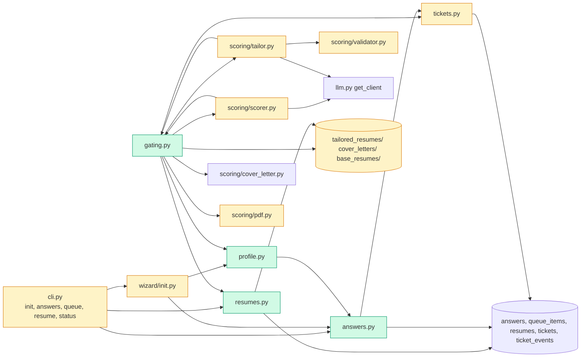

# Tech spec — Add profile, base resumes, answer bank and score/tailor gating

## Approach
Add four small modules beside `tickets.py` (the phase 1 data layer): `profile.py` (ten profile groups, schema, example check), `answers.py` (bank, matching, sensitive check, queue, answering), `resumes.py` (base resumes, pin, best fit), and `gating.py` (score, threshold, tailor, validate, write PDFs, update ticket). All of them take a `sqlite3.Connection` and use the phase 1 tables (`answers`, `queue_items`, `resumes`, `tickets`) and `tickets.set_status` / `normalize_text` / `get_threshold` / `set_job_score`, so history events and the threshold come for free. Existing `scoring/scorer.py`, `tailor.py`, `validator.py` and `wizard/init.py` are extended, not replaced. CLI additions follow `cli.py`: sub-apps `answers`, `queue`, `resume` with lazy imports and `_bootstrap()`. Tests use the `isolated_db` fixture and fake LLM clients.

Key decisions:
- Question normalization is `tickets.normalize_text` (lowercase, punctuation to space, collapse whitespace). It is the answer key.
- Matching never needs a browser. It is `answers.match_answer`.
- Replace on re-answer (the product-spec proposal): `save_answer` updates the existing entry for that key. `replace=False` always inserts a new row; this is how imports and tests create conflicts.
- After a queued answer the ticket goes to `pending` (proposal).
- Blank profile answers re-prompt. The user types `skip` or `decline` for optional items; the typed word is stored as the answer.
- Retry limit: reuse `tailor_resume(max_retries=3)`. No new setting.
- Init does not import the old `profile.json`. It starts fresh and rewrites `profile.json` from the answers (the validator and tailor still read `load_profile()`).
- PDF output: `scoring/pdf.py` renders with Playwright, which tests cannot rely on. Add `write_text_pdf` (dependency-free, one-font text PDF) and use it when the Playwright render raises. Files always exist and start with `%PDF`.
- Base-resume text: `.txt` is read directly. For a `.pdf`, `resume add --text <txt>` supplies a text copy stored next to it. A PDF without a text copy cannot be scored, so its ticket is blocked with `base resume has no text version`.

## Architecture

## Interface contract

All functions take an open `sqlite3.Connection` (from `hireember.database.init_db`) as first argument. Statuses and reasons are exact strings. Timestamps are ISO-8601 UTC strings as in `tickets._now()`.

### `hireember.profile`
- `PROFILE_GROUPS: tuple[ProfileGroup, ...]` — exactly ten, in this order, `key` values: `contact`, `location`, `work_authorization`, `availability`, `compensation`, `experience_level`, `target_roles`, `skills_boundary`, `resume_facts`, `eeo`. `ProfileGroup` is a frozen dataclass with `key: str`, `title: str` (e.g. "Name and contact", "Location", "Work authorization", "Availability", "Compensation expectation", "Experience level", "Target roles", "Skills boundary", "Resume facts", "EEO preferences"), `questions: tuple[str, ...]` (the question texts; one prompt per question), `optional: bool` (true only for `eeo`).
- `PROFILE_SCHEMA: dict` — JSON-schema-like dict of the profile.json layout. No key named `password` anywhere, at any depth.
- `group_answers(conn, group_key: str) -> list[dict]` — stored answers (rows of the answer bank, as dicts with keys `question_text, normalized_key, answer, source, times_used, last_used_at`) whose normalized key equals the normalized key of one of that group's questions and whose source is `profile`.
- `contains_key(obj, name: str) -> bool` — case-insensitive recursive key search in dicts/lists (used to check `profile.example.json` and `PROFILE_SCHEMA`).

### `hireember.wizard.init`
- `run_profile_step(conn, ask: Callable[..., str] | None = None, *, console=None) -> dict` — asks all ten groups in order. For each group prints a heading line `Profile step <n> of 10: <title>`, then calls `ask(question_text)` once per question (default `rich.prompt.Prompt.ask`). A blank (whitespace-only) reply re-asks the same question; it is never stored. Each reply is stored with `answers.save_answer(..., source="profile")`. For the `eeo` group the reply must be a real answer or the word `skip` or `decline`. Returns the profile dict that is also written to `config.PROFILE_PATH`. On a non-empty bank, a group whose questions are all stored is not re-asked unless the user says to change it (prompt: `Keep your <title> answers? [Y/n]`; the reply `n` re-asks). Never asks for a password, token or payment detail.
- `run_wizard()` (existing) calls `run_profile_step` for the profile step. `hireember init` therefore stores the ten groups.

### `hireember.answers`
- Constants: `KIND_UNKNOWN = "unknown question"`, `KIND_CONFLICT = "conflicting answers"`, `KIND_SENSITIVE = "sensitive question"`.
- `normalize_question(text: str) -> str` — same as `hireember.tickets.normalize_text`.
- `is_sensitive(question: str) -> bool` — true when the normalized question asks for a password, passcode, token, API key, card number, credit/debit card, CVV/CVC, bank account, routing number, IBAN, SSN, social security / social insurance number, passport, national id, government id, tax id, or driver licence number.
- `save_answer(conn, question: str, answer: str, source: str = "user", *, replace: bool = True) -> int` — returns the answer row id. `source` must be `profile`, `user` or `import` (else `ValueError`). Stores `question_text`, `normalized_key`, `answer`, `source`, `times_used=0`, `last_used_at=NULL`. With `replace=True` an existing row with the same key is updated in place (answer and source, times used kept); with `replace=False` a new row is always inserted. Raises `SensitiveQuestionError` (subclass of `ValueError`) if `is_sensitive(question)`, and `ValueError("Answer cannot be empty.")` on a blank answer.
- `list_answers(conn) -> list[dict]` — dicts with keys `id, question_text, normalized_key, answer, source, times_used, last_used_at`, ordered by id.
- `@dataclass AnswerResult` with `status: str` (`"answered"`, `"unknown"`, `"conflict"` or `"sensitive"`), `answer: str | None`, `queue_item_id: int | None`.
- `match_answer(conn, ticket_id: int, question: str) -> AnswerResult` — browser-free lookup.
  - Sensitive question: no lookup. Status `sensitive`, `answer=None`. Ticket set to `blocked for human`, reason `sensitive question`. Queue item kind `sensitive question`.
  - One key match, or several with equal values (after strip and case-fold): status `answered`, `answer` is the stored value. The lowest-id matching row gets `times_used + 1` and `last_used_at = now`. Ticket status is untouched.
  - Several matches with different values: status `conflict`, `answer=None`. Ticket blocked for human, reason `conflicting answers`. Queue item kind `conflicting answers`.
  - No match: status `unknown`, `answer=None`. Ticket blocked for human, reason `unknown question`. Queue item kind `unknown question`.
  - In all blocked cases the `queue_items` row has `ticket_id`, `kind`, `reason` (= kind) and `question_text` (the question as asked) set and `resolved_at` NULL. Queuing the same normalized question for the same ticket while an open item exists reuses that item (one open item only).
- `queue_question(conn, ticket_id: int, kind: str, question: str) -> int` — the queue step on its own (idempotent as above); returns the queue item id.
- `list_queue(conn, include_resolved: bool = False) -> list[dict]` — dicts with keys `id, ticket_id, kind, reason, question_text, resolved_at`, open items first by id.
- `@dataclass QueueAnswerResult` with `saved: bool`, `ticket_id: int | None`, `message: str`.
- `answer_queue_item(conn, item_id: int, answer: str) -> QueueAnswerResult`
  - Blank answer: raises `QueueError("Answer cannot be empty.")`; item stays open.
  - Unknown id or already resolved: raises `QueueError(f"Queue item {item_id} not found or already resolved.")`; no change.
  - Kind `sensitive question`: sets `resolved_at`, does not store the answer, ticket stays blocked. `saved=False`, `message` = `Not saved: passwords, tokens, payment details and government IDs are never stored. Ticket <n> stays blocked for human.`
  - Otherwise: `save_answer(question_text, answer, "user")` (replace), sets `resolved_at`, and if the ticket is `blocked for human` sets it to `pending` (actor `user`, reason `answered queued question`). `saved=True`, `message` = `Answer saved. Ticket <n> is ready to resume.`
- `QueueError(Exception)`; `SensitiveQuestionError(ValueError)`.

### `hireember.resumes`
- `add_resume(conn, file: str | Path, name: str, tags: str = "", text_file: str | Path | None = None) -> int` — copies the file into `config.APP_DIR / "base_resumes"` and inserts a row (`file_path` is the copy, `tags` stored as the normalized comma list, `pinned=0`, `added_at`). Errors, all `ResumeError(message)`: `File not found: <path>.`; `Unsupported format. Provide a .txt or .pdf file.` (only `.txt` and `.pdf`); `A resume named "<name>" already exists.` (case-insensitive).
- `list_resumes(conn) -> list[dict]` — keys `id, name, tags` (list of str), `pinned` (bool), `file_path, added_at`.
- `pin_resume(conn, resume_id: int) -> None` — pins that one and clears all others. Unknown id: `ResumeError(f"No resume with id {resume_id}.")`.
- `unpin_resume(conn) -> None`.
- `get_resume_text(conn, resume_id: int) -> str` — text of the base resume (the `.txt` file, or the stored text copy for a PDF). Raises `ResumeError("base resume has no text version")` when none.
- `choose_resume(conn, job: dict) -> int | None` — the pinned resume id; else the id of the best fit: most overlap between resume tags and the words of the normalized job title (ties: lowest id; no overlap: lowest id); `None` when there are no resumes.
- `update_resume(conn, resume_id: int, file: str | Path, text_file: str | Path | None = None) -> None` — replaces the base resume's stored file (and text copy). It never touches tickets or tailored files.
- `ResumeError(Exception)`.

### `hireember.tickets` (additions)
- `open_ticket(conn, url: str, status: str = "pending", reason: str = "") -> int` — idempotent: returns the existing ticket id for the job, else creates a ticket with no score and writes the first history event.
- `set_ticket_resume(conn, ticket_id: int, resume_id: int) -> None` — sets `tickets.resume_id`.
- `set_ticket_files(conn, ticket_id: int, resume_path: str, cover_letter_path: str) -> None` — sets `tailored_resume_path` and `cover_letter_path`.

### `hireember.scoring.validator` (additions)
- `validate_against_profile(data: dict, profile: dict) -> list[str]` — takes the tailor JSON (`skills`, `experience`, `projects`, `education`, bullets). Returns reasons, each exactly one of:
  - `employer "<name>" not in resume facts` (employer = first `|`/` - ` segment of an `experience[].header`; allowed = `profile["resume_facts"]["preserved_companies"]`, compared case-insensitively),
  - `project "<name>" not in resume facts` (against `preserved_projects`),
  - `school "<name>" not in resume facts` (against `preserved_school`),
  - `metric "<value>" not in resume facts` (percent, multiplier or `<n>k/M` tokens in bullets, against `real_metrics`),
  - `skill "<name>" not in skills boundary` (each comma-separated item in `skills` values, against the lists in `skills_boundary`).
  Empty list means valid.
- `validate_json_fields` now also appends these reasons to `errors`, so `tailor_resume` retries on them as before.

### `hireember.scoring.pdf` (addition)
- `write_text_pdf(text: str, output_path: str | Path) -> Path` — pure-Python PDF writer; no browser. Output starts with `%PDF-` and ends with `%%EOF`.

### `hireember.gating`
- `@dataclass GateResult` with `ticket_id: int`, `status: str` (the ticket status after the step), `reason: str`, `score: int | None`, `resume_id: int | None`, `tailored_resume_path: str | None`, `cover_letter_path: str | None`.
- `score_job_for_ticket(conn, url: str, *, profile: dict | None = None) -> GateResult` — steps:
  1. `choose_resume`. None: `open_ticket`, status `blocked for human`, reason `no base resume`; no LLM call. Resume without text: blocked with `base resume has no text version`.
  2. Score with `scorer.score_job(resume_text, job, profile)` (prompt now also carries the profile's target roles, location and experience level). On an LLM error (score 0): ticket blocked for human, reason is the error text (`LLM error: ...`); no fit score is stored.
  3. `tickets.set_job_score(url, score, reasoning)` creates or updates the ticket: below threshold gives `skipped` with reason `score <n> below threshold <t>`; at or above gives `pending`. The resume id is set on the ticket in every case that picks a resume. `score_reason` is non-empty (the LLM `reasoning`, or `no reason given` if empty).
- `tailor_ticket(conn, ticket_id: int, *, profile: dict | None = None, validation_mode: str = "normal", max_retries: int = 3) -> GateResult` — only for a ticket whose status is `pending` and has a resume id and no files. Runs `tailor_resume` with the ticket's base resume text, then `generate_cover_letter`. Writes `TAILORED_DIR/ticket<id>_<slug>.txt/.pdf` and `COVER_LETTER_DIR/ticket<id>_<slug>_CL.txt/.pdf` (names unique per ticket, never overwritten by later work) and calls `set_ticket_files`. On `failed_validation` or `exhausted_retries`: ticket `blocked for human`, reason `validation failed: <first error>` (for example `validation failed: employer "Acme Corp" not in resume facts`); no file paths stored. On an LLM exception: blocked for human, reason `LLM error: <message>`. A skipped or blocked ticket is returned unchanged with no tailoring.
- `process_job(conn, url: str, *, profile: dict | None = None, validation_mode: str = "normal") -> GateResult` — `score_job_for_ticket`, then `tailor_ticket` if the ticket is `pending`.
- `profile=None` means `config.load_profile()`.
- Fake LLM contract for tests: patch `get_client` in `hireember.scoring.scorer`, `hireember.scoring.tailor` and `hireember.scoring.cover_letter` with a function returning an object whose `chat(messages, max_tokens=..., temperature=...) -> str` returns, respectively: `SCORE: 8\nKEYWORDS: a, b\nREASONING: Fits well.`; a JSON object with keys `title, summary, skills (dict of lists), experience ([{header, subtitle, bullets}]), projects ([{header, subtitle, bullets}]), education (str)`; and a letter starting `Dear Hiring Manager,`. With `validation_mode="lenient"` the judge call is skipped.

### CLI (`hireember ...`, Typer; exit code 0 unless stated)
- `hireember init` — as today plus the ten-group profile step.
- `hireember answers list` — table titled `Answers` with columns `Question`, `Key`, `Answer`, `Source`, `Last used`, `Used`. Empty: `No answers stored yet. Run "hireember init" or answer queued questions.`
- `hireember queue list` — table columns `Id`, `Ticket`, `Kind`, `Question` for open items. Empty: `No open queue items.`
- `hireember queue answer <id> "<answer>"` — prints the `message` of `QueueAnswerResult`. On `QueueError` prints the message and exits with code 1.
- `hireember resume add <file> --name "<name>" --tags "<t1,t2>" [--text <txt>]` — prints `Added resume <id>: <name>.` On `ResumeError` prints the message and exits 1.
- `hireember resume list` — columns `Id`, `Name`, `Tags`, `Pinned`, `File`, `Added`. Empty: `No base resumes. Add one with "hireember resume add".`
- `hireember resume pin <id>` — prints `Pinned resume <id>.`; unknown id prints `No resume with id <id>.` and exits 1.
- `hireember resume unpin` — prints `Unpinned.`
- `hireember status` — now also prints a table `Tickets needing attention` (columns `Ticket`, `Job`, `Status`, `Reason`) for tickets in `blocked for human`; the validation reason text is shown in full.

### Files
- `profile.example.json` has no `password` key at any depth.

## Data and state changes
- No schema change. Tables `answers`, `queue_items`, `resumes`, `tickets` come from phase 1 (`src/hireember/migration.py`).
- `queue_items.kind` and `.reason` hold `unknown question`, `conflicting answers` or `sensitive question`. `answers.source` holds `profile`, `user` or `import`.
- New folder `APP_DIR/base_resumes/`, created on demand by `resumes.add_resume`.
- `profile.json` keeps its current layout (the `skills_boundary`, `resume_facts` keys that `validator.py` and `tailor.py` read), minus `personal.password`.
- No new env vars or settings. Threshold stays `settings.score_threshold` (default 7).

## Tasks
1. **Profile groups, schema, example cleanup** — `src/hireember/profile.py` (new): `ProfileGroup`, `PROFILE_GROUPS`, `PROFILE_SCHEMA`, `contains_key`. `profile.example.json` (modified): delete `personal.password`. `src/hireember/wizard/init.py` (modified): drop the password prompt from `_setup_profile` so the build stays consistent. Tests: schema and example have no `password`; ten groups in order.
2. **Answer bank and matching** — `src/hireember/answers.py` (new): `normalize_question`, `is_sensitive`, `save_answer`, `list_answers`, `match_answer`, `queue_question`, `list_queue`, `answer_queue_item`, result types and errors. Uses `tickets.set_status` (follow `tests/unit/test_tickets_core.py` fixture style for tests).
3. **Wizard: ten-group profile step** — `src/hireember/wizard/init.py` (modified): add `run_profile_step`, replace the `_setup_profile` call in `run_wizard`, build and write `profile.json` from the answers, keep/change on re-run. `src/hireember/profile.py` (modified): add `group_answers`. Uses `answers.save_answer` with source `profile`.
4. **CLI for answers and queue** — `src/hireember/cli.py` (modified): add `answers_app` and `queue_app` Typer sub-apps with `list` and `answer`; register with `app.add_typer`. Update the `typer.Typer(help=...)` text per standards if it lists commands. `README.md` (modified): one short section on the new commands.
5. **Base resumes and CLI** — `src/hireember/resumes.py` (new): all functions in the contract. `src/hireember/cli.py` (modified): `resume_app` with `add`, `list`, `pin`, `unpin`.
6. **Ticket helpers** — `src/hireember/tickets.py` (modified): `open_ticket`, `set_ticket_resume`, `set_ticket_files`. Tests next to `tests/unit/test_tickets_core.py`.
7. **Validator checks against the profile** — `src/hireember/scoring/validator.py` (modified): `validate_against_profile`, called from `validate_json_fields`. `src/hireember/scoring/tailor.py` (modified): `_build_tailor_prompt` unchanged in meaning; no code change unless a unit test shows the prompt contradicts the new rule. Check existing validator tests still pass; if profiles in older tests list no companies, update those test profiles.
8. **PDF fallback writer** — `src/hireember/scoring/pdf.py` (modified): `write_text_pdf`; `convert_to_pdf` falls back to it when `render_pdf` raises (log at debug). Test that the file starts with `%PDF-` and is non-empty.
9. **Score step with resume choice and threshold** — `src/hireember/gating.py` (new): `GateResult`, `score_job_for_ticket`. `src/hireember/scoring/scorer.py` (modified): `score_job(resume_text, job, profile=None)` adds target roles, location, level to the user message; `run_scoring` calls `gating.score_job_for_ticket` per job (replaces the `RESUME_PATH` read and `set_job_score` batch). `tests/unit/test_scorer_tickets.py` (modified): add a base resume and adapt to the new path.
10. **Tailor step with validation gating** — `src/hireember/gating.py` (modified): `tailor_ticket`, `process_job`. `src/hireember/scoring/tailor.py` (modified): `run_tailoring` processes tickets in `pending` with a resume id and no files through `gating.tailor_ticket`, keeping its return shape.
11. **Status shows blocked tickets** — `src/hireember/cli.py` (modified): add the `Tickets needing attention` table to `status`. Test via `typer.testing.CliRunner` and `isolated_db`.

## Implementation tests
- `tests/unit/test_profile.py`: group order and count, no `password` in schema or example.
- `tests/unit/test_wizard_profile.py`: scripted `ask` fake; blank re-asks; `skip` stored; re-run keeps stored groups.
- `tests/unit/test_answers.py`: normalization match, increment of times used, conflict vs identical duplicates, sensitive questions with a matching bank entry, single open queue item, queue answer paths and error messages.
- `tests/unit/test_resumes.py`: add/list/pin/unpin, duplicate name, bad format, best fit, tie-break, `update_resume` leaves tickets alone.
- `tests/unit/test_validator_profile.py`: each reason string.
- `tests/unit/test_pdf_fallback.py`, `tests/unit/test_gating.py` (fake LLM clients, skip below threshold, exact-threshold pass, no resume, retry exhaustion reason, byte-identical tailored files after a base resume edit), `tests/unit/test_cli_phase2.py` (CliRunner for the new commands and status).

## Risks and rollout
- `run_scoring` now needs at least one base resume; without one tickets block with `no base resume`. Users who only had `resume.txt` must run `hireember resume add`. README gets a note (task 4).
- Tightened validation (employers, projects, skills must be in the profile) can reject more tailoring for old profiles with empty `resume_facts`; those tickets block for human with a clear reason, never apply.
- PDF fallback output is plain text, not styled. Playwright output is used when available.
- Task order keeps every commit green; tasks 9 and 10 change existing scoring and tailoring behaviour and their existing tests.

## Open questions
- Resolved by proposal, flag if wrong: re-answering replaces (not duplicates); queued answer returns the ticket to `pending`; `init` starts fresh without importing `profile.json`; retry limit reuses `max_retries=3`.
- None blocking.
