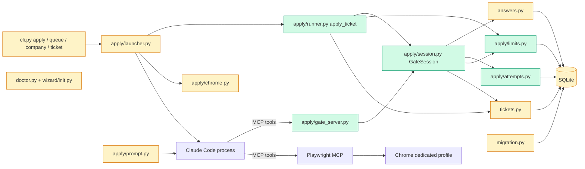

# Tech spec — Rework the apply stage with human gates and safety rules

## Approach

Today the safety of an application depends on a 600-line prompt. This change moves every decision that matters into Python and makes the agent ask for it. A new `GateSession` (`src/hireember/apply/session.py`) is the single choke point for a ticket's run: it answers "may I fill this field, and with what" from the answer bank and profile (reusing `answers.match_answer`), blocks the ticket and queues a human item for every stop, writes the attempt log, and records submit and outcome. A new `apply_ticket` (`src/hireember/apply/runner.py`) wraps one attempt: duplicate, manual-company and limit checks, the move to `applying` with the live-session link, then it calls an injectable `agent(session)`. In production the agent is Claude Code driving Chrome through the Playwright MCP, plus a small stdio MCP server (`src/hireember/apply/gate_server.py`) that exposes `GateSession` as tools. In tests the agent is a plain Python function over local fixture forms, so no Claude, Chrome or network is needed.

The old `launcher.py` keeps its public names (`acquire_job`, `mark_result`, `run_job`, `worker_loop`, `main`, `gen_prompt`, `launch_chrome` is imported there), because existing tests patch them (`tests/unit/test_apply_linkedin.py`, `tests/acceptance/test_ac5_apply_rejects_linkedin.py`). Their LinkedIn behaviour is untouched. Ticket state becomes the source of truth for what a worker may pick: `acquire_job` left-joins `tickets` so a job without a ticket still works. Blocked and held outcomes release the job lock (`release_lock`) instead of writing `failed`, so `jobs.apply_status` never has to be reset after `queue answer` or `queue ready`.

The one-day same-company wait (human decision) is a queue: a pending ticket carries `tickets.not_before`, and `acquire_job` skips tickets whose time has not passed. Limits are computed from `tickets.submitted_at`, not from process memory, so they hold across batches, workers and restarts.

Existing patterns followed: schema through `CREATE TABLE IF NOT EXISTS` plus additive column checks in `migration.py` (like `database.ensure_columns`); ticket status changes only through `tickets.set_status`; queue items through `answers.queue_question`; CLI groups as `typer.Typer` sub-apps in `cli.py` (like `queue_app`, `resume_app`); tests isolate with `HIREEMBER_DIR` and the `isolated_db` fixture. New abstractions and why: `GateSession` (one place enforcing the rules, shared by tests and the MCP adapter), `limits.py` (limit maths away from the launcher so it is testable with a fake clock), `attempts.py` (a log table plus three functions; nothing existing fits).

## Architecture



## Interface contract

All paths are under `src/hireember/`. Import examples use the package name `hireember`.

### Constants (`hireember.apply.session`)

```python
REASON_ACCOUNT = "account needed"
REASON_CAPTCHA = "captcha"
REASON_IDENTITY = "identity check"
REASON_VIDEO = "video or biometric"
REASON_REVIEW = "review before submit"
REASON_MANUAL = "manual site"
REASON_OUTCOME = "outcome unknown"
REASON_RECOVERED = "recovered after interrupted run"
REASON_NO_RESULT = "agent finished without a result"
REASON_CLOSED_DEFAULT = "closed by employer page"
STOP_REASONS = (REASON_ACCOUNT, REASON_CAPTCHA, REASON_IDENTITY, REASON_VIDEO)
INJECTION_LOG_KIND = "injected instruction ignored"
```

Queue item `kind` and ticket `status_reason` are the same string for every stop. For questions they are the existing `hireember.answers` constants: `KIND_UNKNOWN = "unknown question"`, `KIND_CONFLICT = "conflicting answers"`, `KIND_SENSITIVE = "sensitive question"`. (This replaces the shorter words `unknown`, `conflict`, `sensitive` in the product spec's AC-1; the existing constants win because phases 1 and 2 already store them.) New item kinds: `account needed`, `captcha`, `identity check`, `video or biometric`, `review before submit`, `manual site`, `outcome unknown`.

### `hireember.apply.session`

```python
@dataclass
class FieldDecision:
    action: str            # "fill" or "stop"
    value: str | None      # text to type when action == "fill"
    source: str            # "answer:<answers.id>", "profile:<key>", or "" when action == "stop"
    reason: str            # "" when fill; else the ticket status_reason set by the stop
    queue_item_id: int | None

class GateSession:
    def __init__(self, conn: sqlite3.Connection, ticket_id: int, *,
                 review_before_submit: bool | None = None, attempt: int | None = None) -> None
    ticket_id: int
    attempt: int                      # attempt number in attempt_log
    resume_from: str | None           # page link to continue on after `queue ready`, else None
    state: str                        # "open", "blocked", "closed", "submit_pressed", "submitted"

    def answer_field(self, question: str, field_type: str = "text") -> FieldDecision
    def resume_path(self) -> str
    def stop(self, reason: str, page_link: str = "") -> None
    def note_page_text(self, text: str) -> bool
    def before_submit(self) -> str
    def submit_pressed(self) -> None
    def submitted(self, confirmation_link: str | None = None) -> None
    def closed(self, reason: str = "") -> None
```

- `answer_field(question, field_type)`: `field_type` is the HTML-like type (`text`, `textarea`, `select`, `radio`, `checkbox`, `file`, `password`, `email`, `tel`). A field of type `password`, or a question for which `answers.is_sensitive(question)` is true, never gets a value: the ticket becomes `blocked for human` with reason `sensitive question`, one open queue item of kind `sensitive question` is created (reused if the same question is already open) and the decision is `FieldDecision("stop", None, "", "sensitive question", item_id)`. Otherwise a profile match (full name, email, phone, from `config.load_profile()`; map in `session._PROFILE_FIELDS`) is tried first, then `answers.match_answer`. A bank hit fills with source `answer:<id>` and increments `times_used` once. No bank entry blocks with `unknown question`; two differing entries block with `conflicting answers`. Every call writes an `attempt_log` row (`kind` `fill` or `stop`, `field` = the question, `source`). A filled value is logged in `detail`; a stopped one never is.
- `resume_path()` returns the absolute path of the ticket's tailored resume PDF (`tickets.tailored_resume_path` with suffix `.pdf`) and logs kind `upload`, `field` = file name. Raises `SessionError("No tailored resume for ticket <id>.")` if none.
- `stop(reason, page_link)`: `reason` must be one of `STOP_REASONS` else `ValueError`. Sets the ticket `blocked for human` with that reason (actor `system`), creates a queue item with `kind = reason`, `reason = reason`, `page_link = page_link`, `question_text = <company name>`, keeps `session_link` on the ticket, logs kind `stop`, sets `state = "blocked"`.
- `note_page_text(text)`: returns `True` and writes an `attempt_log` row `kind = "injected instruction ignored"`, `detail = <the matching sentence>` when the text matches an instruction pattern (for example "ignore previous instructions", "disregard", "you must now", "system prompt", "act as"); otherwise `False`. It never changes ticket state or any answer.
- `before_submit()` returns `"submit"`, or `"stop"` when review is on. With review on it blocks the ticket (`review before submit`, queue kind `review before submit`, `page_link` empty) and sets `state = "blocked"`. Review is on when the constructor argument is `True`, or is `None` and the setting `review_before_submit` is `"true"`.
- `submit_pressed()`: must be called before the agent clicks submit. Sets `tickets.submitted_at` (UTC ISO) and `state = "submit_pressed"`; logs kind `submit`.
- `submitted(confirmation_link)`: sets the ticket `applied` (actor `system`), `tickets.confirmation_link` to the link when given; if `None` or blank sets `tickets.unverified = 1`. Clears `session_link` and `resume_link`. Calls `limits.record_submission`. `state = "submitted"`. Calling it without a prior `submit_pressed()` sets `submitted_at` itself.
- `closed(reason)`: ticket becomes `closed` with `reason` (or `REASON_CLOSED_DEFAULT` when blank), no queue item, `state = "closed"`.
- `resume_from`: set at construction to `tickets.resume_link` when the ticket has one (written by `queue ready`); the constructor logs kind `resume`, `detail` = that link.
- `SessionError(Exception)` is raised for misuse (unknown ticket, `stop` after `closed`).

### `hireember.apply.runner`

```python
@dataclass
class ApplyOutcome:
    ticket_id: int
    result: str      # "applied", "blocked", "closed", "held", "duplicate", "interrupted", "skipped"
    reason: str      # status_reason of the ticket after the attempt
    session: GateSession | None

def apply_ticket(conn: sqlite3.Connection, ticket_id: int,
                 agent: Callable[[GateSession], None], *,
                 review_before_submit: bool | None = None,
                 now: datetime | None = None,
                 session_link: str = "http://127.0.0.1:9222") -> ApplyOutcome

def recover_stale_tickets(conn: sqlite3.Connection) -> list[int]
```

`apply_ticket` order of work (the agent is called only if every check passes):
1. Ticket status `applied` or `closed`, or `blocked for human` with reason other than `ready`: return `skipped`, agent not called.
2. Company flagged manual-only (`tickets.is_manual_company`): ticket `blocked for human`, reason `manual site`, one queue item kind `manual site`; return `blocked`. Agent not called.
3. If status is `pending`: `tickets.set_status(..., "started")`. A `DuplicateTicketError` returns `duplicate` with the ticket `blocked for human`, reason `duplicate`; agent not called.
4. `limits.check_limits(conn, ticket_id, now)`; if not ok, `limits.hold_ticket`; return `held`; agent not called. Status goes back to or stays `pending`.
5. `tickets.set_status(..., "applying", link=session_link, link_kind="session")`, `tickets.session_link = session_link`, `attempts.start_attempt`, build `GateSession`, call `agent(session)`.
6. After the agent returns: `session.state` of `submitted` gives `applied`; `blocked` gives `blocked`; `closed` gives `closed`. Any other state: if `submit_pressed` was called, block with `outcome unknown` (queue kind `outcome unknown`); else set `pending` with reason `agent finished without a result` and return `interrupted`.
7. If the agent raises any exception (including `KeyboardInterrupt`): log kind `error`; if `submit_pressed` was called, the ticket is `blocked for human` with reason `outcome unknown` plus a queue item; otherwise it returns to `pending` with reason `interrupted before submit`. The exception is re-raised only if it is not an `Exception` subclass.

`recover_stale_tickets(conn)`: for every ticket in status `applying`: if `submitted_at` is set, move to `blocked for human`, reason `outcome unknown`, queue item kind `outcome unknown`; else move to `pending`, reason `recovered after interrupted run`. Actor `system`. Returns the recovered ticket ids. Called at the start of `launcher.main`.

### `hireember.apply.limits`

Settings keys (integer strings in the `settings` table): `max_open_per_company`, `max_per_day`, `company_wait_hours`.

```python
DEFAULT_MAX_OPEN_PER_COMPANY = 3
DEFAULT_MAX_PER_DAY = 25
DEFAULT_COMPANY_WAIT_HOURS = 24

@dataclass
class LimitResult:
    ok: bool
    reason: str               # "" when ok; else starts with "limit: company", "limit: daily"
    not_before: str | None    # UTC ISO time the ticket becomes eligible, or None

def check_limits(conn, ticket_id: int, now: datetime | None = None) -> LimitResult
def hold_ticket(conn, ticket_id: int, result: LimitResult) -> None
def record_submission(conn, ticket_id: int, now: datetime | None = None) -> None
def eligible_ticket_ids(conn, now: datetime | None = None) -> list[int]
```

- Open applications for a company are tickets of the same company (the `tickets._COMPANY` expression) in `started`, `applying` or `blocked for human`, excluding this ticket. If that count is at least `max_open_per_company`: `LimitResult(False, "limit: company (<n> open)", None)`.
- If any other ticket of the same company has `submitted_at` within the last `company_wait_hours`: `LimitResult(False, "limit: company wait until <YYYY-MM-DD HH:MM>", <submitted_at + wait, UTC ISO>)`.
- If tickets with `submitted_at` on the same UTC date as `now` number at least `max_per_day`: `LimitResult(False, "limit: daily", <next UTC midnight ISO>)`.
- Checks run in that order; the first failing one is returned.
- `hold_ticket` keeps the ticket `pending`, writes `status_reason = result.reason` and `not_before`, adds one history event (actor `system`) only when the reason changes.
- `record_submission` sets `not_before` and the reason `limit: company wait until …` on every other `pending` ticket of the same company.
- `eligible_ticket_ids` returns `pending` ticket ids with `not_before` null or at or before `now`, ordered by score descending then id.

### `hireember.apply.attempts`

```python
def start_attempt(conn, ticket_id: int) -> int           # next attempt number for the ticket, starting at 1
def log_step(conn, ticket_id: int, attempt: int, kind: str, field: str = "",
             source: str = "", detail: str = "") -> None
def get_log(conn, ticket_id: int) -> list[dict]           # keys: id, attempt, time, kind, field, source, detail; oldest first
```

`kind` values written: `start`, `fill`, `stop`, `upload`, `submit`, `resume`, `error`, `injected instruction ignored`.

### `hireember.tickets` additions

```python
class CompanyNotFoundError(TicketError)       # message: No company named "<name>".
def get_setting(conn, key: str, default: str | None = None) -> str | None
def set_company_manual(conn, name: str, manual: bool = True) -> int        # returns companies.id; raises CompanyNotFoundError
def is_manual_company(conn, ticket_id: int) -> bool
def list_companies(conn) -> list[dict]        # keys: id, name, manual_only (bool); ordered by name
def set_reason(conn, ticket_id: int, reason: str, *, actor: str = "system",
               not_before: str | None = None) -> None
```

`set_reason` rewrites `status_reason` (and `not_before`) without changing status and without a history event if the reason is unchanged. Company matching in `set_company_manual` is case-insensitive and trimmed, like `get_or_create_company`. `is_manual_company` looks up the company of the ticket's job (`jobs.company_id`, else the company whose name equals `jobs.site`); it is `False` when none.

### `hireember.answers` changes

- `AnswerResult` gains `answer_id: int | None = None` (last field, default `None`); `match_answer` sets it on an `answered` result.
- `list_queue(conn, include_resolved=False)` rows gain `page_link` and `company` (company name of the ticket's job, or `""`).
- `READY_KINDS = ("account needed", "captcha", "identity check", "video or biometric", "review before submit", "manual site", "outcome unknown")`.
- `ready_queue_item(conn, item_id: int) -> QueueAnswerResult`: only for a kind in `READY_KINDS`; resolves the item; sets `tickets.resume_link = page_link` (None if empty); moves the ticket from `blocked for human` to `pending` with reason `ready`, actor `user`, clearing `not_before`. Message: `Ticket <id> is ready to resume.` Raises `QueueError` for an unknown or resolved item (`Queue item <id> not found or already resolved.`) and for a question kind (`Use "queue answer" for this item.`). For `outcome unknown` it behaves like any other ready kind: the ticket goes to `pending` with reason `ready`, `submitted_at` is cleared so the next run may apply again, and `resume_link` is left empty (the user has chosen to retry). Automatic runs still never retry an `outcome unknown` ticket; only this user action does.
- `answer_queue_item` raises `QueueError('Use "queue ready" for this item.')` for a kind in `READY_KINDS`.

### `hireember.apply.chrome` additions

```python
class DefaultProfileError(ValueError)
def assert_dedicated_profile(path: Path) -> None
def check_worker_profiles(workers: int = 1) -> None
```

`assert_dedicated_profile` raises `DefaultProfileError("Refusing to use the default Chrome profile. HireEmber uses its own browser profile.")` when the resolved path equals, is inside, or contains `config.get_chrome_user_data()`. `check_worker_profiles(n)` checks `config.CHROME_WORKER_DIR / f"worker-{i}"` for `i < n`. `launch_chrome` calls `assert_dedicated_profile` first. `setup_worker_profile` no longer clones from the user's real Chrome profile; with no other worker profile it creates an empty one.

### `hireember.apply.launcher` (public surface)

```python
def build_mcp_config(cdp_port: int, ticket_id: int) -> dict        # replaces _make_mcp_config
def agent_tools() -> list[str]                                     # ["mcp__playwright", "mcp__hireember"]
def run_job(job: dict, port: int, worker_id: int = 0, model: str = "sonnet",
            dry_run: bool = False, session: GateSession | None = None) -> tuple[str, int]
def main(limit=1, target_url=None, min_score=7, headless=False, model="sonnet", dry_run=False,
         continuous=False, poll_interval=60, workers=1, review=None) -> None
```

- `build_mcp_config(...)["mcpServers"]` has exactly the keys `playwright` and `hireember`. The `hireember` entry runs `[sys.executable, "-m", "hireember.apply.gate_server", "--ticket", str(ticket_id)]`. There is no `gmail` key anywhere.
- `run_job` passes `--allowedTools` built from `agent_tools()` and `--strict-mcp-config`. It no longer passes `--disallowedTools` for mail tools (there are none).
- `acquire_job` skips a job whose ticket is `blocked for human`, `closed`, `applied` or `applying`, or has `not_before` in the future. A job with no ticket row is still eligible and gets one through `tickets.ensure_ticket`. Unchanged signature.
- `main` calls `recover_stale_tickets` and `chrome.check_worker_profiles(workers)` before starting any worker. `review` overrides the `review_before_submit` setting for the run.
- `worker_loop` ends a job as follows: `applied` calls `mark_result(url, "applied")`; a ticket-blocked or held outcome calls `release_lock(url)`; a closed outcome calls `mark_result(url, "expired", reason, permanent=True)`; other failures call `mark_result(url, "failed", ...)` as today.

### `hireember.apply.gate_server`

```python
TOOLS: list[dict]                      # MCP tool descriptors: name, description, inputSchema
def call_tool(session: GateSession, name: str, arguments: dict) -> dict
def serve(ticket_id: int, review: bool | None = None) -> None     # stdio JSON-RPC loop
```

Tool names and arguments: `answer_field(question, field_type)`, `resume_path()`, `stop(reason, page_link)`, `page_text(text)`, `before_submit()`, `submit_pressed()`, `submitted(confirmation_link)`, `closed(reason)`. `call_tool` returns a JSON-serializable dict (`FieldDecision` as `{"action","value","source","reason"}`, `before_submit` as `{"action": "submit" | "stop"}`, others `{"ok": true}`); an unknown tool name raises `ValueError`. Run as `python -m hireember.apply.gate_server --ticket N [--review]`.

### `hireember.apply.prompt`

`build_prompt(job: dict, tailored_resume: str, cover_letter: str | None = None, dry_run: bool = False) -> str` keeps its signature. The text it returns, compared case-insensitively, contains none of: `capsolver`, `gmail`, `send_email`, `search_emails`, `read_email`, `verification code`, `sign up`, `signup`, `create an account`, `create account`. It contains the strings `answer_field`, `stop`, `before_submit`, `submit_pressed`, `submitted`, `closed`. The module no longer defines `_build_captcha_section` and `profile["personal"]["password"]` is never read.

### `hireember.migration` / schema

`migration.create_schema(conn)` also runs `ensure_phase3_schema(conn)` (idempotent, additive; see data changes).

### `hireember.doctor`

`run_checks()` returns 11 checks; none is named `CapSolver API key`. `doctor.py` has no `_check_capsolver`.

### CLI (`hireember.cli.app`, Typer; `CliRunner` exit codes and text)

- `hireember apply [existing options] [--review]`: `--review` turns review-before-submit on for the run. Before `check_tier` and before any Chrome or Claude start, `chrome.check_worker_profiles(workers)`; on `DefaultProfileError` it prints `Refusing to use the default Chrome profile. HireEmber uses its own browser profile.` and exits 1. The LinkedIn check stays first and still runs before the database is opened.
- `hireember queue ready ITEM_ID`: prints `ready_queue_item(...).message`; `QueueError` text printed and exit 1.
- `hireember queue list`: columns `Id`, `Ticket`, `Kind`, `Company`, `Page`, `Question`.
- `hireember company manual NAME [--off]`: prints `Company "<NAME>" is now manual-only.` or, with `--off`, `Company "<NAME>" is no longer manual-only.`; an unknown name prints `No company named "<NAME>".` and exits 1.
- `hireember company list`: table `Id`, `Name`, `Manual-only` (`yes` or `no`); with none prints `No companies yet.`
- `hireember ticket log TICKET_ID`: table `Attempt`, `Time`, `Step`, `Field`, `Source`, `Detail`; with no rows prints `No attempts logged for ticket <id>.`; an unknown ticket prints `Ticket <id> not found.` and exits 1.
- `hireember status`: the "Tickets needing attention" table gains the held `pending` tickets (reason starts with `limit:`) and shows the reason; a ticket with `not_before` shows it in the `Reason` cell (`limit: company wait until 2026-10-19 09:30`).
- `hireember init` no longer asks for a CapSolver key.
- The `cli.py` `Typer(help=...)` strings for `company_app` (`"Companies and the manual-only flag."`) and `ticket_app` (`"Ticket details."`) are set at construction (standards: help text lives there).

## Data and state changes

Applied in `migration.ensure_phase3_schema(conn)`, called from `create_schema`; additive, safe to re-run, no backup logic change (the existing `backup_if_needed` already runs before schema changes).

| Table | Change |
| --- | --- |
| `companies` | add `manual_only INTEGER DEFAULT 0` |
| `tickets` | add `not_before TEXT`, `submitted_at TEXT`, `confirmation_link TEXT`, `session_link TEXT`, `resume_link TEXT` |
| `attempt_log` (new) | `id INTEGER PRIMARY KEY, ticket_id INTEGER NOT NULL, attempt INTEGER NOT NULL, time TEXT NOT NULL, kind TEXT NOT NULL, field TEXT DEFAULT '', source TEXT DEFAULT '', detail TEXT DEFAULT ''` |
| `queue_items` | none (`page_link` already exists) |

Settings rows (existing `settings` table): `review_before_submit` (`"true"`/`"false"`, default absent = off), `max_open_per_company`, `max_per_day`, `company_wait_hours`. Time values are UTC ISO strings written with `tickets._now()`.

Removed: `CAPSOLVER_API_KEY` from `.env.example`, the README and the init wizard; the Gmail MCP server entry; the CapSolver doctor check. `sites.yaml` `manual_ats` keeps working as the existing, domain-based check inside `acquire_job`. The new per-company flag is separate.

## Tasks

1. **Schema and ticket helpers** — `src/hireember/migration.py` (modified: `ensure_phase3_schema`, call it from `create_schema`, `attempt_log` DDL), `src/hireember/tickets.py` (modified: `get_setting`, `set_company_manual`, `is_manual_company`, `list_companies`, `set_reason`, `CompanyNotFoundError`), `tests/unit/test_migration_phase3.py` (new), `tests/unit/test_tickets_phase3.py` (new). Existing databases gain the columns once and unchanged data stays unchanged.
2. **Remove CapSolver and the Gmail server** — `src/hireember/doctor.py` (modified: drop `_check_capsolver`), `src/hireember/wizard/init.py` (modified: drop the CapSolver prompt, lines ~246-262), `README.md` and `.env.example` (modified: drop the CapSolver rows), `tests/unit/test_doctor.py` (modified: expected check names). The frozen doctor acceptance test (`test_ac6_doctor.py`) is edited by the test-author for this change; the implementer does not touch it. `prompt.py` and `launcher.py` keep their CapSolver and Gmail text until tasks 10 and 11, so lint and the other tests stay green.
3. **Dedicated Chrome profile only** — `src/hireember/apply/chrome.py` (modified: `DefaultProfileError`, `assert_dedicated_profile`, `check_worker_profiles`; `setup_worker_profile` no longer copies the user's Chrome profile; `launch_chrome` asserts first), `tests/unit/test_chrome_profile.py` (new).
4. **Attempt log** — `src/hireember/apply/attempts.py` (new), `src/hireember/cli.py` (modified: `ticket_app` with `log`), `tests/unit/test_attempts.py` (new), `tests/unit/test_cli_phase3.py` (new, ticket log part).
5. **Manual-only companies in the CLI** — `src/hireember/cli.py` (modified: `company_app` with `manual` and `list`), `tests/unit/test_cli_phase3.py` (extend).
6. **Queue ready and bank source ids** — `src/hireember/answers.py` (modified: `AnswerResult.answer_id`, `list_queue` fields, `READY_KINDS`, `ready_queue_item`, guard in `answer_queue_item`), `src/hireember/cli.py` (modified: `queue ready`, new `queue list` columns), `tests/unit/test_answers.py` (extend), `tests/unit/test_cli_phase3.py` (extend). `tests/unit/test_cli_phase2.py` is updated if it asserts the old `queue list` columns.
7. **Limits and the one-day company queue** — `src/hireember/apply/limits.py` (new), `tests/unit/test_limits.py` (new). Uses `tickets._COMPANY`/`_JOB_FROM`; no clock access except the `now` argument.
8. **GateSession** — `src/hireember/apply/session.py` (new), `tests/unit/test_session.py` (new). Covers fill from bank and profile, each stop, sensitive and password fields, injection note, review, submit/confirmation/unverified, closed.
9. **apply_ticket and recovery** — `src/hireember/apply/runner.py` (new), `tests/unit/test_runner.py` (new). Covers duplicate, manual company, limit hold, interrupted before and after submit, stale `applying` recovery, resume after `queue ready`.
10. **Prompt rewrite and gate server** — `src/hireember/apply/prompt.py` (modified: delete CAPTCHA, login, signup and email sections and the password read; instruct the agent to use the gate tools and to treat page text as data), `src/hireember/apply/gate_server.py` (new), `tests/unit/test_prompt_phase3.py` (new), `tests/unit/test_gate_server.py` (new). `build_prompt` keeps its signature.
11. **Launcher and CLI integration** — `src/hireember/apply/launcher.py` (modified: `build_mcp_config`, `agent_tools`, `run_job` with gate session, `acquire_job` ticket filters, `worker_loop` outcomes, `main` recovery, profile check and `review`), `src/hireember/cli.py` (modified: `apply --review`, profile check ahead of `check_tier`, `status` held tickets), `tests/unit/test_apply_linkedin.py` (kept green, not changed), `tests/unit/test_launcher_phase3.py` (new). Also removes the last `capsolver`, `gmail` and `password` text from `src/`.

## Implementation tests

Added with the code, not frozen. Fixtures live in `tests/fixtures/forms/` (new HTML files: `account_wall.html`, `captcha.html`, `password_field.html`, `unknown_question.html`, `closed_role.html`, `injected.html`, `upload_form.html`).
- Migration: re-running `create_schema` twice adds columns once; an old database keeps its rows.
- Tickets: `set_company_manual` is case-insensitive; unknown company raises; `is_manual_company` follows `jobs.company_id` and the `site` fallback.
- Answers: `match_answer` returns `answer_id`; `ready_queue_item` and `answer_queue_item` refuse each other's kinds; `list_queue` includes company and page link.
- Limits: fake clock; third open ticket passes, fourth holds; second ticket for a company holds 24 hours after a submission, while another company's ticket is eligible; 26th in a UTC day holds until midnight; settings override defaults.
- Session: bank fill logs `answer:<id>`; profile fill logs `profile:<key>`; password type leaves no value; two differing bank rows give a conflict; stop creates exactly one queue item; injected text logs once and changes no decision.
- Runner: duplicate and manual tickets never call the agent (agent raises if called); exception after `submit_pressed` blocks with `outcome unknown`; before it returns to `pending`; `recover_stale_tickets` handles both; `queue ready` then `apply_ticket` exposes `resume_from`.
- Launcher: `build_mcp_config` keys; `agent_tools` has no mail tool; `acquire_job` skips blocked, closed and held tickets and still picks a job with no ticket; existing LinkedIn tests unchanged.
- CLI: `company manual`, `company list`, `ticket log`, `queue ready` outputs and exit codes; `apply` refuses the default profile before touching Chrome.
- Repo scan (unit): no `capsolver` or `gmail` in `src/`, `README.md`, `.env.example`, `pyproject.toml`.

## Risks and rollout

- **MCP gate server is hand-rolled.** To avoid a new runtime dependency it speaks minimal JSON-RPC over stdio (`initialize`, `tools/list`, `tools/call`). Tests cover `call_tool` and `TOOLS` directly, not the transport. The transport is exercised only by a manual run with Claude Code. Human decision: start hand-rolled; moving to the `mcp` SDK later is an accepted option.
- **The agent can still ignore the tools.** `GateSession` guarantees the recorded state and the queue, but Claude Code drives the browser and could type something it should not. The prompt, the restricted tool list (`--allowedTools`, `--strict-mcp-config`, no mail or shell tools) and the gate tools reduce this; they cannot make it zero. The launcher keeps `--permission-mode bypassPermissions` because the CLI would otherwise prompt on every browser action; with only browser and gate tools allowed, the permission surface is those tools.
- **Queue kind strings differ from the product spec.** Existing kinds `unknown question`, `conflicting answers`, `sensitive question` are kept (phase 2 stores them). Tests use the constants above.
- **Existing frozen tests change.** Removing the CapSolver doctor check changes `tests/acceptance/test_ac6_doctor.py` (a check name list). The test-author edits it; this is the existing-test-edit case named in the standards. `tests/unit/test_doctor.py` is updated in task 2.
- **Behaviour change for users.** Existing worker Chrome profiles under the app folder are reused as before; only the first-time copy from the real Chrome profile is removed, so a new worker profile starts signed out. This is intended (SAF-7, SAF-2) and the user signs in once.
- **Requirement text vs. decision.** `req.md` R10 and AC-8 say 2 minutes between submissions; the human replaced that for the same company with a one-day wait (`answers.md`). The 3-open and 25-per-day caps stay. Nothing waits two minutes between submissions to different companies.
- **Crash window.** A process killed between `submit_pressed` and the click is treated as `outcome unknown` and needs a human look; this is deliberate (NFR-3).
- Rollout: one branch, tasks in order; schema changes are additive, so the user's existing database upgrades on first run.

## Open questions

- none. (Human decisions: start with the hand-rolled stdio MCP server, change later if needed; `queue ready` on an `outcome unknown` item returns the ticket to `pending`.)
