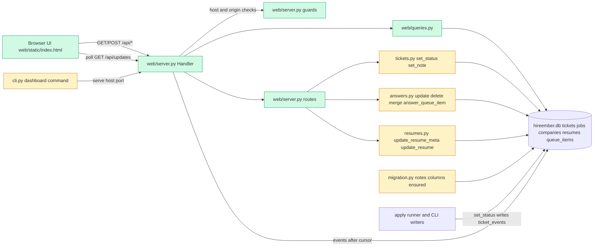

# Tech spec — Local web dashboard with ticket board, blocked queue, answer editing and CSV export

## Approach
Add a new package `src/hireember/web/` with a standard-library HTTP server (`http.server.ThreadingHTTPServer`), so no new dependency is needed (the venv has no web framework and `gate_server.py` already sets the precedent of a dependency-free stdlib server). The server exposes a small JSON API plus one static single-page UI (`web/static/index.html`, vanilla JS, no build step). All reads and writes go through the existing data layer: `tickets.set_status` for status changes, `answers.answer_queue_item` for inline queue answers, `resumes.update_resume` for file replacement. Missing capabilities are added to the data modules in the same style as the existing code (plain functions taking `conn`, module-level error classes): `tickets.set_note`, `answers.update_answer/delete_answer/merge_answers`, `resumes.update_resume_meta`. The board and list are rendered client-side from the one `/api/tickets` response, so they cannot disagree (AC-9). Live updates use polling of `/api/updates` (every 2 s, well inside the 5 s limit), driven by `ticket_events.id`, which `set_status` always writes. Connections are opened per request through `database.get_connection` and closed afterwards (thread-per-request server).

Findings that differ from earlier docs:
- `hireember dashboard` already exists (`cli.py`, opens the static HTML from `view.py`) and is listed in frozen/existing tests (`COMMANDS` set in the CLI acceptance test, README test). The command name stays; its behaviour changes to start the web server. `view.generate_dashboard` and the Rich view stay untouched (only the CLI binding changes). The README line "Open HTML results dashboard" is reworded.
- `tickets.notes` and `tickets.referral_note` columns already exist in `migration._SCHEMA`. No data migration is needed; for safety against databases created before those columns, `migration._PHASE3_COLUMNS["tickets"]` gains `("notes", "TEXT")` and `("referral_note", "TEXT")`, which `ensure_phase3_schema` adds only when missing (idempotent).
- Stored link fields: `tickets.tailored_resume_path`, `cover_letter_path` (started), `session_link` (applying), `confirmation_link` (applied), `queue_items.page_link` and `tickets.resume_link` (blocked), job URL from `jobs.url` (pending, skipped, closed).

## Architecture

## Interface contract

### Python: `hireember.web.server`
- `class HostRefusedError(ValueError)`: message exactly `Refusing to bind to <host>. The dashboard is local only and binds to 127.0.0.1.`
- `DEFAULT_HOST = "127.0.0.1"`, `DEFAULT_PORT = 8765`.
- `create_server(host: str = "127.0.0.1", port: int = 8765, db_path: str | Path | None = None) -> http.server.ThreadingHTTPServer`: raises `HostRefusedError` for any host other than the exact string `127.0.0.1` (including `0.0.0.0`, `localhost`, `::1`) before any socket is created. `port=0` picks a free port; read it from `server.server_address[1]`. `db_path=None` uses `config.DB_PATH` (so `HIREEMBER_DIR` isolates tests). Tests run it with `threading.Thread(target=server.serve_forever)` and call `server.shutdown()`; `server.server_close()` releases the socket.
- `serve(host: str = "127.0.0.1", port: int = 8765, open_browser: bool = False) -> None`: prints `HireEmber dashboard running at http://127.0.0.1:<port> (local only). Press Ctrl+C to stop.`, blocks until Ctrl+C.

### Python: `hireember.web.queries` (all take `conn: sqlite3.Connection`)
- `NO_LINK = "No link available"`.
- `@dataclass TicketFilters(company: str = "", score_min: int | None = None, score_max: int | None = None, date_from: str | None = None, date_to: str | None = None, resume_id: int | None = None)`. Dates are `YYYY-MM-DD`. Company is a case-insensitive substring of the company name (`companies.name`, else `jobs.site`). Date field is the applied date when the ticket is applied, else the created date. A set score filter excludes unscored tickets. Invalid values (score outside 0-100, from after to) raise `FilterError(ValueError)` with messages `Enter a whole number from 0 to 100.` / `From date must be on or before To date.`
- `SORT_COLUMNS = ("company", "title", "location", "status", "score", "resume", "applied", "updated")`; default sort `updated` descending.
- `list_tickets(conn, filters: TicketFilters | None = None, sort: str = "updated", direction: str = "desc") -> list[dict]`: each dict has keys `id, company, title, location, status, status_reason, score, resume_id, resume_name, applied_date (YYYY-MM-DD or None), created_at, updated_at, notes, referral_note, job_url, link` where `link` is `None` or `{"label": str, "url": str, "local": bool}`. Unknown sort/direction raises `ValueError`.
- `status_link(ticket: dict) -> dict | None`: link per status. pending: label `Job posting`, job URL. started: `Tailored files`, `tailored_resume_path` (local true). applying: `Live browser session`, `session_link`. blocked for human: `Page needing action`, latest unresolved `queue_items.page_link` else `resume_link`. applied: `Confirmation`, `confirmation_link`. skipped, closed: `Job posting`, job URL. Empty or missing value gives `None`. `local` is true when the value is not an `http(s)://` URL.
- `status_counts(tickets: list[dict]) -> dict[str, int]` (keys: every entry of `tickets.ALLOWED_STATUSES`, zero filled).
- `next_step(kind: str | None) -> str`: `account needed` -> `Create an account`; `captcha`/`CAPTCHA` -> `Solve the CAPTCHA`; `unknown question`, `conflicting answers`, `sensitive question` -> `Answer the question`; `identity check`, `video or biometric`, `manual site`/`manual ATS` -> `Review and complete this step yourself`; any sign-in reason (contains `sign in`/`login`) -> `Sign in`; everything else (`review before submit`, `outcome unknown`, `duplicate`, unknown) -> `Review`. Matching is case-insensitive.
- `blocked_queue(conn) -> list[dict]`: every ticket with status `blocked for human` (unaffected by filters), keys `ticket_id, company, title, reason, next_step, link, queue_item_id (open queue item id or None), question (text or None), kind`. `reason` is the open queue item's `reason`, else the ticket's `status_reason`, never empty (falls back to `Needs your attention`).
- `tickets_csv(conn, filters=None, sort="updated", direction="desc") -> str`: header exactly `company,title,location,status,score,resume used,applied date,links,notes`; one row per ticket of `list_tickets` with the same arguments, in the same order; RFC 4180 quoting (`csv` module, `\r\n` terminators); applied date `YYYY-MM-DD` or empty; links is the status link url (empty if none); notes is `notes` then, if present, a newline and `Referral: <referral_note>`; cells starting with `=`, `+`, `-`, `@` get a leading `'`. Returns text without BOM (the HTTP layer adds the BOM).

### Python: data-layer additions
- `hireember.tickets.set_note(conn, ticket_id: int, text: str, *, kind: str = "note", actor: str = "user") -> None`: `kind` is `"note"` (column `notes`) or `"referral note"` (column `referral_note`); other kinds raise `ValueError`. Raises `TicketNotFoundError` for a missing ticket, `NoteTooLongError(TicketError)` with message `Note is too long (max 10,000 characters).` above 10,000 characters. Saves the text (empty string clears it), keeps the status, and writes exactly one `ticket_events` row: status = current status, actor, reason = `kind` (`note` / `referral note`). Does not change `updated_at`.
- `hireember.answers.update_answer(conn, answer_id: int, question: str, answer: str) -> None`: updates question text, normalized key and answer; `AnswerError(ValueError)` `Answer cannot be empty.` for a blank answer, `Answer {id} not found.` if missing; `SensitiveQuestionError` for a sensitive question; keeps `source`, sets nothing else.
- `hireember.answers.delete_answer(conn, answer_id: int) -> None`: removes the row; `AnswerError` if missing. Queue items and tickets are untouched.
- `hireember.answers.merge_answers(conn, keep_id: int, remove_id: int, *, question: str | None = None, answer: str | None = None) -> int`: updates the kept entry with the chosen question/answer (defaults: the kept entry's own), deletes `remove_id`, adds `times_used`, keeps the later `last_used_at`, returns `keep_id`. One transaction (nothing changes on failure). `AnswerError` if ids are equal or missing; same validation as `update_answer`.
- `hireember.resumes.update_resume_meta(conn, resume_id: int, name: str | None = None, tags: str | None = None) -> None`: `ResumeError("Name cannot be empty.")` for blank name, `ResumeError('A resume named "<name>" already exists.')` on case-insensitive duplicate (other id), tags normalized with `_normalize_tags`. Existing `resumes.update_resume(conn, resume_id, file, text_file=None)` is reused unchanged for file replacement.
- Existing `tickets.set_status(conn, id, status, actor="user", reason=..., override_reason=...)` and `answers.answer_queue_item(conn, item_id, answer)` are used as is.

### CLI
- `hireember dashboard [--host TEXT] [--port INT] [--open]`: help text `Open the local web dashboard.` (both the `@app.command()` docstring and any listing). `--host` default `127.0.0.1`, `--port` default `8765`. Any host other than `127.0.0.1`: stderr/stdout contains `Refusing to bind to <host>. The dashboard is local only and binds to 127.0.0.1.`, exit code 2, nothing listens. Port in use: `Port <n> is already in use. Choose another with --port.`, exit code 1. Start message as in `serve`. `hireember --help` lists `dashboard`. The set of command names in `hireember --help` stays `init, run, apply, status, dashboard, doctor, answers, queue, resume, company, models, ticket`.

### HTTP (JSON unless noted; errors are `{"error": "<message>", "code": "<slug>"}`)
- Every request: `Host` must be `127.0.0.1:<port>` or `localhost:<port>` else 403; for POST/PUT/DELETE an `Origin` header, when present, must be `http://127.0.0.1:<port>` or `http://localhost:<port>` else 403. Database busy -> 503 `Database is busy. Try again.`
- `GET /` -> `text/html` page (title contains `HireEmber`; tabs `Tickets`, `Blocked`, `Answers`, `Resumes`).
- `GET /api/tickets?company=&score_min=&score_max=&date_from=&date_to=&resume_id=&sort=&dir=` -> 200 `{"tickets": [...as list_tickets...], "counts": {status: n}, "total": n, "blocked_count": n}`; 400 `{"error": "Enter a whole number from 0 to 100."}` etc. for bad filters/sort.
- `GET /api/tickets/{id}` -> 200 ticket dict (as above plus all columns) with `"history": [{id, status, actor, reason, link, link_kind, time}...]` newest first; `"blocked": {reason, next_step, question, queue_item_id} | null`; 404 `Ticket {id} not found.`
- `POST /api/tickets/{id}/status` body `{"status": str, "reason": str = "", "override_reason": str | null}` -> 200 `{"changed": bool, "status": str, "message": "Status changed to <status>." | "Ticket is already <status>."}`; 400 invalid status (`InvalidStatusError` text); 409 `code: "duplicate"` with `DuplicateTicketError` text and `duplicate_of`; 400 `code: "override_reason"` with `An override needs a reason.`; 404 missing. Writes via `tickets.set_status(..., actor="user")`.
- `POST /api/tickets/{id}/note` and `POST /api/tickets/{id}/referral-note` body `{"text": str}` -> 200 `{"ok": true}`; 400 `Note is too long (max 10,000 characters).`; 404 missing. Each writes one `ticket_events` row with actor `user`.
- `GET /api/blocked` -> `{"count": n, "items": [blocked_queue entries]}`.
- `POST /api/queue/{item_id}/answer` body `{"answer": str}` -> 200 `{"saved": bool, "message": str}` via `answers.answer_queue_item`; 400 with the `QueueError` text.
- `GET /api/updates?after=<event id>` -> `{"cursor": <max ticket_events.id>, "changes": [{"ticket_id": n, "status": str, "time": str}]}` with one entry (the latest event) per ticket for events with id > `after`; omitting `after` returns the current cursor and no changes.
- `GET /api/export.csv?<same filters and sort as /api/tickets>` -> 200 `text/csv; charset=utf-8`, body starts with UTF-8 BOM, `Content-Disposition: attachment; filename="hireember-tickets-YYYY-MM-DD.csv"`; bad filters 400.
- `GET /api/answers` -> `{"answers": [{id, question, answer, source, last_used_at, times_used}]}`.
- `PUT /api/answers/{id}` body `{"question": str, "answer": str}` -> `{"ok": true, "message": "Answer saved."}`; 400 `Answer cannot be empty.` / sensitive text; 404.
- `POST /api/answers/merge` body `{"keep_id": n, "remove_id": n, "question": str|null, "answer": str|null}` -> `{"ok": true}`; 400 on equal or missing ids.
- `DELETE /api/answers/{id}` -> `{"ok": true}`; 404.
- `GET /api/resumes` -> `{"resumes": [{id, name, tags: [str], pinned, file_name}]}`.
- `PUT /api/resumes/{id}` body `{"name": str, "tags": str}` -> `{"ok": true, "message": "Resume saved."}`; 400 `Name cannot be empty.`
- `POST /api/resumes/{id}/file` raw request body is the file, header `X-Filename: resume.pdf` (`.pdf` or `.txt` only), optional `X-Text-Filename` not supported -> `{"ok": true, "message": "Resume file replaced."}`; 400 with the `ResumeError` text (`Unsupported format. Provide a .txt or .pdf file.`).

### UI (static page, queried by accessible text)
Tabs (role `tab`): `Tickets`, `Blocked (N)`, `Answers`, `Resumes`. Tickets tab: toggle buttons `Board` / `List`, filter inputs labelled `Company`, `Min score`, `Max score`, `From`, `To`, select `Resume` (option `Any`), buttons `Clear filters`, `Export CSV` (link to `/api/export.csv` with the current filters). Board column headers `<status> (<count>)`; empty column `No tickets`. Detail panel: select `Status`, input `Reason`, button `Change status`, textareas `Notes` and `Referral note`, buttons `Save note` and `Save referral note`, input `Override reason`. Empty/err texts exactly as in product-spec.md. Live indicator text `Live` / `Reconnecting...`. Filter state is mirrored into the URL query string.

## Data and state changes
- No new tables. `tickets.notes` and `tickets.referral_note` already exist; `migration._PHASE3_COLUMNS["tickets"]` adds them if missing (additive, idempotent, run by `create_schema`).
- No new env vars or config. The dashboard uses `HIREEMBER_DIR` through `config.DB_PATH`.
- Packaging: `src/hireember/web/static/index.html` is included in the wheel via the `packages = ["src/hireember"]` setting (hatch includes non-Python files in package directories).
- Optional index for performance: `CREATE INDEX IF NOT EXISTS idx_tickets_job_url ...` is not needed (`job_url` is UNIQUE); add `CREATE INDEX IF NOT EXISTS idx_tickets_updated ON tickets(updated_at)` to `migration._SCHEMA`.

## Tasks
1. **Ticket notes and referral notes** — `src/hireember/tickets.py` (modified): add `NoteTooLongError`, `set_note`; `src/hireember/migration.py` (modified): add `notes`/`referral_note` to `_PHASE3_COLUMNS["tickets"]` and the `idx_tickets_updated` index; `tests/unit/test_tickets_notes.py` (new).
2. **Answer edit, delete, merge** — `src/hireember/answers.py` (modified): `AnswerError`, `update_answer`, `delete_answer`, `merge_answers` (one transaction; rollback on error); `tests/unit/test_answers_edit.py` (new).
3. **Resume metadata update** — `src/hireember/resumes.py` (modified): `update_resume_meta`; `tests/unit/test_resumes_meta.py` (new).
4. **Dashboard queries** — `src/hireember/web/__init__.py` (new, empty docstring), `src/hireember/web/queries.py` (new): `TicketFilters`, `FilterError`, `status_link`, `list_tickets` (single SQL with `LEFT JOIN jobs/companies/resumes`, whitelist sort mapping, applied date from `submitted_at` or latest `applied` event), `status_counts`, `next_step`, `blocked_queue`, `tickets_csv`; `tests/unit/test_web_queries.py` (new) including a 5,000-ticket timing check.
5. **HTTP server, guards and read-only API** — `src/hireember/web/server.py` (new): `HostRefusedError`, `create_server`, `serve`, request handler with Host/Origin checks, per-request DB connection (`database.get_connection`, closed in `finally`; `sqlite3.OperationalError: database is locked` -> 503), JSON helpers, routes `GET /`, `/api/tickets`, `/api/tickets/{id}`, `/api/blocked`, `/api/export.csv`, `/api/answers`, `/api/resumes`; `src/hireember/web/static/index.html` (new, minimal placeholder page with title and tabs); `tests/unit/test_web_server.py` (new).
6. **Mutating API and updates endpoint** — `src/hireember/web/server.py` (modified): `POST /api/tickets/{id}/status|note|referral-note`, `POST /api/queue/{id}/answer`, `GET /api/updates`, `PUT/DELETE /api/answers`, `POST /api/answers/merge`, `PUT /api/resumes/{id}`, `POST /api/resumes/{id}/file` (body written to a temp file named from `X-Filename`, passed to `resumes.update_resume`, then deleted); error mapping for `DuplicateTicketError` (409), `OverrideReasonError`, `InvalidStatusError`, `TicketNotFoundError` (404), `QueueError`, `AnswerError`, `ResumeError`, `SensitiveQuestionError` (400); body size cap (10 MB); `tests/unit/test_web_api_write.py` (new).
7. **Dashboard UI** — `src/hireember/web/static/index.html` (modified): full vanilla-JS single page. Fetches `/api/tickets` with filters from the URL query string, renders board and list from the same array, column header counts, sortable list headers with arrows, detail panel with history and controls, Blocked tab with inline answer box, Answers tab (edit, merge with choice of text, delete with confirmations), Resumes tab (edit, replace file), 2 s polling of `/api/updates` with `Live`/`Reconnecting...` indicator that skips overwriting a focused or dirty textarea, all user text inserted with `textContent` (never `innerHTML`), loading and error states, toasts. Add a unit test `tests/unit/test_web_static.py` (new) that fetches `/` and asserts required strings and that `innerHTML` is not used with data.
8. **CLI command, docs and listings** — `src/hireember/cli.py` (modified): replace the body of `dashboard` with `--host/--port/--open` options calling `hireember.web.server.serve` (catch `HostRefusedError` -> message + `typer.Exit(2)`; `OSError` EADDRINUSE -> port message + `typer.Exit(1)`); change docstring to `Open the local web dashboard.`; run `_bootstrap()` first. `README.md` (modified): reword the `hireember dashboard` line and add a short section; `CHANGELOG.md` (modified); `src/hireember/config.py` line 290 list needs no change (name unchanged) but verify `doctor.py` output and any help listings that mention `dashboard`; update existing tests only if they assert the old description; `tests/unit/test_cli_dashboard.py` (new).

## Implementation tests
- `test_tickets_notes.py`: note and referral note save, one event each with actor `user` and reason `note` / `referral note`, status unchanged, 10,001 chars rejected with no event, clearing, missing ticket.
- `test_answers_edit.py`: update, blank answer rejected, sensitive rejected, merge keeps chosen text and sums `times_used`, merge same id rejected, failed merge changes nothing, delete leaves queue items intact.
- `test_resumes_meta.py`: rename, tags normalization, blank name, duplicate name.
- `test_web_queries.py`: one ticket per status gives the right label/URL or `None`; filters (company substring, score range excludes unscored, date, resume) and counts equal row count; sorts on every column; blocked queue next-step mapping; CSV header, round-trip through `csv.reader` with commas, quotes, newlines, formula guard; 5,000 seeded tickets list under 2 s for each sort and with filters; CSV under 5 s.
- `test_web_server.py` (real server on port 0 with `HIREEMBER_DIR` tmp): `create_server("0.0.0.0")`, `"localhost"`, `"::1"` raise `HostRefusedError`; bad Host header -> 403; cross-origin POST -> 403; each GET route returns expected shape; `/api/export.csv` BOM and filename.
- `test_web_api_write.py`: status change writes event with actor `user` and goes through duplicate rules (409, override with and without reason); same-status no event; `/api/updates` returns the change after `tickets.set_status` from outside the server; answers/resumes mutations visible on a second GET; resume file replacement with `.txt` and unsupported extension.
- `test_cli_dashboard.py`: `--host 0.0.0.0` exit code 2 and message, `--help` shows `Open the local web dashboard.`.

## Risks and rollout
- Behaviour change: `hireember dashboard` no longer writes/opens the static HTML (the function `view.open_dashboard` remains for other callers). Flagged for the human below.
- SQLite contention with a running apply job: WAL plus the existing `busy_timeout=10000` is used; the server maps lock errors to 503.
- Thread-per-request with thread-local cached connections would leak connections; handlers must call `close_connection` in `finally`.
- Local file links are shown as path text with a `Copy path` button (browsers do not open `file://` from http pages); the server does not serve files from the data directory.
- DNS-rebinding and CSRF are covered by Host and Origin checks; no authentication by design.
- Order of tasks keeps every commit green; only task 8 changes user-visible CLI behaviour.

## Open questions
- Reusing the name `dashboard` replaces the existing static-HTML command; is that acceptable, or should the old behaviour move to a flag (for example `hireember dashboard --static`)? The tech spec assumes replacement per the product spec.
- The answers record said to add a notes column with a migration, but `notes` and `referral_note` already exist on `tickets`; this spec only adds a defensive ensure-column. Confirm that is fine.
- Product spec open questions about local-file links (path text with Copy path), default port 8765, date-filter field (applied date else created date) and merge choice (user chooses) are taken as specified.
