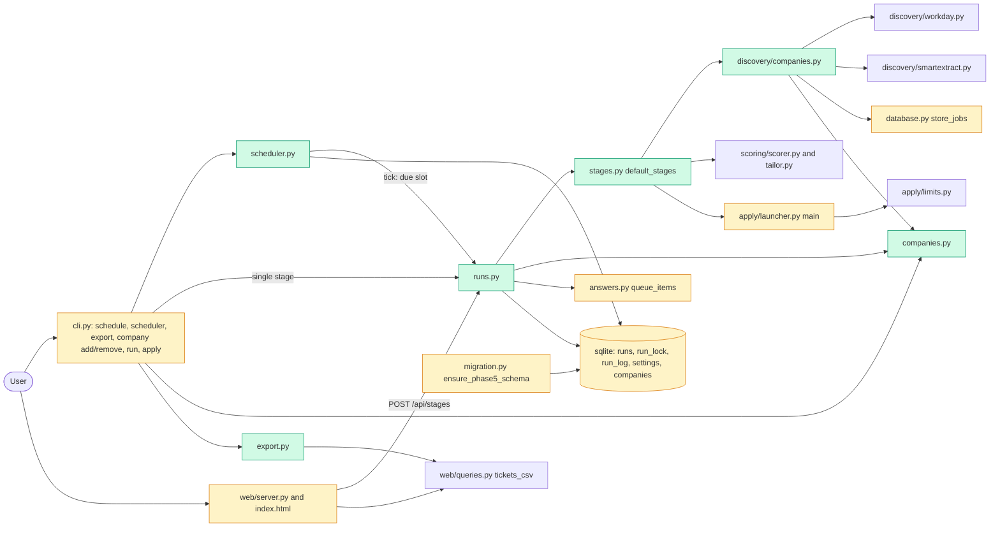

# Tech spec — Add scheduled runs, run summaries and a user-maintained company list

## Approach
Everything runs on the existing SQLite database and the existing stage code; no new dependency.

- **Run model** (`src/hireember/runs.py`, new). One `execute_run` function drives enrich, discover, score and tailor (plus apply only when asked) through an injected `Stages` bundle. It writes exactly one `runs` row, and a single-run lock lives in the DB so the scheduler, CLI and dashboard exclude each other across processes and threads. The `runs` table already exists in `migration.py` with `kind, started_at, ended_at, summary`; it is extended additively, in the same way as `ensure_phase3_schema`.
- **Scheduler mechanism: a built-in loop, not an OS scheduler.** `hireember scheduler` is a small foreground process that calls `scheduler.tick` every 30 seconds (`--once` does one tick and exits, so a user can also drive it from cron or launchd). An OS integration (cron, launchd, schtasks) would be three platform paths we cannot test; the built-in loop is testable with an injected clock. Catch-up is free: the first tick after start sees any slot between `schedule_last_slot` and now and fires one run. The `schedule` confirmation and the README say that runs fire only while `hireember scheduler` is running (start it at login).
- **Company list.** The existing `companies` table already has `careers_url`, `ats_type` and `active`, so no schema change. New `src/hireember/companies.py` holds add and remove; removal is soft (`active = 0`) so tickets that join to the company keep their name. `src/hireember/discovery/companies.py` (new) searches exactly the active companies that have a URL and an ATS type, through two adapters over the existing code: `workday` (`discovery/workday.py`) and `careers-page` (`discovery/smartextract.py`). Storage reuses `database.store_jobs`, which already upserts by URL and refreshes `last_seen_at`; it only gains an optional `now` argument for the test clock.
- **Dashboard.** The server follows the existing pattern in `web/server.py` and `web/queries.py` (JSON API plus one static page). `GET /` must stay byte-identical to `static/index.html` (an existing test asserts it), so the runs summary is a server-rendered HTML page at `GET /runs`, and the new Runs tab in `index.html` loads `GET /runs?fragment=1`.
- **Blocked tickets to the queue.** `gating._block` and `tailor_ticket` block tickets without a queue item. `runs.enqueue_blocked` creates one open `queue_items` row per blocked ticket that has none (company via the existing `list_queue` join, reason, page link), so re-runs never duplicate.
- **Scheduled applying** reuses `apply/limits.py` (`tickets.submitted_at` per UTC day) and the existing `acquire_job` eligibility. The scheduled per-day limit is a new setting `schedule_apply_limit` (default 25, equal to `limits.DEFAULT_MAX_PER_DAY`); `limits.check_limits` still enforces `max_per_day` on top.

Patterns followed: `cli.py` sub-Typer groups with lazy imports and `_bootstrap()`; `tickets.get_setting/set_setting`; `migration.ensure_phase3_schema`; `answers.queue_question`/`list_queue`; `web/queries.py` CSV helpers; `tests/acceptance/p4_helpers.py` for server tests.

## Architecture

## Interface contract

All paths are under `src/hireember/`. "conn" is a `sqlite3.Connection` from `hireember.database.get_connection()` / `init_db()`. Timestamps stored in the DB are ISO-8601 UTC strings, as elsewhere.

### `hireember.runs`
- `class RunInProgressError(Exception)`: `str(e) == "A run is already in progress."`.
- `@dataclass Stages`: fields `discover`, `enrich`, `score`, `tailor`, `apply`, all required callables.
  - `discover(conn, run_id: int) -> dict` with keys `found: int`, `new: int`.
  - `enrich(conn, run_id: int) -> dict` (result ignored).
  - `score(conn, run_id: int) -> dict` with keys `scored: int`, `skipped: int`.
  - `tailor(conn, run_id: int) -> dict` with keys `created: int`, `blocked: int`.
  - `apply(conn, run_id: int, limit: int) -> dict` with key `submitted: int`.
  - A missing key counts as 0.
- `@dataclass RunSummary`: `id: int`, `kind: str` (`"full"`), `trigger: str` (`"scheduled"` or `"manual"`), `status: str` (`"running"`, `"completed"`, `"partial"` when a stage raised, `"interrupted"`), `started_at: str`, `ended_at: str | None`, `found: int`, `scored: int`, `skipped: int`, `tickets_created: int`, `tickets_blocked: int`.
- `execute_run(trigger: str = "manual", *, stages: Stages | None = None, apply: bool = False, apply_limit: int | None = None, conn=None, now: datetime | None = None) -> RunSummary`
  - Takes the run lock; if held by a live process, raises `RunInProgressError` and writes no row.
  - Inserts one `runs` row (`status="running"`), then calls `discover`, `enrich`, `score`, `tailor` in that order. Calls `apply(conn, run_id, limit)` only if `apply` is true and `limit > 0`; `limit = apply_limit` if given, otherwise 25. When `apply` is false, `stages.apply` is never called.
  - A stage that raises is logged to the run log with `source` = the stage name, the run continues with the next stage, and the final status is `"partial"`.
  - Counts: `found` = `discover["found"]`; `scored`, `skipped` = `score[...]`; `tickets_created` = number of `tickets` rows with `created_at >= started_at`; `tickets_blocked` = number of queue items added by `enqueue_blocked` at the end of this run. Finishes the same row (`ended_at`, status, counts), releases the lock in `finally`, and returns the summary.
  - `now` is the run's start time (default: current UTC time).
- `run_stage(stage: str, *, stages: Stages | None = None, conn=None, limit: int | None = None, min_score: int | None = None, validation_mode: str = "normal") -> StageResult`
  - `stage` in `("discover", "score", "tailor", "apply")`, else `ValueError`.
  - Takes the same lock (raises `RunInProgressError`), calls only that stage callable, writes **no** `runs` row, calls `enqueue_blocked` after score, tailor and apply, and stores the result (JSON) in setting `last_stage_result`.
  - `StageResult(stage: str, message: str, counts: dict)`; `message` is exactly one of `"discover: {found} roles found, {new} new."`, `"score: {scored} scored, {skipped} skipped."`, `"tailor: {created} tickets created, {blocked} blocked."`, `"apply: {submitted} submitted."`. `limit` is passed to apply (default 1).
- `start_stage_async(stage: str, *, stages=None, limit=None, min_score=None) -> threading.Thread`: acquires the lock synchronously (raises `RunInProgressError`), then runs the stage in a daemon thread that owns the lock.
- `enqueue_blocked(conn) -> int`: for each ticket with status `"blocked for human"` that has no open queue item (`resolved_at IS NULL`), inserts a `queue_items` row (`ticket_id`, `kind="run blocked"`, `reason` = ticket `status_reason` or `"Needs your attention"`, `page_link` = job `application_url`, else job `url`); returns the number inserted. `answers.list_queue` then shows company, reason and page link, all non-empty.
- `log_event(conn, run_id: int | None, source: str, message: str, level: str = "error") -> None`; `get_run_log(conn, run_id: int) -> list[dict]` with keys `time, source, level, message`, oldest first.
- `list_runs(conn, limit: int = 50) -> list[RunSummary]`, newest first. `get_run(conn, run_id) -> RunSummary | None`.
- `is_pid_alive(pid: int) -> bool` (module-level, patchable). A lock whose pid is not alive, or older than 24 hours, is stale: it is reclaimed and any `runs` row still `"running"` is set to `"interrupted"`.

### `hireember.companies`
- `ATS_TYPES = ("workday", "careers-page")`.
- Errors (all subclass `TicketError` from `hireember.tickets`): `CompanyExistsError(name)`, `CompanyMissingError(name)`, `UnknownAtsError(value)` (message `Unknown ATS type "<x>". Valid types: workday, careers-page.`).
- `add_company(conn, name: str, careers_url: str, ats_type: str) -> int`: duplicate name (case-insensitive, among active companies) raises `CompanyExistsError`; an inactive row of that name is reactivated with the new URL/type. Returns the company id.
- `remove_company(conn, name: str) -> None`: sets `active = 0`; unknown or already removed raises `CompanyMissingError`.
- `search_list(conn) -> list[dict]`: active companies with non-empty `careers_url` and `ats_type`; keys `id, name, careers_url, ats_type`.
- `tickets.list_companies(conn)` (modified, additive): returns only active companies; each dict also has `careers_url` and `ats_type` (`""` when unset).

### `hireember.discovery.companies`
- `discover_companies(conn, *, adapters: dict[str, Callable[[dict], list[dict]]] | None = None, run_id: int | None = None, now: datetime | None = None) -> dict`
  - Iterates `companies.search_list(conn)`. For each, calls `adapters[ats_type](company)` where `company` has keys `id, name, careers_url, ats_type`; the adapter returns role dicts with keys `title, url`, and optionally `location, salary, description`. Default adapters: `{"workday": ..., "careers-page": ...}`.
  - Stores roles with `database.store_jobs(conn, roles, site=<company name>, strategy=<ats_type>, now=...)` after setting `company` = company name on each role. The role's source is the company name; date found is `jobs.discovered_at`, kept on re-discovery; `jobs.last_seen_at` is refreshed.
  - An adapter that raises (or a `careers-page` result whose status is not PASS/PARTIAL/FAIL) is logged with `runs.log_event(conn, run_id, source=<company name>, message=<error text>)`, and the loop continues.
  - Returns `{"found": int, "new": int, "existing": int, "companies": int, "failures": [{"source": str, "error": str}], "message": str}`. With an empty list: `found == 0` and `message == "No companies to search. Add one with `hireember company add`."`.
- `hireember.database.store_jobs(conn, jobs, site, strategy, now: str | None = None)` gains the optional `now` (ISO string); behaviour is unchanged when omitted.

### `hireember.scheduler`
- `class ScheduleError(ValueError)`: the message is exactly `Invalid time "<value>". Use 24-hour HH:MM, e.g. 08:00.`
- `parse_time(value: str) -> str`: returns zero-padded `"HH:MM"` for `00:00`..`23:59`; else raises `ScheduleError`.
- `@dataclass Schedule`: `times: list[str]` (sorted, duplicates collapsed), `apply: bool`, `apply_limit: int`.
- `get_schedule(conn) -> Schedule`; `set_schedule(conn, times: list[str], now: datetime | None = None) -> Schedule` (validates all before changing anything, replaces the old schedule, sets `schedule_last_slot` = `now`, so slots earlier than now are not fired); `clear_schedule(conn) -> None`; `set_apply(conn, on: bool | None = None, limit: int | None = None) -> Schedule` (`limit < 1` raises `ValueError`).
- `due_slot(conn, now: datetime) -> datetime | None`: the latest slot `s` with `schedule_last_slot < s <= now`, with slots being each configured `HH:MM` on each calendar day (in `now.tzinfo`) from the last-slot day to the `now` day; `None` if none or no schedule.
- `tick(conn=None, now: datetime | None = None, *, stages: Stages | None = None) -> RunSummary | None`: if `due_slot` is not `None`, stores it as `schedule_last_slot` (so the slot is consumed even when the run is rejected), then calls `runs.execute_run("scheduled", stages=stages, apply=schedule.apply, apply_limit=remaining, now=now)` and returns the summary. `remaining = max(0, schedule.apply_limit - tickets with submitted_at on the UTC day of now)`. Several missed slots start exactly one run. `RunInProgressError` is caught: logged, returns `None`, no row. `now` defaults to `datetime.now().astimezone()`.
- `serve(poll_seconds: float = 30, once: bool = False, stop: threading.Event | None = None, clock: Callable[[], datetime] | None = None, stages: Stages | None = None) -> None`: loops `tick` until `stop` is set; `once=True` ticks once and returns.

### `hireember.export`
- `export_csv(conn, out_dir: str | Path) -> list[tuple[Path, int]]`: writes `tickets.csv` (same header and rows as `web.queries.tickets_csv`) and `runs.csv` (header `id,kind,trigger,status,started_at,ended_at,found,scored,skipped,tickets_created,tickets_blocked`, one row per run, oldest first); the header is written even with zero rows; existing files are overwritten; returns `(path, row_count)` for each. If `out_dir` is missing, not a directory or not writable, raises `ExportError(message)` and writes nothing.

### CLI (`hireember ...`, Typer app `hireember.cli.app`)
- `schedule [--at HH:MM]... [--off] [--apply on|off] [--apply-limit N]`
  - `--at 08:00` (repeatable) prints `Schedule set: daily at 08:00.` (several: `daily at 08:00, 18:30.`) plus a line saying the schedule fires only while `hireember scheduler` is running and that a run missed while it was not running starts once at the next start. Exit 0.
  - Invalid time prints `Invalid time "25:00". Use 24-hour HH:MM, e.g. 08:00.` and exits 1; the schedule is unchanged.
  - `--off` prints `Schedule cleared.`.
  - No options prints `Scheduled daily at 08:00, 18:30.` or `No schedule set.`, then `Scheduled applying: off.` or `Scheduled applying: on (up to N per day).`.
  - `--apply on|off` / `--apply-limit N` update those settings (a bad value exits 1) and print the same applying line. Default is off, limit 25.
- `scheduler [--once] [--poll-seconds N]`: runs `scheduler.serve`; `--once` ticks once and exits 0.
- `company add "<name>" --url <careers-url> --ats <type>` prints `Added company "<name>".`; a duplicate prints `Company "<name>" already exists.` exit 1; an unknown type prints `Unknown ATS type "<x>". Valid types: workday, careers-page.` exit 1.
- `company remove "<name>"` prints `Removed company "<name>".`; an unknown name prints `Company "<name>" not found.` exit 1.
- `company list` columns `Id, Name, Careers URL, ATS, Manual-only`; empty prints `No companies yet.`.
- `run discover|score|tailor` (exactly one of these three stage names, no `--dry-run`, no `--stream`) runs only that stage via `runs.run_stage` and prints its result message line. A busy lock prints `A run is already in progress.` exit 1. Any other stage combination uses the existing pipeline path unchanged.
- `apply` (full apply mode) prints `apply: N submitted.` after the launcher returns, and takes the same lock (busy: `A run is already in progress.`, exit 1). The utility modes (`--mark-applied`, `--mark-failed`, `--reset-failed`, `--gen`) do not take the lock.
- `export [--out DIR]` prints one `Wrote <path> (N rows).` per file (`tickets.csv`, then `runs.csv`); on `ExportError` prints the reason and exits 1.
- `--help` exits 0 for `init, run, apply, status, dashboard, doctor, schedule, scheduler, export, answers, queue, company`, on a fresh install (no profile, no DB).

### HTTP (dashboard, `hireember.web.server.create_server(host, port, db_path=None, stages=None)`; `stages` is an optional `runs.Stages` injected for tests)
- `GET /` unchanged (byte-identical to `static/index.html`).
- `GET /runs` returns `200 text/html`, a full page containing a heading `Runs`; one table row per run, newest first, with start time, trigger, status and the five counts as plain integers in cells; with no runs it contains `No runs yet.`. `GET /runs?fragment=1` returns the same section without `<html>` wrapper. All values are HTML-escaped.
- `GET /api/runs` returns `{"runs": [{"id", "kind", "trigger", "status", "started_at", "ended_at", "found", "scored", "skipped", "tickets_created", "tickets_blocked"}]}`, newest first.
- `POST /api/stages/<discover|score|tailor|apply>` (JSON body optional `{"limit": int}`) returns `202 {"started": true, "stage": "<s>"}`. If the lock is held it returns `409 {"error": "A run is already in progress.", "code": "run_in_progress"}`. An unknown stage returns `404 {"code": "not_found"}`.
- `GET /api/stages/status` returns `{"running": bool, "last": {"stage", "message"} | null}`.
- UI: a tab button `Runs` (id `tab-runs`) and four buttons labelled `Run discover`, `Run score`, `Run tailor`, `Run apply`; a 409 shows the inline text `A run is already in progress.`.

## Data and state changes
- `migration.ensure_phase5_schema(conn)` (idempotent, called from `create_schema`; `NEW_TABLES` is not changed):
  - `runs` gains columns `trigger TEXT`, `status TEXT`, `found INTEGER DEFAULT 0`, `scored INTEGER DEFAULT 0`, `skipped INTEGER DEFAULT 0`, `tickets_created INTEGER DEFAULT 0`, `tickets_blocked INTEGER DEFAULT 0`. Existing columns: `kind` = `"full"`, `summary` = short text such as `found 42, scored 30`.
  - New `run_lock(id INTEGER PRIMARY KEY CHECK (id = 1), pid INTEGER, token TEXT, run_id INTEGER, acquired_at TEXT)`: acquisition is an atomic `INSERT`.
  - New `run_log(id INTEGER PRIMARY KEY, run_id INTEGER, time TEXT, source TEXT, level TEXT, message TEXT)` plus an index on `run_id`.
- `settings` keys: `schedule_times` (`"08:00,18:30"`), `schedule_last_slot` (ISO datetime with offset), `schedule_apply` (`"on"`/`"off"`, default off), `schedule_apply_limit` (int, default 25), `last_stage_result` (JSON).
- `companies`: no schema change; `active = 0` means removed.
- `answers.READY_KINDS` gains `"run blocked"`, so `queue ready` can release those tickets.
- `config/employers.yaml` is trimmed to a small example (three Workday employers, plus a header pointing to `hireember company add`). The doctor counts it; zero or few employers is already handled.
- No new env vars.

## Tasks
1. **Run schema** — `src/hireember/migration.py` (modified): add `ensure_phase5_schema` (columns, `run_lock`, `run_log`) and call it from `create_schema`. Add unit test `tests/unit/test_migration_phase5.py` (new): fresh DB, upgraded DB, idempotent.
2. **Run model core** — `src/hireember/runs.py` (new): `Stages`, `RunSummary`, lock acquire/release/stale handling, `execute_run`, `log_event`, `get_run_log`, `list_runs`, `get_run`, `enqueue_blocked`. `src/hireember/answers.py` (modified): add `"run blocked"` to `READY_KINDS`. Tests `tests/unit/test_runs.py` (new). Reason it is a new module: nothing in `pipeline.py` has a lock, a row or injected stages, and `pipeline.run_pipeline` is console-oriented.
3. **Company list** — `src/hireember/companies.py` (new); `src/hireember/tickets.py` (modified: `list_companies` filters active and adds `careers_url`, `ats_type`); `src/hireember/cli.py` (modified: `company add`, `company remove`, new `company list` columns); `src/hireember/config/employers.yaml` (modified: trim to examples). Tests `tests/unit/test_companies.py`, `tests/unit/test_cli_company.py` (new).
4. **Discovery over the company list** — `src/hireember/database.py` (modified: `store_jobs(..., now=None)`); `src/hireember/discovery/companies.py` (new): `discover_companies`, the `workday` adapter (derive `base_url`, `tenant` and `site_id` from `https://<tenant>.wd<N>.myworkdayjobs.com/<site_id>` and reuse `workday.search_employer` and `fetch_details` for the configured queries), the `careers-page` adapter (wraps `smartextract._run_one_site(name, url)` and returns its `jobs`; a status of `LLM_ERROR`, `PARSE_ERROR` or `EXEC_ERROR` raises with its `error`). Tests `tests/unit/test_discovery_companies.py` (new) with fake adapters.
5. **Default stages and single-stage runner** — `src/hireember/stages.py` (new): `default_stages(min_score=None, validation_mode="normal") -> runs.Stages`, with discover = `discover_companies`, enrich = `enrichment.detail.run_enrichment`, score = `scoring.scorer.run_scoring` (`skipped` = location-skipped plus tickets created in the call with status `skipped`), tailor = `scoring.tailor.run_tailoring` (`created` = approved, `blocked` = failed + errors), apply = `apply.launcher.main(limit, headless=True)` returning `{"submitted": n}`. `src/hireember/apply/launcher.py` (modified): `main` returns the applied count (0 on interrupt). `src/hireember/runs.py` (modified): `run_stage`, `start_stage_async`, `StageResult`, `last_stage_result`. Tests `tests/unit/test_run_stage.py` (new).
6. **CLI single stages** — `src/hireember/cli.py` (modified): `run` single-stage path for exactly one of discover, score, tailor (after preflight and tier checks), `apply` full mode wrapped with the lock and the `apply: N submitted.` line, "A run is already in progress." handling. Update the `run` help text in both `typer.Typer`/command help and docstring (per standards). Tests `tests/unit/test_cli_stages.py` (new, mocking `runs.run_stage` and `launcher.main`).
7. **Dashboard runs** — `src/hireember/web/queries.py` (modified: `runs_html(conn, fragment=False)`); `src/hireember/web/server.py` (modified: `GET /runs`, `GET /api/runs`, `POST /api/stages/<s>`, `GET /api/stages/status`, `create_server(..., stages=None)`); `src/hireember/web/static/index.html` (modified: Runs tab and four stage buttons; `GET /` keeps serving the file as is). Tests `tests/unit/test_web_runs.py` (new); update tab list in `tests/unit/test_web_static.py` only if it asserts an exact tab set.
8. **Scheduler and schedule command** — `src/hireember/scheduler.py` (new); `src/hireember/cli.py` (modified: `schedule`, `scheduler`). Tests `tests/unit/test_scheduler.py`, `tests/unit/test_cli_schedule.py` (new) with a fake clock.
9. **Export** — `src/hireember/export.py` (new); `src/hireember/cli.py` (modified: `export`). Reuse `web/queries.tickets_csv` and its formula-injection guard. Tests `tests/unit/test_export.py` (new).
10. **Help on every command and README** — `src/hireember/cli.py` (modified: a `help=` string on each new command and group, and the `Typer(help=...)` text, per standards); `README.md` (modified: a "Scheduled runs" section stating that runs fire only while `hireember scheduler` is running, with `@reboot`/launchd/systemd start-at-login snippets, that a run missed while the machine was asleep or off starts once at the next start, and that scheduled applying is off by default; also replace the "48 Workday employer portals" wording with the company list). Test `tests/unit/test_cli_help.py` (new): `--help` exits 0 for every command on a fresh `HIREEMBER_DIR`.

## Implementation tests
Unit and integration tests added with each task (listed above), using `isolated_db` from `tests/conftest.py`, fake `Stages`, fake adapters and an explicit `now`:
- lock: two threads call `execute_run` at once and yield one row; a lock with a dead pid is reclaimed and the old `running` row becomes `interrupted`.
- `enqueue_blocked` is idempotent; counts match; every item has company, reason and link.
- scheduler: slot at 08:00, a second tick the same day fires nothing, three missed slots fire once, an invalid time leaves the schedule untouched, apply quota subtracts today's submissions.
- `discover_companies`: three companies, then a second pass; a raising adapter is logged and the others are stored; an empty list gives the message.
- CSV header-only export; non-writable directory writes nothing.
- Dashboard `/runs` escaping (a status containing `<b>`), `409` on a held lock.

## Risks and rollout
- `run discover` (one stage) now searches the company list only, not the JobSpy boards, Workday registry and `sites.yaml` crawl that `pipeline._run_discover` runs. Those still run in `hireember run` (all stages) and in any multi-stage call. This follows the product spec ("discovery searches exactly the companies in this list"), but it is a behaviour change worth a reviewer's eye.
- The scheduler only fires while `hireember scheduler` is running. There is no OS-level installer; the README gives snippets.
- `launcher.main` now returns a value; existing callers ignored the old `None`.
- Task 1 must land first: tasks 2 to 9 assume the new tables. Everything is additive, with no destructive migration. Existing `runs` rows (if any) get null trigger/status and show blank in the dashboard.
- The `careers-page` adapter calls an LLM and a headless browser through `smartextract`; a scheduled run with that type needs a configured model. Failure is logged per source and does not stop the run.

## Open questions
- none (decisions taken: the `scheduler` loop instead of an OS scheduler; `GET /runs` instead of changing `GET /`; `schedule_apply_limit` as a separate setting defaulting to 25; the dashboard cannot edit the schedule; the 409 message is shown inline).
