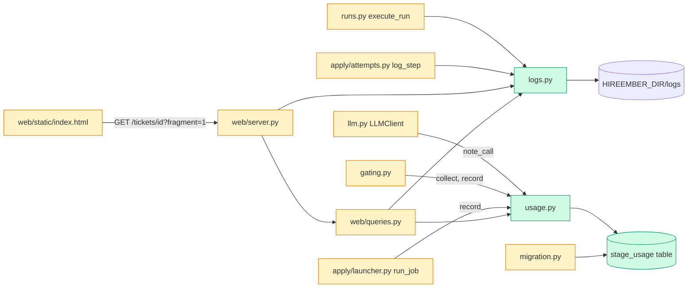

# Tech spec - Release hardening: logs, token totals, key scan, traceability and docs

## Approach
Four small modules plus docs, each following a pattern already in the repo.

- `src/hireember/logs.py` (new) owns log files under `config.LOG_DIR` (already `APP_DIR/logs`, already git-ignored): `logs/runs/run-<id>.log` and `logs/tickets/ticket-<id>-attempt-<n>.log`. It is the single place that builds paths, appends lines, reads logs and prunes. Existing choke points feed it: `runs.log_event` / `runs.execute_run` for run logs, and `apply/attempts.log_step` for attempt logs (the runner already calls `log_step("start")` at the start of every attempt, so the file exists from then, and FR/SAF-5 and SAF-11 entries land in the file for free).
- `src/hireember/usage.py` (new) records per-ticket, per-stage model and tokens in a new `stage_usage` table (created in `migration.py` next to `ensure_phase5_schema`). LLM calls report to a `contextvars` collector from `LLMClient._chat_compat` and `_chat_native_gemini`; `gating.score_job_for_ticket` and `gating.tailor_ticket` wrap their model calls in `usage.collect()` and write the totals once the ticket id is known. Applying reads the `result` event the launcher already parses (`stats` in `apply/launcher.py:run_job`) and records it. A contextvar avoids threading a ticket id through `scorer`, `tailor` and `cover_letter`.
- The dashboard follows the `/runs` pattern: server-rendered HTML in `web/queries.py`, a new route in `web/server.py`, and `index.html` fetching the fragment. The new `GET /tickets/<id>` page (with `?fragment=1`) carries the "Logs" and "Model and tokens" sections; the JSON payload gains `usage` and `logs`.
- Key scan, telemetry scan, traceability completeness and doc-phrase checks are acceptance tests only (written by the test author); the implementer's job is to make the repo satisfy them (docs, table, parked-fixes). Reuse over new abstractions: no new dependency.

The requirements document and `docs/parked-fixes.md` are untracked in the main checkout, so the worktree lacks them. Task 1 copies both in and commits them; the traceability test needs the requirements document in the repo.

## Architecture

## Interface contract

### Logs: `hireember.logs`
- `RETENTION_DAYS = 90`
- `log_root() -> Path`: `Path(hireember.config.LOG_DIR)`, read at call time (tests may monkeypatch `hireember.config.LOG_DIR`; by default it is `HIREEMBER_DIR/logs`).
- `run_log_path(run_id: int) -> Path`: `<log_root>/runs/run-<run_id>.log`.
- `attempt_log_path(ticket_id: int, attempt: int) -> Path`: `<log_root>/tickets/ticket-<ticket_id>-attempt-<attempt>.log`.
- `write_line(path: Path, message: str, level: str = "info", now: datetime | None = None) -> bool`: creates parent folders, appends one line `"<ISO-8601 UTC timestamp> [<level>] <message>\n"` (newlines inside `message` are replaced by spaces so one event is one line). Values of environment variables whose name ends in `KEY`, `TOKEN` or `SECRET` (value length 8 or more) are replaced by `[redacted]`. Returns True on success. On `OSError` it returns False, prints one warning line to stderr the first time in the process (text starts `Warning: could not write log`), and never raises.
- `read_log(path: Path) -> str | None`: file text (UTF-8, errors replaced), or None when missing.
- `prune_logs(max_age_days: int = RETENTION_DAYS, now: datetime | None = None) -> int`: deletes files under `<log_root>/runs` and `<log_root>/tickets` whose mtime is older than `now - max_age_days` days (so 91 days old is deleted, 89 kept); returns the count deleted; never raises; leaves other folders (for example `worker-*.log` in `log_root`) alone.

### Run and attempt logging behaviour
- `hireember.runs.execute_run(...)`: after the run row is inserted it calls `logs.prune_logs()` and then writes `run-<id>.log` with a first line `run <id> started (trigger: <trigger>)`. Every `runs.log_event(conn, run_id, source, message, level)` with a non-None `run_id` also appends `"<source>: <message>"` at that level to the run log. At the end one line `run <id> <status>: found F, scored S` is appended. Signatures are unchanged. The file exists as soon as the run starts, even if every stage fails.
- `hireember.apply.attempts.log_step(conn, ticket_id, attempt, kind, field="", source="", detail="")`: unchanged signature and DB row; also appends `"<kind> | field=<field> | source=<source> | <detail>"` (empty parts omitted) to `attempt_log_path(ticket_id, attempt)`. `apply_ticket` therefore produces `ticket-<id>-attempt-<n>.log` for every attempt that reaches the agent.
- If the log folder cannot be written, the run or attempt continues unchanged.

### Dashboard HTTP
- `GET /logs/runs/<run_id>` -> 200, `Content-Type: text/plain; charset=utf-8`, body = file text exactly; `X-Content-Type-Options: nosniff`.
- `GET /logs/tickets/<ticket_id>/<attempt>` -> same for the attempt file.
- Any other path under `/logs/` (non-numeric id, path characters, `..`, missing file) -> 404, JSON `{"error": "Log not found.", "code": "not_found"}`; no file outside the logs folder is ever read. Ids are matched with `\d+`.
- `GET /runs` and `GET /runs?fragment=1` (HTML): each run row gets a final cell. When the run log file exists: `<a href="/logs/runs/<id>">Log</a>`; otherwise the text `Log removed`. Column header `Log`.
- `GET /api/runs`: each run object gains `log_url` (`"/logs/runs/<id>"`) and `log_available` (bool).
- `GET /tickets/<ticket_id>` -> 200 HTML (full page; `?fragment=1` returns only the `<section id="ticket-extras">`), unknown ticket 404. The section contains:
  - heading `Logs`; for each attempt number found in `attempt_log` (newest first) either `<a href="/logs/tickets/<ticket_id>/<n>">Attempt <n> log</a>` or, when the file is missing, the text `Attempt <n>: Log removed`; with no attempts at all the text `No attempt log yet.`
  - heading `Model and tokens`; a `<table>` with header cells `Stage`, `Model`, `Input tokens`, `Output tokens`, `Total tokens` and three body rows `Scoring`, `Tailoring`, `Applying`. A recorded stage shows model and thousands-separated counts, for example `Scoring | claude-sonnet-5-5 | 1,200 | 150 | 1,350`. A stage with no record shows `-` in all four value cells. A recorded stage with zero tokens shows `0`.
  - All values HTML-escaped.
- `GET /api/tickets/<id>` payload gains:
  - `usage`: `{"scoring": U, "tailoring": U, "applying": U}` where `U` is `null` or `{"model": str, "input_tokens": int, "output_tokens": int, "total_tokens": int}`.
  - `logs`: list, newest first, of `{"attempt": int, "url": "/logs/tickets/<id>/<n>", "available": bool}`; `[]` when no attempts.
  - Tickets with no data return HTTP 200 with all three usage values `null`.

### Usage: `hireember.usage`
- `STAGES = ("scoring", "tailoring", "applying")`
- `record(conn: sqlite3.Connection, ticket_id: int, stage: str, model: str, input_tokens: int = 0, output_tokens: int = 0) -> None`: adds the tokens to the `(ticket_id, stage)` row (insert on first call), sets `model` to the latest value (empty model becomes `"unknown"`), `total_tokens = input + output` summed. Unknown stage raises `ValueError`. Negative or non-int token values are coerced to 0.
- `get_usage(conn: sqlite3.Connection, ticket_id: int) -> dict`: `{"scoring": U|None, "tailoring": U|None, "applying": U|None}` with `U` as in the payload above.
- `note_call(model: str, input_tokens: int, output_tokens: int) -> None`: adds one LLM call to the active collector, if any (no-op otherwise).
- `collect()`: context manager yielding a `Collected` object with attributes `model: str`, `input_tokens: int`, `output_tokens: int`, `calls: int` (zero/empty until `note_call` runs inside the block; `model` is the latest model seen). Nested or concurrent blocks (other threads) do not mix, via `contextvars`.
- `record_collected(conn, ticket_id, stage, collected) -> None`: calls `record` when `collected.calls > 0`, else does nothing.
- Table `stage_usage(ticket_id INTEGER, stage TEXT, model TEXT, input_tokens INTEGER, output_tokens INTEGER, total_tokens INTEGER, updated_at TEXT, PRIMARY KEY (ticket_id, stage))`, created by `hireember.migration.ensure_phase6_schema(conn)` (idempotent, additive; called from `create_schema` after `ensure_phase5_schema`), so every database from `database.get_connection` has it.
- Wiring behaviour tests may rely on: after `gating.score_job_for_ticket` scores a job with a fake client whose response carries usage, the ticket has a `scoring` row; after `gating.tailor_ticket` runs the resume and cover letter calls, a `tailoring` row (also when tailoring fails midway, with whatever tokens were spent); `apply.launcher.run_job` records an `applying` row with `model` = its `model` argument and the `input_tokens` / `output_tokens` from the stream `result` event, or zeros when no such event arrived. A stage whose model was never called leaves no row.
- `hireember.llm.LLMClient` reads usage from OpenAI-style responses (`usage.prompt_tokens`, `usage.completion_tokens`) and Gemini native responses (`usageMetadata.promptTokenCount`, `candidatesTokenCount`); missing usage counts as 0. `chat()` return type and signature are unchanged.

### Docs and policy files (checked by tests)
- `docs/traceability.md`: keep the first table (`| Requirement | Description | Tests |`) with one row per FR-, SAF- and NFR- ID in `OpenApply — Requirements Document.md` (repo root). Tests cell: backticked paths under `tests/` or `.github/workflows/`, optional `::test_name`. Further sections, each a table whose first cell is the ID:
  - `## Exempt` with header `| Requirement | Reason |`; each ID must be marked later or out of scope in the requirements document.
  - `## Known exceptions` with header `| Requirement | Reason |`; each ID must also appear in `docs/parked-fixes.md` under the heading `## Traceability known exceptions`.
  An ID appears in exactly one of: main table, Exempt, Known exceptions.
- `README.md`: heading `Setup to your first scored role` with a numbered list covering install, `hireember init`, discovery, scoring and opening the dashboard; contains `do not fire while the machine` and `asleep` (sentence: "Schedules do not fire while the machine is asleep; a missed run starts at the next scheduled time after wake.").
- `CONTRIBUTING.md` (heading `Safety rules`) and `docs/safety.md` (new, title `# Safety`): each contains `LinkedIn`, `human gate`, `telemetry`, every ID `SAF-1` to `SAF-12`, and `.env`. CONTRIBUTING also mentions `NFR-12` and that docs change in the same PR as behaviour.
- No telemetry: no analytics client import or dependency in `src/hireember` or `pyproject.toml` (already true; the work is not to add any).

## Data and state changes
- New table `stage_usage` (above), created in `src/hireember/migration.py` via `ensure_phase6_schema`. Existing rows and tickets need no backfill; missing rows show `-`.
- New files under `HIREEMBER_DIR/logs/runs` and `HIREEMBER_DIR/logs/tickets`. Pruning at run start removes files older than 90 days (by mtime).
- No new env vars, no new dependencies.
- `docs/parked-fixes.md` gains a section; the requirements document is added to the repo root as-is.

## Tasks
1. **Add the requirements document and parked-fixes file to the repo** - `OpenApply — Requirements Document.md` (new, copy byte for byte from `/Users/reetesh/workspace/openapply/`), `docs/parked-fixes.md` (new, copy byte for byte from the same checkout). No code change. Confirm `.env` is ignored and `.env.example` is not (`git check-ignore`); adjust `.gitignore` only if not.
2. **Log writer** - `src/hireember/logs.py` (new), `tests/unit/test_logs.py` (new): paths, `write_line` (timestamp, single line, redaction, unwritable folder warns once and returns False), `read_log`, `prune_logs` (91 days deleted, 89 kept, other folders untouched).
3. **Write run and attempt logs** - `src/hireember/runs.py` (modified: prune and start line in `execute_run`, mirror in `log_event`, end line), `src/hireember/apply/attempts.py` (modified: mirror in `log_step`), `tests/unit/test_run_logs.py` (new): run with fake stages creates the file; failing stage line present; unwritable log dir does not stop the run; `apply_ticket` creates the attempt file with field and source entries.
4. **Serve logs and link them** - `src/hireember/web/server.py` (modified: `/logs/...` routes, `log_url`/`log_available` in `/api/runs`, `GET /tickets/<id>` route, `usage` and `logs` keys in `_ticket_detail` once task 6 lands; in this task add only logs), `src/hireember/web/queries.py` (modified: Log column in `runs_html`, `ticket_extras_html(conn, ticket_id, fragment)` with the Logs section; Model and tokens table rendered with all `-` until task 6), `tests/unit/test_web_logs.py` (new): 200 text/plain exact body, 404 for missing, `..`, non-numeric, HTML in log not rendered, "Log removed", "No attempt log yet.".
5. **Usage store and LLM hook** - `src/hireember/migration.py` (modified: `ensure_phase6_schema`, called from `create_schema`), `src/hireember/usage.py` (new), `src/hireember/llm.py` (modified: call `usage.note_call` after a successful `_chat_compat` / `_chat_native_gemini`), `tests/unit/test_usage.py` (new): record sums and latest model, get_usage nulls, collect isolation across threads, llm usage parsing with a stub httpx response, missing usage gives 0.
6. **Record usage per stage and show it** - `src/hireember/gating.py` (modified: wrap model calls in `usage.collect()`, `record_collected` for scoring including the blocked-after-score path, and for tailoring in a `finally`), `src/hireember/apply/launcher.py` (modified: record applying usage after the stream loop and on failure paths), `src/hireember/web/server.py` and `src/hireember/web/queries.py` (modified: `usage` in payload, real table rows, thousands separators), `src/hireember/web/static/index.html` (modified: after `renderDetail`, fetch `/tickets/<id>?fragment=1` and append its nodes, as `loadRuns` does), `tests/unit/test_usage_wiring.py` (new): gating with a fake client, launcher stats record, page and API show three rows, empty stage `-` / `null`, zero-token stage shows `0`.
7. **Docs** - `README.md` (modified: "Setup to your first scored role" section and the sleep sentence, no step edits code), `CONTRIBUTING.md` (modified: "Safety rules" with SAF-1 to SAF-12 plus NFR-12), `docs/safety.md` (new: one heading per rule group, where data goes, where keys live).
8. **Complete traceability** - `docs/traceability.md` (modified: one row per ID from the requirements document, using existing tests under `tests/acceptance` and `tests/unit`, plus new rows for the logs, usage, scan and docs tests from this phase; "Exempt" and "Known exceptions" sections), `docs/parked-fixes.md` (modified: `## Traceability known exceptions` listing each ID with no test and why). Do not write tests for those IDs. Run the frozen traceability, key-scan, telemetry and docs-phrase tests and fix any doc or table gaps they report. Do not edit frozen tests or conftest.

## Implementation tests
- Unit tests listed per task above. They are separate from the frozen acceptance tests and use the `isolated_db` fixture and `HIREEMBER_DIR` isolation from `tests/conftest.py`.
- Reuse the existing fake-stage pattern from the phase 5 runs tests for task 3 and the web server test harness from the phase 4 dashboard tests for tasks 4 and 6 (find them with `grep -l create_server tests/unit tests/acceptance`).

## Risks and rollout
- Untracked inputs: if the requirements document or `docs/parked-fixes.md` is missing in task 1, the traceability test cannot run; stop and report.
- `test_ac9_traceability` reads the first table in `docs/traceability.md`; keep it first and keep its header unchanged.
- The key scan covers every tracked file, including `.congoforce/` history and the requirements document. If a match appears in a tracked file, remove or reword it; do not weaken the patterns.
- Only the stream `result` event gives apply tokens; a Claude run that dies before it records zeros with the model name.
- `LOG_DIR` also holds `worker-*.log` and `claude_*.txt` from the launcher; pruning only touches `runs/` and `tickets/`.
- Migration is additive (`CREATE TABLE IF NOT EXISTS`), safe on existing databases.

## Open questions
- none
