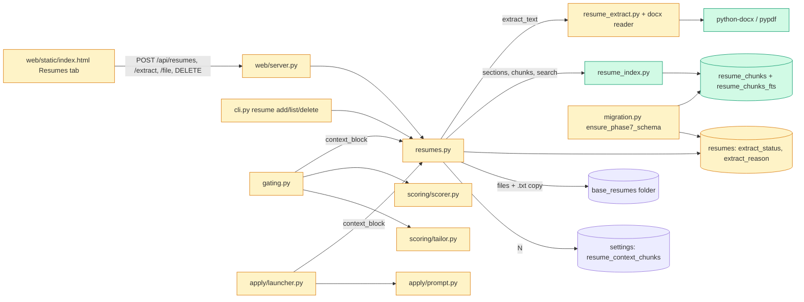

# Tech spec — Resume library with .docx upload and local searchable context store

## Approach
Extend the existing `resumes.py` (stored copies, pin, choose) rather than add a parallel store. Text extraction joins `resume_extract.py` (which already holds local `pypdf` reading) with a `.docx` reader built on `python-docx`. A new pure-ish module `resume_index.py` owns sections, chunking, the `resume_chunks` table and its FTS5 index, and keyword search; `resumes.py` calls it and exposes `search`, `extract_resume`, `delete_resume` and byte-upload helpers. Schema is added with a new `ensure_phase7_schema` in `migration.py`, called from `create_schema` exactly like the phase 3/5/6 additions (idempotent, additive; existing resumes get nullable status columns and show "Not extracted"). Retrieval context is built by one function, `resumes.context_block`, and passed as an optional argument (default empty, so output is byte-identical) into `scorer.score_job`, `tailor.tailor_resume` and `apply.prompt.build_prompt`; `gating.py` and `apply/launcher.py` compute it, following how they already fetch resume text. The number of chunks N is a row in the existing `settings` table (key `resume_context_chunks`, default 5), read with `tickets.get_setting` like `score_threshold`. The dashboard server (`web/server.py`) gets a raw-body upload route that mirrors the existing `/api/resumes/<id>/file` route (the front-end `api()` helper already sends a `Blob` body) plus a multipart branch parsed with the stdlib `email` parser (no `cgi`, removed in 3.13). The UI follows `renderResumes` in `web/static/index.html`. Patterns followed: `resumes.py`, `migration.py` (phase 6 block), `web/server.py` `_write`/`_replace_resume_file`, `cli.py` resume commands.

No embeddings, no network, no remote index. Resume text is never logged above debug.

## Architecture

## Interface contract

### Python API (`hireember.resumes`)
- `ResumeError(Exception)` (existing). Messages (exact):
  - `"Unsupported format. Provide a .pdf, .txt or .docx file."` (replaces the old `.txt or .pdf` text everywhere)
  - `"The file is empty."`, `"The file is larger than 10 MB."` (limit `MAX_UPLOAD_BYTES = 10 * 1024 * 1024`; exactly that size is accepted)
  - `"Name cannot be empty."`, `'A resume named "<name>" already exists.'`
  - `'Resume "<name>" is used by N ticket(s) and cannot be deleted.'`
  - `"No resume with id <id>."`
- `add_resume(conn, file, name, tags="", text_file=None) -> int` — as today, now accepts `.docx`, rejects empty / over-10 MB files and blank names, and runs extraction after storing. Extraction problems never raise: the resume is kept with a failed or no_text status.
- `add_resume_bytes(conn, filename: str, data: bytes, name: str, tags: str = "") -> int` — validates in the order extension, empty, size, name, duplicate; `filename` is reduced to its base name (both `/` and `\` separators dropped) and only its extension is used. Stores nothing on any refusal.
- `update_resume(conn, resume_id, file, text_file=None) -> None` — as today (accepts `.docx`, same validation), then re-extracts; old chunks are replaced.
- `replace_resume_file_bytes(conn, resume_id, filename: str, data: bytes) -> None` — bytes variant of the above, same validation.
- `extract_resume(conn, resume_id) -> ExtractResult` — re-runs extraction, replaces all chunks, stores status. `ExtractResult` is a dataclass with `status: str`, `reason: str`, `chunks: int`. Never raises for file problems. Raises `ResumeError("No resume with id <id>.")` for unknown id.
  - `status` values: `"extracted"`, `"failed"`, `"no_text"`.
  - Reasons: `"this .docx file could not be read."`, `"this PDF could not be read."`, `"The stored file is missing. Replace the file."`, `"this looks like a scanned PDF. OCR is not supported. Add a text copy or a text-based PDF."` (no_text for PDF), `"the file has no text."` (no_text for txt/docx). Reasons never contain file content or stack traces.
- `list_resumes(conn) -> list[dict]` — existing keys plus `extract_status` (`"extracted"|"failed"|"no_text"|"not_extracted"`; `"not_extracted"` for rows with no status), `extract_reason: str` (`""` if none) and `chunk_count: int`.
- `delete_resume(conn, resume_id) -> None` — removes the stored file, its `.txt` copy (for `.pdf`/`.docx`), all `resume_chunks` rows and their FTS entries, then the row. Refuses with the "is used by N ticket(s)" error when `tickets.resume_id` references it (nothing removed). Unknown id: `ResumeError("No resume with id <id>.")`.
- `search(conn, query: str, resume_id: int | None = None, limit: int = 5) -> list[dict]` — ranked, best first. Each dict has `chunk_id`, `resume_id`, `resume_name`, `section`, `position`, `text`, `score` (float, higher is better). `[]` for a blank or whitespace query, a query with no word characters, an empty store, `limit <= 0`, or an unknown `resume_id`. Never raises for FTS special characters (`" * - : ( ) ^ AND OR NEAR`). Terms are OR-matched and BM25 ranked, so a chunk containing "Python" ranks above one without it for "Python experience".
- `context_block(conn, resume_id: int, job: dict, n: int | None = None) -> str` — query is built from `job["title"]` and the first 2000 characters of `job.get("full_description")`. `n` defaults to the integer setting `resume_context_chunks` (default 5; non-numeric or < 1 falls back to 5). Returns `""` when the resume has no chunks or nothing matches. Otherwise returns text starting `RELEVANT RESUME EXCERPTS (best matches for this job):\n` followed by one line per chunk `[<section>] <text with newlines collapsed to spaces>`, joined by `\n`, with no trailing newline. At most n chunks.
- `get_resume_text`, `choose_resume`, `pin_resume`, `unpin_resume`, `update_resume_meta` unchanged in behaviour.

### Python API (`hireember.resume_index`)
- `SECTIONS = ("summary", "experience", "education", "skills", "other")`
- `MAX_CHUNK_CHARS = 800`
- `split_sections(text: str) -> list[tuple[str, str]]` — `(section, body)` in document order. Heading lines (case-insensitive, whole line, optional trailing colon, e.g. "Professional Summary", "Summary", "Profile", "Work Experience", "Experience", "Employment", "Education", "Skills", "Technical Skills") start a section. Text before the first heading goes to `summary` if there is no heading before it and it is at most 600 characters, otherwise `other`. With no headings, one section `other`. Empty sections are dropped.
- `chunk_text(text: str, max_chars: int = MAX_CHUNK_CHARS) -> list[str]` — packs whole paragraphs/lines into chunks of at most `max_chars`; a single over-long line is split on whitespace. No empty chunks. Whitespace-only text returns `[]`.
- `replace_chunks(conn, resume_id: int, text: str) -> int` — deletes the resume's chunks, inserts new ones (0-based `position` over the whole resume), returns the count.
- `delete_chunks(conn, resume_id: int) -> None`
- `count_chunks(conn, resume_id: int) -> int`
- `search_chunks(conn, query, resume_id=None, limit=5) -> list[dict]` — same result shape and rules as `resumes.search`.

### Python API (`hireember.resume_extract`)
- `extract_docx_text(path) -> str` — body paragraphs and table cells in document order; cells in a row joined by a tab, rows and paragraphs by newlines. Raises `ValueError("this .docx file could not be read.")` on corrupt/unreadable files.
- `extract_pdf_text(path)` unchanged (returns `""` on failure).

### Prompt hooks
- `hireember.scoring.scorer.score_job(resume_text, job, profile=None, resume_context: str = "")`. When non-empty, the user message becomes `RESUME:\n{resume_text}\n\n---\n\n{resume_context}\n\n---\n\n{preferences}JOB POSTING:...`. When empty the message is byte-identical to today.
- `hireember.scoring.tailor.tailor_resume(resume_text, job, profile, max_retries=3, validation_mode="normal", resume_context: str = "")`. When non-empty, the user message is `ORIGINAL RESUME:\n{resume_text}\n\n---\n\n{resume_context}\n\n---\n\nTARGET JOB:...`. Empty: byte-identical.
- `hireember.apply.prompt.build_prompt(job, tailored_resume, cover_letter=None, dry_run=False, resume_context: str = "")`. When non-empty, a block `== RESUME EXCERPTS (from your base resume, reference only) ==\n{resume_context}\n\n` is inserted immediately after the `== RESUME TEXT (reference only) ==` block (after `{tailored_resume}` and its blank line) and before `== COVER LETTER TEXT`. Empty: byte-identical.
- `gating.score_job_for_ticket` and `gating.tailor_ticket` pass `resumes.context_block(conn, resume_id, job)` as `resume_context`. `apply.launcher.run_job` and `gen_prompt` pass the block for the ticket's `resume_id` (none/no ticket resume: `""`).

### CLI (`hireember resume ...`)
- `resume_app` help: `"Base resumes (.pdf, .txt, .docx) used for scoring and tailoring."`
- `resume add FILE --name NAME [--tags T] [--text PATH]`: file argument help `"Resume file (.pdf, .txt or .docx)."`; command docstring and `help` `"Add a base resume (.pdf, .txt or .docx)."`. Output: `Added resume <id>: <name>.`; then, when status is extracted, `Extracted <N> chunks.`; otherwise `Added, but no text could be extracted: <reason>` (exit code 0). Unsupported extension: prints `Unsupported format. Provide a .pdf, .txt or .docx file.`, exit 1.
- `resume list`: table gains columns `Extraction` (`Extracted`, `Failed: <reason>`, `No text found: <reason>`, `Not extracted`) and `Chunks`.
- `resume delete RESUME_ID`: prints `Deleted resume <id>.`; errors printed, exit 1.

### HTTP (dashboard server)
Resume JSON object (used in `GET /api/resumes` -> `{"resumes": [...]}` and responses below): `{"id", "name", "tags": [..], "pinned": bool, "file_name", "extract_status", "extract_reason", "chunk_count"}`.
- `POST /api/resumes` — either
  - raw body (file bytes) with headers `X-Filename`, `X-Name`, `X-Tags` (optional); header values are percent-decoded (UTF-8), or
  - `multipart/form-data` with parts `file` (filename taken from the part), `name`, `tags` (optional).
  Success: `201` with the resume object. Failure: `400` with `{"error": "<message>"}` for the messages above (unsupported, empty, blank name, duplicate); a body larger than 10 MB + 64 KB is refused with `413` and `{"error": "The file is larger than 10 MB."}`; a file over 10 MB inside that margin gives `400` with the same message. Nothing stored on any failure. Stored name derives from the resume name, never from the client filename.
- `POST /api/resumes/<id>/extract` (empty or `{}` body) — `200` `{"ok": true, "message": "Extraction finished: N chunks.", "resume": {...}}` when status is extracted; otherwise `200` `{"ok": false, "message": "Extraction failed: <reason>", "resume": {...}}`. Unknown id: `404`.
- `POST /api/resumes/<id>/file` — as today (raw body, `X-Filename`), now accepts `.docx`, validates, re-extracts; `200` `{"ok": true, "message": "Resume file replaced.", "resume": {...}}`.
- `DELETE /api/resumes/<id>` — `200` `{"ok": true}`; used by a ticket: `400` with the "is used by N ticket(s)" message; unknown: `404`.
- Same host/origin guard as other write routes (`_WRITE_METHODS`).

### UI (`web/static/index.html`, Resumes tab)
- Always-visible form above the list, labelled controls: `File` (input type=file, `accept=".pdf,.txt,.docx"`, aria-label "File"), `Name` (aria-label "Name"), `Tags` (aria-label "Tags"), submit button text `Add resume` (`Adding...` and disabled while uploading). Success toast `Resume added.`, form cleared, list refreshed without reload. Failure text appears in the `role="alert"` message element; form values kept.
- Empty state text: `No resumes yet. Add one with the form above or with 'hireember resume add'.`
- Table headers: `Name`, `Tags`, `Pinned`, `File`, `Extraction`, `Chunks`, and an action column. Extraction cell text: `Extracted`, `Failed: <reason>`, `No text found: <reason>`, `Not extracted`. Chunks cell: integer. Every row has buttons `Re-extract`, `Replace file` (accept `.pdf,.txt,.docx`), `Edit`, `Delete` (asks `window.confirm` first). Toasts: `Extraction finished: N chunks.` / `Extraction failed: <reason>`, `Resume file replaced.`, `Resume deleted.`.

## Data and state changes
- Migration `migration.ensure_phase7_schema(conn)`, called from `create_schema` after phase 6:
  - `ALTER TABLE resumes ADD COLUMN extract_status TEXT` and `extract_reason TEXT` (added only if missing, via `PRAGMA table_info`).
  - `CREATE TABLE IF NOT EXISTS resume_chunks (id INTEGER PRIMARY KEY, resume_id INTEGER NOT NULL, section TEXT NOT NULL, position INTEGER NOT NULL, text TEXT NOT NULL)` and `CREATE INDEX IF NOT EXISTS idx_resume_chunks_resume ON resume_chunks(resume_id)`.
  - `CREATE VIRTUAL TABLE IF NOT EXISTS resume_chunks_fts USING fts5(text, content='resume_chunks', content_rowid='id')` with `AFTER INSERT/DELETE/UPDATE` triggers on `resume_chunks` that keep it in sync (external-content form, using the `'delete'` command on delete/update). Deleting chunks therefore removes FTS entries.
- Settings row (optional): key `resume_context_chunks`, integer string, default 5 when absent.
- Files: for `.pdf`/`.docx` the text copy is `<stored name with suffix replaced by .txt>` (same convention `get_resume_text` already reads); for `.txt` the stored file is the text.
- Dependency: `python-docx>=1.1` added to `pyproject.toml` `dependencies` and `uv.lock` (`uv lock`). `lxml` comes with it. Documented in README.
- No other config or env var.

## Tasks
1. **Chunk store and keyword search** — `src/hireember/migration.py` (modified: `ensure_phase7_schema`, call from `create_schema`), `src/hireember/resume_index.py` (new: `split_sections`, `chunk_text`, `replace_chunks`, `delete_chunks`, `count_chunks`, `search_chunks`; query building = lowercase `\w+` tokens, deduplicated, capped at 40, each double-quoted, joined with ` OR `; `ORDER BY bm25(...), id`), `tests/unit/test_resume_index.py` (new). Existing behaviour untouched; green because nothing calls it yet.
2. **docx dependency and extraction** — `pyproject.toml`, `uv.lock` (modified: add `python-docx`), `src/hireember/resume_extract.py` (modified: `extract_docx_text`, walking `doc.element.body` children to keep paragraph/table order), `tests/unit/test_resume_extract.py` (modified: add docx cases; docx fixtures are built in tests with `python-docx`, not committed binaries).
3. **Resumes: formats, status, extraction, delete, search** — `src/hireember/resumes.py` (modified): allow `.docx`; empty/size validation in `_check_file`; new message text; `_store` unchanged except the `.txt` copy rules; `_remove` also drops the `.txt` copy for `.docx`; `extract_resume` (reads text: `.txt` file, or `.txt` copy, or extracts from `.pdf`/`.docx` and writes the copy; whitespace-only -> `no_text`; missing file -> failed; stores `extract_status`/`extract_reason`; calls `resume_index.replace_chunks` or `delete_chunks`); call it at the end of `add_resume` and `update_resume` (extraction wrapped so it never raises; failure logs only a debug message without text); `add_resume_bytes`, `replace_resume_file_bytes`, `delete_resume`, `search`, `list_resumes` extra keys. Update `tests/unit/test_resumes.py` only for the changed unsupported-format message if an existing assertion needs it (message is mandated by the spec). New `tests/unit/test_resumes_library.py`.
4. **Retrieval context in prompts** — `src/hireember/resumes.py` (modified: `context_block`), `src/hireember/scoring/scorer.py`, `src/hireember/scoring/tailor.py`, `src/hireember/apply/prompt.py` (modified: new `resume_context` params, byte-identical when empty), `src/hireember/gating.py`, `src/hireember/apply/launcher.py` (modified: compute and pass the block), `tests/unit/test_resume_context.py` (new).
5. **CLI** — `src/hireember/cli.py` (modified: help strings in `typer.Typer(help=...)` and docstring, `file` argument help, success output with chunk count / failure line, `Extraction` and `Chunks` list columns, `resume delete`), `tests/unit/test_cli_help.py` (modified only if it pins the old help text), `tests/unit/test_cli_resume_docx.py` (new). Standards note: both the Typer `help=` and the docstring change.
6. **Dashboard API** — `src/hireember/web/server.py` (modified: `_resume_json(r)` helper used by `_resumes`; `POST /api/resumes` raw and multipart (`email.parser.BytesParser` with the Content-Type header prepended), `POST /api/resumes/<id>/extract`, `DELETE /api/resumes/<id>`, `/file` response gains `resume`; `_read_body(limit=MAX_BODY)` gets a parameter, resume upload routes use `MAX_BODY + 65536` and map over-limit to 413 with the file-size message), `tests/unit/test_web_resume_upload.py` (new).
7. **Dashboard UI** — `src/hireember/web/static/index.html` (modified: `renderResumes` form, new columns, `Re-extract`/`Delete` buttons, `accept` on Replace file, empty-state text, list refresh after add via `loadResumes()`). Add percent-encoding (`encodeURIComponent`) for `X-Name`, `X-Tags`. Check for an existing HTML-string test of the page and extend it.
8. **Docs** — `README.md` (modified: supported formats `.pdf`, `.txt`, `.docx`, no OCR, 10 MB limit, the `python-docx` dependency, privacy note, `hireember resume delete`), `docs/traceability.md` (modified: rows RES-1 to RES-7 with the tests above and the acceptance tests once frozen). Privacy note text: "Resume text extraction and search run entirely on your machine. Resume text leaves it only inside the prompts the pipeline already sends to your configured model."

## Implementation tests
- `test_resume_index.py`: heading detection (case, colon, no headings -> one `other`, pre-heading text rule), chunk bounds (<= 800, no empties, long single line split), positions 0-based, replace removes old chunks and FTS rows, search ranking ("Python experience"), special-character and blank queries, `resume_id` filter, `limit`, empty store.
- `test_resume_extract.py`: docx paragraphs + table in order, corrupt docx raises `ValueError`.
- `test_resumes_library.py`: add `.docx`/`.txt`/`.pdf` (with and without text copy), non-UTF-8 txt, whitespace-only -> no_text, corrupt docx stored as failed, missing file on re-extract, replace re-extracts and drops stale chunks, delete removes file/copy/chunks and FTS rows, delete blocked by a ticket, 10 MB exact accepted / +1 refused, path-traversal filename stored inside `base_resumes`, no resume text in `caplog` at INFO and above.
- `test_resume_context.py`: `context_block` empty cases and format, setting N, and that the exact captured messages for scoring, tailoring and `build_prompt` are unchanged without chunks and contain the block with chunks (fake LLM client as existing scoring tests do).
- `test_web_resume_upload.py`: raw and multipart create (201), each refusal and its message, no row/file left behind, extract endpoint, replace, delete, origin guard.
- Existing suites (resume pin, choose, name uniqueness, phase 6 key and telemetry scans) must pass unchanged.

## Risks and rollout
- Migration is additive and idempotent; old DBs gain nullable columns and empty tables. Existing resumes show "Not extracted" until re-extracted (no backfill).
- FTS5 must exist in the Python build; verified available locally. If `CREATE VIRTUAL TABLE` fails the migration raises a clear error (no silent fallback).
- `uv.lock` needs network for `uv lock`; the implementer regenerates it in task 2.
- The unsupported-format message changes for the CLI and API, so any existing assertion on the old text must be updated in the same commit.
- Retrieved excerpts partly duplicate full text already in the prompts; this is what the requirement asks for and keeps size small (N x <= 800 chars).
- Header-based names rely on percent-decoding; a literal `%` in a raw-header name from a non-browser client must be sent as `%25`.

## Open questions
- Resume delete has no existing entry point or message. This spec adds `hireember resume delete`, `DELETE /api/resumes/<id>` and a Delete button with the proposed message; confirm.
- Dashboard PDF uploads rely on local `pypdf` extraction (already a dependency); assumed in scope. A failed extraction on upload stores the resume with status failed (as the product spec says).
