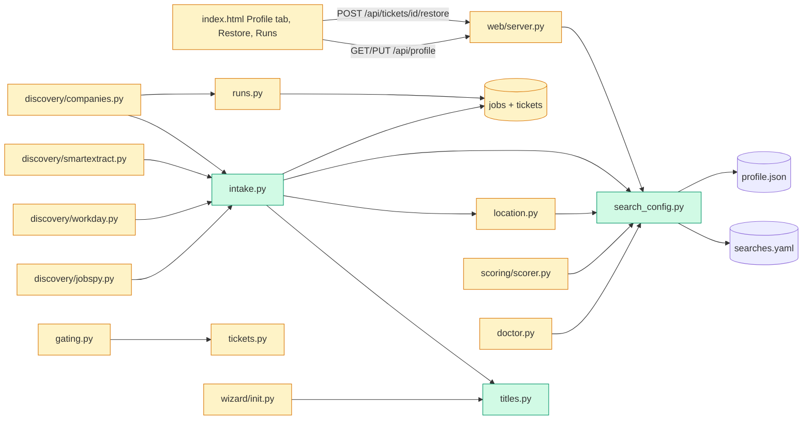

# Tech spec — Filter discovery by target title and location, editable in the dashboard

## Approach
Three small shared modules replace three copies of ad-hoc logic, and every discovery path calls them:

- `src/hireember/titles.py` (new): whole-word, case-insensitive title matching (`title_filter`) and the init proposal.
- `src/hireember/search_config.py` (new): the one place that reads `searches.yaml` keys and aliases (`title_include`, `title_exclude`/`exclude_titles`, `location.accept_patterns`/`location_accept`, `location.reject_patterns`/`location_reject_non_remote`, `locations[].remote`) and the one place that writes the Profile panel keys back (atomic, two files). `location.py` already does word-level matching and merges `profile.json` personal fields; it now takes its accept/reject lists from `search_config`, so old and new keys give identical results. The three `_location_ok` substring matchers are deleted.
- `src/hireember/intake.py` (new): `JobFilter` (title filter, then `location_skip_reason`), `DropTally`, and `store_filtered`. A dropped job is inserted into `jobs` like any other (so the URL is a duplicate next time and is never fetched again), then marked: `detail_scraped_at` is set so enrich skips it, and a `skipped` ticket with reason `title: ...` or `location: ...` is opened via `tickets.open_ticket`. A job already in `jobs` is never re-filtered, which makes restore sticky in discovery for free.

Status naming (open question in the spec): there is no `new` status. `tickets.ALLOWED_STATUSES` starts at `pending`, and `open_ticket`/`_ensure_ticket` create `pending`, so "restore to the initial status" means `pending`. A restored ticket has no score yet; `gating.score_job_for_ticket` currently leaves an existing ticket's status alone after scoring (except for `blocked for human`), so it is extended to apply the threshold to an unscored `pending` ticket too. Restore is also sticky at scoring time: `restore_dropped` writes a ticket event with reason `restored from filter`, and gating skips its location re-check when that event exists.

The pending-score query in `database.get_jobs_by_stage` excludes jobs whose ticket is `skipped` with a `title:`/`location:` reason, so a dropped job that arrived with a full JobSpy description is never scored.

Follows existing patterns: `web/server.py` route and `ApiError` conventions, `runs.log_event` for the run log, additive `_PHASE5_RUN_COLUMNS` in `migration.py` for new run columns, `doctor.Check` for warnings, server-rendered Runs fragment in `web/queries.py`, vanilla JS `h()` helper in `index.html`.

## Architecture

## Interface contract

### `hireember.titles` (new, `src/hireember/titles.py`)
- `title_filter(title: str | None, include: Sequence | None, exclude: Sequence | None) -> str | None`
  - Returns `None` (keep) or a reason string.
  - Exclude is checked first: a match returns `"title: <matched exclude entry, stripped, as written>"`, for example `"title: program manager"`.
  - Then, if `include` has at least one usable entry and nothing matches, returns `"title: not in target roles"`. A `None` or empty title with a non-empty include list returns that same reason.
  - Matching is case-insensitive on whole words or whole phrases. Any run of non-alphanumeric characters (spaces, hyphens, slashes, punctuation) counts as a single word boundary on both the title and the entry. So `sales` matches "Sales/Marketing Lead" and "Sales Engineer" but not "Salesforce Developer"; `program manager` matches "Senior  Program   Manager"; entry `TS/SCI` matches "TS-SCI Engineer".
  - Entries that are not `str`, or are blank after stripping, are ignored. Both lists empty (or all unusable) returns `None`.
- `propose_title_lists(roles: Sequence[str], target_role: str = "", resume_text: str = "") -> tuple[list[str], list[str]]`
  - Returns `(include, exclude)`, lower-case, de-duplicated, order stable.
  - `include`: the given roles and `target_role`, plus, when any of them (or the resume text) is software-ish (contains engineer, developer, programmer or software), the entries `software engineer`, `engineer`, `developer`.
  - `exclude`: for software-ish input, a fixed non-engineering list that contains at least `sales`, `program manager`, `account executive`, `recruiter`, `marketing`, `customer success`, `business development`; empty otherwise.

### `hireember.search_config` (new, `src/hireember/search_config.py`)
Paths are read from `hireember.config.SEARCH_CONFIG_PATH` and `hireember.config.PROFILE_PATH` at call time (no caching, so a saved value is seen on the next call).
- `load() -> dict`: parsed `searches.yaml`, `{}` when missing, unreadable or not a mapping. No fallback to the example file.
- `title_lists(cfg: dict) -> tuple[list[str], list[str]]`: `(title_include, title_exclude)`. `title_exclude` is used when the key is present, otherwise `exclude_titles`. Non-string items dropped.
- `location_lists(cfg: dict) -> tuple[list[str], list[str]]`: `(accept, reject)`. `location.accept_patterns` wins when it is a list, otherwise `location_accept`; `location.reject_patterns` wins when it is a list, otherwise `location_reject_non_remote`. Both styles present: the new block wins (no union).
- `KNOWN_KEYS: frozenset[str]`: top-level keys some code reads: `queries, locations, location, location_labels, tiers, proxy, sites, defaults, glassdoor_location_map, workday_max_tier, workday_location_filter, title_include, title_exclude, exclude_titles, location_accept, location_reject_non_remote`.
- `class SettingsError(ValueError)`: attribute `field: str | None`; `str(exc)` is the user message.
- `class UnreadableConfigError(Exception)`: `str(exc)` is `"Could not read searches.yaml: <parse error>"` (or `profile.json`).
- `read_settings() -> dict`: returns exactly
  `{"title_include": [..], "title_exclude": [..], "location_accept": [..], "location_reject": [..], "remote": bool, "personal": {"city": str, "province_state": str, "country": str}}`.
  Aliases and old keys are normalised. `remote` is true when any `locations[]` entry has a truthy `remote`. Missing files give empty lists, `remote` false, empty strings. Malformed YAML/JSON raises `UnreadableConfigError`.
- `save_settings(payload: dict) -> dict`: validates, writes, returns `read_settings()`.
  - Payload has the same shape as `read_settings()`; absent keys are left unchanged.
  - Writes only: `title_include`, `title_exclude` (and deletes `exclude_titles`), `location.accept_patterns` (and deletes `location_accept`), `location.reject_patterns` (and deletes `location_reject_non_remote`), the `remote` flag on `locations[]` entries, and `personal.city`, `personal.province_state`, `personal.country` in `profile.json`. Every other key in both files is kept. Remote true with no remote entry appends `{"location": "Remote", "remote": true}`; remote false sets `remote: false` on every entry.
  - `searches.yaml` is dumped with `yaml.safe_dump(sort_keys=False, allow_unicode=True)`; comments are lost. A missing file is created with only the saved keys; a missing `profile.json` is created as `{"personal": {...}}`.
  - Validation (raises `SettingsError`, nothing written): non-string entry `"Enter text."`; blank or whitespace entry `"Enter a keyword."`; duplicate after case folding `"'<term>' is already in the list."` (`<term>` is the later duplicate as entered, stripped); entry over 80 characters `"Keep entries under 80 characters."`; a list field that is not a list `"Enter a list of keywords."`; `remote` not a bool `"remote must be true or false."`; a personal value that is not a string `"Enter text."` or over 80 characters `"Keep entries under 80 characters."` (blank personal values are allowed). Entries are stored stripped. `SettingsError.field` is the payload key (`"title_include"`, `"personal.city"`, ...).
  - Atomic: both new contents are written to temp files in the target folders first; then `os.replace` on `searches.yaml`, then `profile.json`; if the second replace fails the first file is restored to its original bytes and the error propagates. A failure leaves both files byte-identical. Files whose content did not change are not rewritten.
  - Refuses to write (raises `UnreadableConfigError`) when either existing file is malformed.

### `hireember.location` (changed)
- `location_skip_reason(location, profile=None, search_cfg=None) -> str | None`: signature unchanged. Accept/reject lists now come from `search_config.location_lists(cfg)`; the `locations[].location` entries and `profile["personal"]` city/province_state/country are still added to accept targets. `profile=None` still means no personal fields (callers pass `config.load_profile()`), so a changed `personal.country` is seen on the next call that passes the re-read profile. With `search_cfg=None` the file is re-read on each call.
- Old-key and new-key configs give identical results; `CA` never matches "Chicago, IL" or "Vacation" and matches "Toronto, CA" and "Oakland, CA"; `SF` does not match "Transfer" and matches "SF Bay Area"; "Calgary, AB" passes for target Canada. Remote, empty and placeholder locations pass as before.
- No `_location_ok` exists in `discovery/jobspy.py`, `discovery/workday.py` or `discovery/smartextract.py`, and no other location matcher is under `discovery/`.

### `hireember.intake` (new, `src/hireember/intake.py`)
- `class DropTally`: `counts: dict[str, int]` (keys `"title"`, `"location"`, both start 0); `items: list[tuple[str, str]]` of `(job title, reason)`; `add(title, reason)` (type is the reason prefix before `:`); `total -> int`; `summary_line() -> str` is `"Dropped 34: 21 title, 13 location"`; `hint(kept: int = 1) -> str` is `""` when `total == 0`, else `"<summary_line>. Review them in Tickets (skipped) or edit rules in Profile."`, plus `" Check your target roles and locations in Profile."` when `kept == 0`.
- `class JobFilter`: `JobFilter.load(search_cfg: dict | None = None, profile: dict | None = None) -> JobFilter` (reads `searches.yaml` and `profile.json` fresh when arguments are `None`; a missing profile is `{}`); `reason(title: str | None, location: str | None) -> str | None` returns `title_filter(...)` first, then `location_skip_reason(...)`.
- `mark_dropped(conn, url: str, reason: str, title: str | None, tally: DropTally | None = None) -> None`: sets `jobs.detail_scraped_at` (when NULL), opens a `skipped` ticket with `reason` via `tickets.open_ticket`, adds to the tally.
- `store_filtered(conn, jobs: list[dict], *, site: str, strategy: str, flt: JobFilter | None = None, tally: DropTally | None = None, now: str | None = None) -> tuple[int, int, int]`: `(new_kept, existing, dropped)`. Each new job that `flt.reason(...)` rejects is inserted and marked dropped; jobs already in `jobs` count as `existing` and are never re-filtered. `flt=None` loads a fresh `JobFilter`.
- `write_run_log(conn, run_id: int | None, tally: DropTally) -> None`: no-op when `tally.total == 0` or `run_id is None`. Otherwise `runs.log_event(..., source="discover", level="info")` for one summary line `Dropped 34: 21 title, 13 location`, then up to 20 lines `dropped: <job title> (<reason>)`, then `...and N more` when over 20. Readable with `runs.get_run_log(conn, run_id)`.

### Discovery results (changed)
- `discovery.companies.discover_companies(conn, *, adapters=None, run_id=None, now=None) -> dict`: adds `"dropped": {"title": int, "location": int}` (always present, zeros when none) and `"hint": str` (see `DropTally.hint`, `kept` is the number of kept roles). `new` counts kept new jobs only; `found = new + existing + dropped`. `message` is unchanged. The run log lines are written through `write_run_log`. Workday responses and careers-page jobs both go through this path, so each is filtered before insert.
- `discovery.jobspy.store_jobspy_results(conn, df, source_label, flt: JobFilter | None = None, tally: DropTally | None = None) -> tuple[int, int]`: with a filter, rejected rows are stored and marked dropped; `(new, existing)` count kept new and existing rows. `run_discovery()` result gains `"dropped"` and `"hint"`. The `filtered` result key is removed.
- `discovery.workday.run_workday_discovery(...)` and `discovery.smartextract.run_smart_extract(...)` store through `store_filtered`; their result dicts gain `"dropped"` and `"hint"`. `workday.search_employer` and `scrape_employers` no longer take `location_filter`, `accept_locs` or `reject_locs`.

### Tickets and restore (changed)
- `hireember.tickets`:
  - `RESTORED_REASON = "restored from filter"`.
  - `class NotRestorableError(TicketError)` with message `"Only jobs dropped by the title or location filter can be restored."`.
  - `is_dropped_reason(reason: str | None) -> bool`: true when the reason starts with `title:` or `location:`.
  - `restore_dropped(conn, ticket_id: int) -> dict`: for a `skipped` ticket with a dropped reason, sets status `pending` with reason `RESTORED_REASON` (actor `user`), clears `jobs.detail_scraped_at` when `jobs.full_description` is NULL, and returns `get_ticket(...)`. Any other ticket (including an already restored one) raises `NotRestorableError`; an unknown id raises `TicketNotFoundError`.
  - `is_restored(conn, ticket_id: int) -> bool`.
- HTTP `POST /api/tickets/<id>/restore` (empty or `{}` body): `200` with the ticket detail JSON (the same object `GET /api/tickets/<id>` returns, so `status == "pending"` and `status_reason == "restored from filter"`); `409 {"error": "Only jobs dropped by the title or location filter can be restored.", "code": "not_restorable"}`; `404 {"error": "Ticket <id> not found.", "code": "not_found"}`.
- After restore, `hireember.gating.score_job_for_ticket` does not re-apply the location check to that ticket, and after scoring applies the threshold (`pending` or `skipped` with the usual reasons) to an unscored `pending` ticket as it already does for `blocked for human`.
- `GET /api/tickets` gains the query parameter `status=<one of ALLOWED_STATUSES>`. Without it, tickets that are `skipped` with a `title:` or `location:` reason are left out of the list and of `counts`; with `status=skipped` they are included. An unknown status returns `400` in the existing `bad_filter` error shape.
- `database.get_stats(...)` gains `"title_skipped"` (skipped tickets with reason `title:%`), alongside the existing `"location_skipped"`. `hireember stats` prints a "Skipped by title" row.

### Runs (changed)
- `runs.RunSummary` gains `dropped_title: int = 0` and `dropped_location: int = 0` (defaulted, appended last).
- `execute_run` stores the discover result's `dropped` counts in new `runs` columns `dropped_title`, `dropped_location`.
- `runs._stage_result("discover", ...)` message: unchanged text, followed by ` ` and the `hint` when `dropped` has any count.
- `GET /runs?fragment=1` (and `/runs`): the table gains a column with header `Dropped`. For a run with dropped jobs the cell reads `Dropped 34 (21 title, 13 location)`; it is empty for runs with none or from before this change.

### Profile API (new, in `web/server.py`)
- `GET /api/profile` → `200` with `read_settings()` JSON. Unreadable file → `422 {"error": "Could not read searches.yaml: <parse error>", "code": "unreadable"}`.
- `PUT /api/profile` with a JSON object → `200` with the re-read settings JSON. `SettingsError` → `400 {"error": "<message>", "code": "bad_request", "field": "<field>"}`; unreadable file → `422` as above; any other write failure → `500 {"error": "Could not save: <reason>. Nothing was changed.", "code": "save_failed"}` with both files unchanged. Host and origin guards behave as for other write routes.

### Scorer (changed)
- `scoring.scorer.score_job(resume_text, job, profile=None, resume_context="") -> dict`: signature unchanged. When `search_config.title_lists(search_config.load())[0]` is non-empty, the messages sent to `get_client("fast").chat(...)` contain the include terms as a role family line (`Target role family: a, b`) in the user message and a system rule that a job outside the family scores 1-3 with the word "role family" in the reasoning. When the response reasoning contains "role family" (case-insensitive) and the include list is non-empty, the returned `score` is capped at 3. With `title_include` empty, no role-family line or rule is added and no cap applies. `SCORE_PROMPT` itself is unchanged.

### Init (changed)
- `wizard.init._setup_searches(ask=None, out=None)`: signature unchanged. The written `searches.yaml` contains `title_include:` and `title_exclude:` lists from `titles.propose_title_lists(roles, profile experience.target_role, resume text)`. If `searches.yaml` already has a non-empty list under `title_include` or `title_exclude` (or the `exclude_titles` alias), that list is kept as is. The final init output includes the line `Proposed target roles and hard-no titles. Edit them in the dashboard Profile tab.`

### Doctor (changed)
- `doctor.check_search_config_keys(cfg: dict | None = None) -> list[Check]`; `cfg=None` loads `searches.yaml` (a missing file gives `[]`). Added to `run_checks()` output.
  - Unknown top-level key: `Check("searches.yaml", "WARN", "Unknown config key 'exclude_title' in searches.yaml (not read by any code). Did you mean 'title_exclude'?")`; the "Did you mean" sentence is omitted when no close match exists. Matching: compare keys with underscore-split tokens sorted and a trailing `s` stripped (so `exclude_title` suggests the canonical `title_exclude`), then `difflib.get_close_matches` with cutoff 0.8 against `title_include, title_exclude, location, locations, queries`.
  - Non-empty `queries` and both title lists empty (after aliasing): `Check("searches.yaml", "WARN", "Job-board queries are set but title_include and title_exclude are both empty; discovery will keep every title.")`.
  - A clean config returns `[]`.

### Dashboard UI (`src/hireember/web/static/index.html`)
- New tab button `role="tab"` with id `tab-profile`, text `Profile`, section `#page-profile`; `?tab=profile` selects it.
- Text and controls: `Loading profile...` while loading; `Could not load profile.` plus a `Retry` button on failure; read-error message `Could not read searches.yaml: <parse error>` with Save disabled. Section headings `Target roles`, `Hard-no titles`, `Target locations`, `Rejected locations`, `Where I live`. Helper texts exactly as in the product spec, including the matching hint `Matches whole words or phrases, ignoring case. 'sales' matches 'Sales Engineer' but not 'Salesforce Developer'.`
- Each keyword section: an input (ids `p-title_include`, `p-title_exclude`, `p-location_accept`, `p-location_reject`), a button `Add`, chips with a button labelled `Remove <term>`; Enter in the input adds. Checkbox labelled `Remote jobs accepted` (id `p-remote`). Text fields labelled `City`, `Region/State/Province`, `Country` (ids `p-city`, `p-province_state`, `p-country`). Button `Save` (disabled until something changes). Inline errors next to the field use the `SettingsError` messages. Status line `Saved. The next discover run will use these values.` on success; `Could not save: <reason>. Nothing was changed.` on failure. Nothing is sent until Save.
- Tickets: rows (list view and card detail) of skipped tickets whose `status_reason` starts with `title:` or `location:` show a button `Restore`; click calls `POST /api/tickets/<id>/restore` and the row leaves the skipped list. No `Restore` button on other tickets. A status filter `<select id="f-status">` (label `Status`, first option `All except dropped`, then each status) maps to `?status=`.

## Data and state changes
- `runs` table: two additive columns `dropped_title INTEGER DEFAULT 0` and `dropped_location INTEGER DEFAULT 0`, added through `migration._PHASE5_RUN_COLUMNS` (idempotent). `export.RUNS_HEADER` is unchanged.
- No new tables and no new settings. Dropped jobs use `jobs` plus `tickets` (`status='skipped'`, `status_reason` `title: ...` / `location: ...`) and `jobs.detail_scraped_at` as the "do not enrich" marker.
- `searches.yaml` / `profile.json`: no schema change; key ownership as in the requirements table. `config/searches.example.yaml` documents only keys read by code: `exclude_titles` becomes `title_exclude`, `title_include` is added, and the unread `country` and `boards` entries are removed (the code reads `sites`).
- No env vars.

## Tasks
1. **Title matcher** — `src/hireember/titles.py` (new), `tests/unit/test_titles.py` (new): `title_filter` and `propose_title_lists` as in the contract. No wiring yet.
2. **Single reader for search keys; location uses it** — `src/hireember/search_config.py` (new: `load`, `title_lists`, `location_lists`, `KNOWN_KEYS`), `src/hireember/location.py` (modified: `_load_search_cfg` delegates to `search_config.load`; `_targets` takes accept/reject from `location_lists`, new block wins over old keys; word-boundary behaviour kept), `tests/unit/test_search_config.py` (new). Existing location tests stay green.
3. **Restore and ticket rules** — `src/hireember/tickets.py` (`RESTORED_REASON`, `NotRestorableError`, `is_dropped_reason`, `restore_dropped`, `is_restored`), `src/hireember/gating.py` (skip location re-check for restored tickets; apply threshold to an unscored `pending` ticket after scoring), `src/hireember/database.py` (`pending_score` excludes dropped tickets; `title_skipped` stat), `src/hireember/cli.py` (stats row "Skipped by title"), `tests/unit/test_restore.py` (new).
4. **Intake module and company-list path** — `src/hireember/intake.py` (new), `src/hireember/discovery/companies.py` (modified: use `store_filtered`, add `dropped` and `hint`, call `write_run_log`), `tests/unit/test_intake.py` (new). Workday and careers-page adapters feed this path unchanged.
5. **Run counts and Runs tab** — `src/hireember/migration.py` (two run columns), `src/hireember/runs.py` (`RunSummary` fields, `_RUN_SELECT`, `execute_run` stores the counts, `_stage_result` hint), `src/hireember/web/queries.py` (`Dropped` column in `runs_html`), `tests/unit/test_runs_dropped.py` (new).
6. **Workday discovery** — `src/hireember/discovery/workday.py` (remove `_location_ok`, `_load_location_filter`, the location parameters of `search_employer`, `_process_one` and `scrape_employers`; `store_results` goes through `store_filtered`; result gains `dropped`/`hint`), `src/hireember/discovery/companies.py` (`workday_adapter` stops passing location arguments), `tests/unit/test_workday_filter.py` (new, one Workday response fixture).
7. **JobSpy discovery** — `src/hireember/discovery/jobspy.py` (remove `_location_ok`, `_load_location_config` and the accept/reject plumbing in `_run_one_search`/`_full_crawl`; `store_jobspy_results` takes `flt`/`tally`; result gains `dropped`/`hint`), `tests/unit/test_jobspy_filter.py` (new, one DataFrame fixture; second run adds no work).
8. **Careers-page smart extract** — `src/hireember/discovery/smartextract.py` (remove `_location_ok`, `_load_location_filter`, `_store_jobs_filtered`; `_run_all` uses `store_filtered`; result gains `dropped`/`hint`), `tests/unit/test_smartextract_filter.py` (new, one careers-page fixture), and a unit test that greps `discovery/` for a second location matcher.
9. **Profile settings read/write and API** — `src/hireember/search_config.py` (add `SettingsError`, `UnreadableConfigError`, `read_settings`, `save_settings` with atomic two-file write), `src/hireember/web/server.py` (`GET`/`PUT /api/profile`, `POST /api/tickets/<id>/restore` with the 409 mapping, `status` param on `GET /api/tickets`), `src/hireember/web/queries.py` (hide dropped tickets by default, `status` filter), `tests/unit/test_profile_api.py` (new).
10. **Scorer role family** — `src/hireember/scoring/scorer.py` (role family line and rule, cap at 3), `tests/unit/test_scorer_role_family.py` (new, stub client).
11. **Init proposals** — `src/hireember/wizard/init.py` (`_setup_searches` writes the lists, keeps existing non-empty lists, prints the summary line), `tests/unit/test_init_titles.py` (new).
12. **Doctor checks** — `src/hireember/doctor.py` (`check_search_config_keys`, added to `run_checks`), `tests/unit/test_doctor_keys.py` (new).
13. **Dashboard Profile tab and Restore** — `src/hireember/web/static/index.html` (Profile tab, chips, validation, Save; Restore button; `f-status` select; `?tab=profile`), `tests/unit/test_index_profile.py` (new, asserts the static page contains the tab, labels and endpoints).
14. **Docs** — `README.md` (search-config section: the key table, Profile tab, Restore), `src/hireember/config/searches.example.yaml` (only keys the code reads, `title_include`/`title_exclude`), `docs/traceability.md` (rows for this phase), `CHANGELOG.md` (entry).

## Implementation tests
- `title_filter`: exclude/include/both, phrase, hyphen and slash boundaries, case, multiple spaces, empty lists, non-string and blank entries, exclude wins over include, empty title.
- `search_config`: alias precedence both ways, new block wins, `read_settings` shape, `save_settings` leaves unrelated keys intact, `exclude_titles` becomes `title_exclude` with no duplicate, validation messages, atomic failure (monkeypatch `os.replace` to fail on the second file; both files byte-identical), missing and malformed files.
- Location: old-key and new-key configs give identical keep/drop on a shared sample set; `CA`/`SF`/Calgary cases; a saved value is used by the next `location_skip_reason` and `title_filter` call; changed `personal.country` seen via the re-read profile.
- Intake and each discovery path: dropped job stored as `skipped` with the reason, kept job stored normally, second run does not re-insert or re-enrich, enrich query skips dropped jobs, `dropped`/`hint` shape, run-log lines (20 cap plus `...and N more`).
- Restore: success returns `pending`, 409 for non-dropped and for double restore, 404 unknown id, restored job not re-dropped by gating, restored job scored then gets the threshold status, restored job with no description is enriched.
- Runs: new columns migrate on an existing database; Runs fragment shows `Dropped 34 (21 title, 13 location)` and nothing for old runs.
- Scorer: stub client sees the role family; a "role family" reason with score 8 stores at most 3; empty include adds nothing.
- Init and doctor as in AC-7 and AC-11, including the clean-config case.
- Server: `PUT /api/profile` 400 bodies include `field`; 422 for malformed file; Host/Origin guard.

## Risks and rollout
- Hiding dropped tickets from the default `GET /api/tickets` also hides tickets that were location-skipped before this change; if an existing test counts those in the default list it must be updated deliberately (they stay visible with `status=skipped`). Run the full suite after task 9.
- Excluding dropped tickets from the `pending_score` query also stops re-visiting old location-skipped jobs each run, which is intended; `stages.score` still counts skips from tickets created during the run.
- Removing the substring matchers means a location with no recognised region or country is now kept (the `location.py` conservative rule). That is a deliberate change from the old "reject unknown" behaviour of the discovery matchers and matches phase 0e/0f.
- Saving rewrites `searches.yaml` and loses comments (accepted). Setting remote false sets `remote: false` on every `locations[]` entry, which also changes the JobSpy remote-only search for that entry.
- A job already in `jobs` is never re-filtered, so tightening the lists does not drop old rows; only new jobs are affected.
- Tasks 6-8 can land in any order after 4; each keeps the build green because `store_filtered` already exists.

## Open questions
- none (the restore target status is `pending`; `new` does not exist in this codebase)
